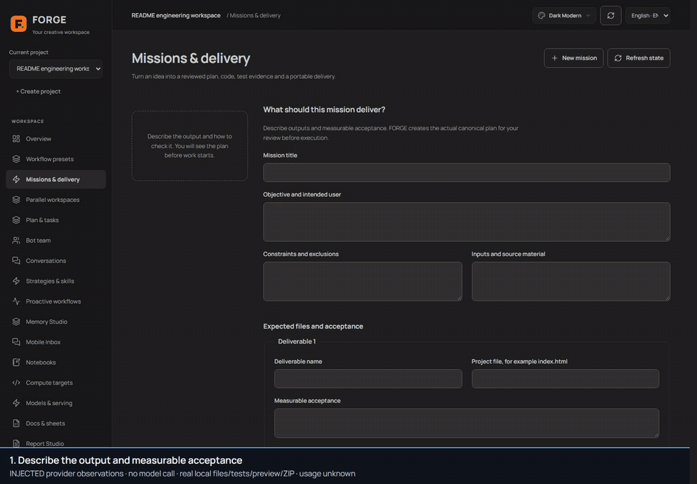
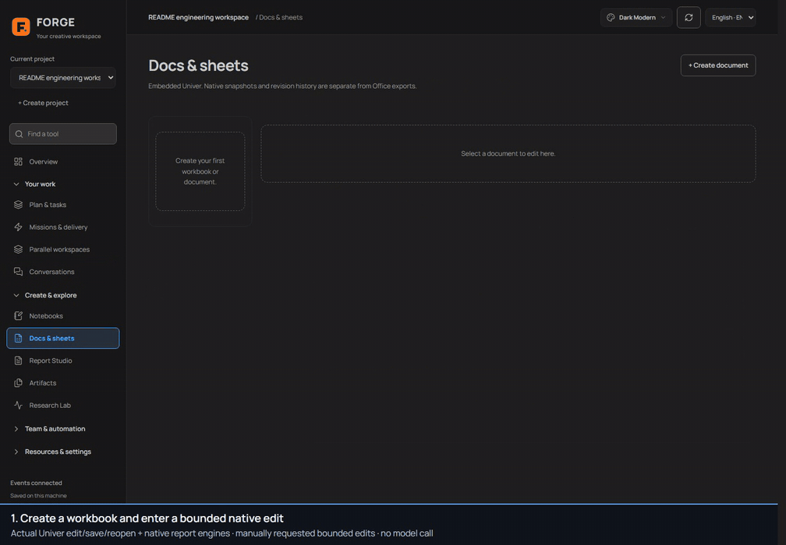
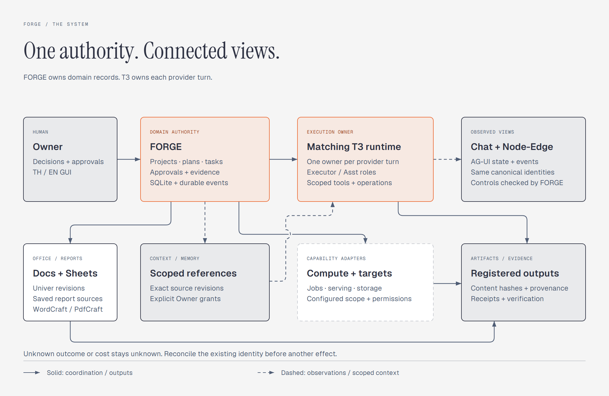

# FORGE

<a href="docs/brand/README.md">
  
  
</a>

**Plan the work. Coordinate agents. Review the evidence.**

FORGE is a local-first workspace for taking an idea through planning, execution
and delivery. Conversations, agent runs, task dependencies, code, documents and
verification evidence stay connected to one project, with explicit Owner
approval for plans and controlled actions.

The interface defaults to Thai and supports English. The local core is
[Apache-2.0](LICENSE); optional remote and team services remain a future direction.

[Get started](#run-locally) · [See the workflow](#idea-to-delivery) ·
[Explore the screenshots](docs/media/README.md) ·
[Thai setup guide](docs/FORGE_LOCAL_QUICKSTART_TH.md) ·
[Development status](docs/owner/forge-local-complete-20261124-v3/progress/CURRENT_STATUS.md)

> **Development checkpoint — implementation incomplete.** Published `main`
> checkpoint `d928e9c` is source for continued development and home testing.
> Complete-product acceptance, newer native integrations and final review remain
> pending. **Live account checks and Home UAT have not run.** No signed desktop
> installer is published.
> [Checkpoint scope and home instructions](docs/CHECKPOINT_HOME_20261125.md) ·
> [Continuation handoff](docs/NEXT_SESSION_20261126.md).


*Actual production App with disposable engineering data. Provider observations
are injected; local tests, file preview and delivery artifacts are real.
[Capture provenance and limitations](docs/media/manifest.json).*

*Media was captured from `758af58` and awaits a refresh on the final integrated
tree. It documents the labelled flows below, not qualification of newer changes.*

## A workspace that follows the work

- **Plan and deliver.** Turn a brief into a reviewed Mission, canonical tasks and
  measurable acceptance criteria. Register actual output files, run reviewed
  local tests, preview supported static output and produce a verified Delivery Pack.
- **See who is doing what.** Switch a team conversation into a Node-Edge Workspace
  to inspect agents, runs, tools and artifacts. Both views use the same records
  and existing permission-checked controls.
- **Work in isolated checkouts.** Give independent tasks separate Git worktrees,
  check their actual changes and review the integration queue. The original
  workspace and its uncommitted work stay under their existing owner.
- **Choose models deliberately.** Inspect connected provider catalogs and exact
  model options. Configure Executor/Asst routing under an explicit policy;
  role-session and Strategist integration remain pending final qualification.
- **Keep useful knowledge.** Search scoped local memory and retain provenance.
  Central Owner Memory is private until the Owner shares an exact revision with
  a named project. Editing or revoking that source invalidates the old grant.
- **Create documents and reports.** Edit real Univer Docs and Sheets, save and
  reopen revisions, then generate validated DOCX/PDF from saved report sources.
- **Operate from the same project.** Run Python jobs, inspect artifacts, configure
  compute and serving targets, review MCP permissions and monitor outcomes.
  Unknown results and unreported costs remain visible as unknown.

The workbench includes 15 semantic themes. Read the
[qualification limits](#verification-and-current-limits) before relying on a flow.

## Run locally

Windows is the primary development platform. Install **Node.js 24.13+** and
**Git**; local notebook and Python job execution also need **Python**. The first
launch needs internet access to obtain dependencies pinned by the lockfile and
build the workbench. This is a source installation.

1. Clone the complete repository, or extract its complete source archive.
2. Double-click **[Start-FORGE.cmd](Start-FORGE.cmd)** in the repository root.
3. Wait for readiness and the browser to open. The default address is
   **http://127.0.0.1:4317**; the launcher can select another available local port.
4. Create a project with its own workspace folder, separate from FORGE's source
   repository. Configure a provider and exact model in project Settings.
5. Use **[Stop-FORGE.cmd](Stop-FORGE.cmd)** to stop the service, or
   **[Restart-FORGE.cmd](Restart-FORGE.cmd)** to restart it.

Closing the browser does not stop FORGE. Provider sign-in belongs to FORGE's
isolated matching T3 runtime; your development application's sessions are not
copied into it. API keys use the machine vault and explicit references.

To install and start from a terminal:

```powershell
git clone https://github.com/siriponsri/forge-agents.git
cd forge-agents
npm ci --include=dev
npm run build
npm start
```

For an existing clone, preserve local changes before updating. Use
`git pull --ff-only origin main` only when the branch is clean and has not
diverged; then start through the launcher so dependencies and the build are
checked. See the [Thai quickstart](docs/FORGE_LOCAL_QUICKSTART_TH.md) for setup,
logs and recovery.

Optional private native runtimes and report engines have separate installation
and configuration flows in Settings. Their compiled images, fonts and machine
credentials are not bundled in Git. A fresh full build of the latest private
runtime setup pipeline remains unqualified; ordinary workbench flows should
remain usable while that setup is investigated.

macOS launcher sources are included as `.command` files. Native macOS operation
and secure credential entry are not yet qualified; see the current status before
choosing that platform.

## Idea to delivery

1. **Write the brief.** Define the outcome, inputs, acceptance criteria,
   dependencies and unresolved decisions. Workflow presets help structure it.
2. **Review the plan.** Choose the team and task dependencies, then approve the
   concrete plan before execution.
3. **Inspect the work.** Follow the task's real run and registered output files.
   Chat and Workspace provide conversation and graph views of the same evidence.
4. **Verify the output.** Review the test command and source hashes, run supported
   local checks and open the immutable static preview.
5. **Accept the delivery.** Review QA evidence, record Owner acceptance and build
   the Delivery Pack with its files, manifest, test results and limitations.



*Real screen recording at 2x speed. Mission source files are predetermined
engineering input; no model authored them in this recording. Local effects are
real. [Static alternative](docs/media/screenshots/mission-preview.png) ·
[Full steps and source recording](docs/media/README.md#software-mission).*

<picture>
  <source media="(prefers-color-scheme: dark)" srcset="docs/diagrams/software-delivery-dark.svg">
  <source media="(prefers-color-scheme: light)" srcset="docs/diagrams/software-delivery.svg">
  
</picture>

*Read left to right. [Open full size](docs/diagrams/software-delivery.svg) for zoom ·
[PNG alternative](docs/diagrams/software-delivery.png) ·
[Editable sources and visual credits](docs/diagrams/README.md).*

Unknown execution outcomes are reconciled using their existing identities.
Reconnection and page reload do not mean an uncertain action should run again.

## More walkthroughs

<details>
<summary>Open the local workspace</summary>

1. Open the ready local App and create a project.
2. Select the saved project and open its workspace.


[Static alternative](docs/media/screenshots/overview.png). This clip begins after
the localhost service is ready; it does not film installation or the launcher.

</details>

<details>
<summary>Switch Chat to a Node-Edge Workspace</summary>

1. Select a team room and keep a conversation draft.
2. Switch to Workspace and inspect the selected Executor run.
3. Inspect persisted recovery and the tool's unconfirmed outcome.
4. Return to Chat with the draft preserved.


[Static alternative](docs/media/screenshots/workspace.png). The graph's provider
observations are injected. An unconfirmed tool result stays unconfirmed.

</details>

<details>
<summary>Edit a document and generate a report</summary>

1. Apply a bounded edit in the actual Sheets editor, save and reopen it.
2. Edit, save and reopen a document in the actual Docs editor.
3. Save a ReportSpec from the saved Sheets source.
4. Generate DOCX/PDF, inspect the rendered PDF and verify the downloads.



[Static alternative](docs/media/screenshots/report-preview.png). These are actual
Windows native engine outputs. Report engines and local fonts are configured
separately; the recording does not redistribute them.

</details>

All clips are real Chromium recordings with numbered documentation captions,
selected contiguous intervals and disclosed 2x speed. No synthetic frames are
used. [All 21 screenshots, static alternatives and provenance](docs/media/README.md).

## How the system fits together

<picture>
  <source media="(prefers-color-scheme: dark)" srcset="docs/diagrams/architecture-dark.svg">
  <source media="(prefers-color-scheme: light)" srcset="docs/diagrams/architecture.svg">
  
</picture>

*The main path runs left to right; supporting paths sit below it.
[Open full size](docs/diagrams/architecture.svg) for zoom ·
[PNG alternative](docs/diagrams/architecture.png) ·
[Editable sources and visual credits](docs/diagrams/README.md).*

FORGE owns project, plan, task, approval and evidence records. T3 owns provider
execution. AG-UI projects state and events into the interface. Executor/Asst
roles use those boundaries; role-session and Strategist work remains pending
and does not establish a second planner or approval authority.
MCP selection does not itself grant permission:
Allowed/Ask/Off policies and exact-operation checks apply at dispatch.

Telegram is the first supported mobile bridge channel through Hermes Agent or
OpenClaw. New work enters an Inbox, is linked to a reviewed task and requires
Owner approval in the originating channel. Live mobile qualification is tracked
separately from the bridge's developer fixtures.

## Data, credentials and recovery

Windows data defaults to `%LOCALAPPDATA%/FORGE/workbench`, outside the source
checkout. Machine credentials, provider sessions and browser profiles are not
portable project data and do not belong in Git.

Use the in-App storage and backup tools with their stated scope. Metadata backups
and portable project bundles have different contents; neither should be treated
as a copy of machine credentials or installed engines. Restoring older metadata
preserves deletion, approval-revocation and execution-deduplication safeguards.

For an interrupted local Python attempt, use explicit Compute reconciliation.
FORGE can recover a verified cleanup receipt without executing Python again.
Missing or tampered proof remains interrupted. See the
[local job recovery guide](docs/LOCAL_JOB_RECOVERY_TH.md) and
[security policy](SECURITY.md).

## Verification and current limits

Developer checks exercise real SQLite, Git, HTTP/session/CSRF, mounted Univer,
native Windows report engines, Python process cleanup, actual local tests,
previews and verified archives. Provider/native observations are injected only
where the evidence explicitly says so. They do not establish model quality,
live account access or cloud/mobile behavior.

| Area | Qualification boundary |
|---|---|
| Guarded automation and private native setup | The [bounded native route](docs/guarded-route.md) has actual Windows native evidence with a loopback model fixture. Arbitrary tools and hard resource caps are unavailable. Fresh full source-build verification of the latest setup pipeline and final integration review remain open. |
| Role sessions and Strategist | Integration is in progress. Persistent role sessions and Strategist behavior must not be treated as completed or qualified features. |
| Usage and budgets | Atomic policy holds and unknown accounting are implemented. Native monetary finality remains unsupported (`cost:null`, `final:false`); this is an implementation gap, independent of credentials. Completion never means zero cost. |
| Research Lab | Fixed local CPU/file experiments, independent checks and exports are exercised. Assembled native action/cohort/GUI qualification remains open; service fixtures and resumed local changes do not establish completion. Official benchmark execution is separate. |
| Remote providers, compute and mobile | Adapters and setup flows have scoped developer tests. Missing live credentials, account-specific checks and actual cloud/mobile use require separate evidence. |
| macOS and Home UAT | Native qualification and Owner home acceptance remain not run. |

Read the [current status](docs/owner/forge-local-complete-20261124-v3/progress/CURRENT_STATUS.md),
[acceptance evidence](docs/owner/forge-local-complete-20261124-v3/progress/ACCEPTANCE_EVIDENCE.md)
and [integration ledger](docs/owner/forge-local-complete-20261124-v3/progress/INTEGRATION_LEDGER.md)
for exact revisions, commands, results and remaining implementation work. Earlier
passing suites and dated media do not qualify subsequent integrations.

## Source layout and ownership

| Path | Responsibility |
|---|---|
| [`app/`](app/) | Current local product: workbench UI, server, canonical state and integrations. |
| [`tests/`](tests/) | Developer verification; individual fixtures disclose injected observations and opt-in live/native requirements. |
| [`apps/website/`](apps/website/README.md) | Independent public website package and publication checks. |
| [`docs/`](docs/) | Owner requirements, acceptance records, guides and documentation media. |
| [`bootstrap/`](bootstrap/), [`runtime/`](runtime/), [`adapters/ao/`](adapters/ao/) | Preserved portable/runtime history and limited adapter boundaries. Legacy launchers retain their original meaning; use `Start-FORGE.cmd` for the current workbench. |

The [architecture guide](docs/FORGE_ARCHITECTURE.md) describes product authority
and integration boundaries. Component ownership, source pins and separate
licenses are recorded in [third-party notices](THIRD_PARTY_NOTICES.md).

## Development and contribution

```powershell
npm ci --include=dev
npm run check
npm run build
npm test
npm run test:browser
```

The public website is an independent package under [apps/website](apps/website/README.md).
Its build, release-availability checks and Cloudflare guide do not start the
workbench or deploy it automatically.

Use isolated branches/worktrees, preserve existing authority boundaries and
include the scope of your verification. See [AGENTS.md](AGENTS.md) for the active
requirements and protected legacy paths. Report bugs through
[GitHub Issues](https://github.com/siriponsri/forge-agents/issues), excluding
credentials, private workspace data and exploit details. Security issues should
be reported privately as described in [SECURITY.md](SECURITY.md).

## License

Original FORGE code and documentation are licensed under
[Apache-2.0](LICENSE). See [NOTICE](NOTICE) and
[third-party notices](THIRD_PARTY_NOTICES.md) for separately licensed components.
The original [FORGE logo and reusable assets](docs/brand/README.md) include
editable vector source, transparent PNG exports and provenance.
The [archived P11 and machine-transfer README](docs/legacy/README_P11_HISTORY.md)
preserves earlier portable-release documentation; it is not the current workbench
acceptance status.
