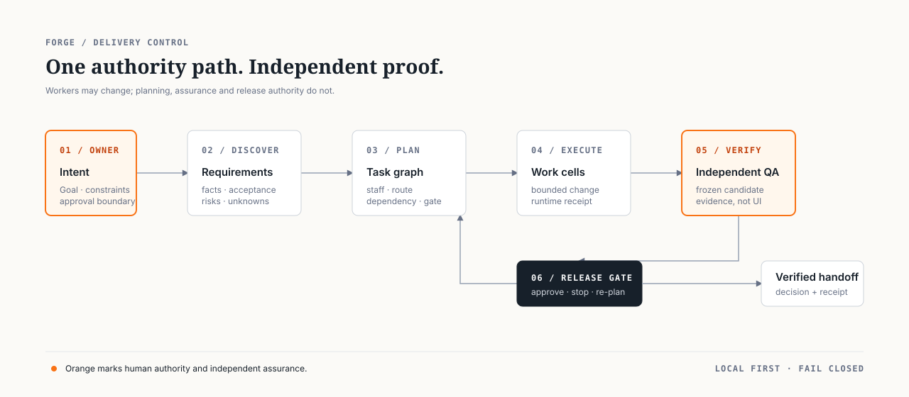
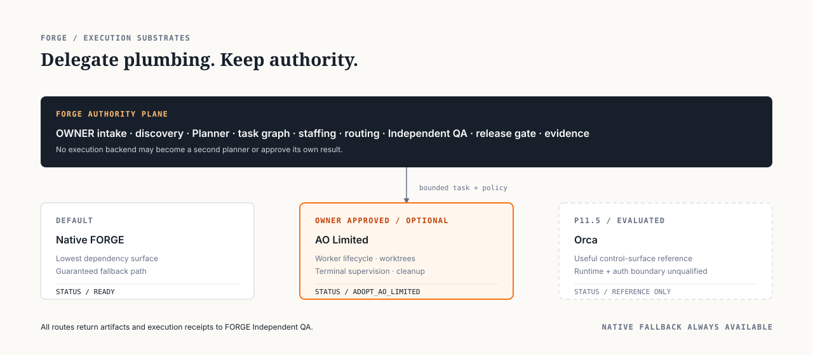

<div align="center">


# FORGE

### Turn an idea into verified delivery—without giving up authority.

**Local-first project orchestration with dynamic workers, independent QA, explicit release gates, and structured evidence.**

[](#verified-status)
[](#install-on-windows)
[](#execution-substrates)
[](#orca-bake-off)

</div>

---

## Start here

FORGE is a local project factory. You describe the outcome; FORGE separates discovery, planning, execution, independent checking, and the final release decision. It can use different worker tools without handing them planning or deployment authority.

You do not need to write code to install or operate the portable package. On 64-bit Windows:

1. On GitHub, choose **Code → Download ZIP**, then extract the complete folder.
2. Open its `bootstrap` folder.
3. Double-click **`bootstrap.cmd`**.
4. If Windows reports a missing prerequisite, install only the named item, then run `bootstrap.cmd` again.
5. Sign in to a provider only with that provider's own application and normal sign-in flow.
6. Double-click **`doctor.cmd`**. Continue when the result is `READY` or `READY_WITH_MISSING_OPTIONAL_PROVIDER`.
7. Double-click **`launch-forge.cmd`**.
8. Keep the console window open while FORGE is running. Close it to stop the local runtime.

The default install location is:

```text
%LOCALAPPDATA%\FORGE\forge-v1-portable
```

Bootstrap is repeatable. Running it again verifies the installed files instead of overwriting an unrelated folder. It does not install Agent Orchestrator or Orca, change global PATH, copy credentials, or merge provider homes.

> Use the release folder's own `bootstrap` files. Do not copy individual scripts into another package.

## The operating model



The OWNER keeps irreversible decisions. FORGE turns intent into a task graph, selects bounded workers, collects receipts, and sends the frozen result to Independent QA. Deployment happens only after the release gate is explicitly satisfied.

| Stage | What happens | Who has authority |
|---|---|---|
| Intent | Goal, constraints, risk and desired outcome are stated | OWNER |
| Discovery | Missing facts and acceptance criteria are resolved | FORGE |
| Plan | Dependencies, staffing and routing are defined | FORGE Planner |
| Work | Bounded workers build or inspect assigned scopes | Selected worker substrate |
| Verify | The exact candidate is tested independently | FORGE Independent QA |
| Release | Evidence is reviewed; deployment may be approved or stopped | OWNER + FORGE gate |

The governing relationship is:

```text
Role ≠ Agent ≠ Skill ≠ Work Cell ≠ Harness ≠ Provider ≠ Model ≠ Tool
```

Routing is an execution choice, not an identity. A worker can be replaced without changing who owns the plan or the release decision.

## Install on Windows

### What you need

- 64-bit Windows
- Node.js 20 or newer
- Git for Windows
- at least one optional provider tool if you want model-backed work

FORGE's doctor reports missing prerequisites. Bootstrap will not install them globally for you.

### First install

1. Extract the complete approved package to a normal local folder.
2. Double-click `bootstrap\bootstrap.cmd`.
3. If the window pauses with `BLOCKED_WITH_ACTION`, follow only the listed action and retry. A successful bootstrap may close automatically.
4. Do not move individual files out of the extracted package.
5. Run `bootstrap\doctor.cmd`.
6. Run `bootstrap\launch-forge.cmd`.

Expected safe outcomes:

- `READY` — core runtime and at least one provider are visible.
- `READY_WITH_MISSING_OPTIONAL_PROVIDER` — core runtime is ready; provider sign-in can wait.
- `BLOCKED_WITH_ACTION` — stop and complete the named prerequisite or integrity repair.
- `FAIL_CLOSED` — stop; the target, package identity, or payload does not meet the safety contract.

### Sign in to a provider

FORGE does not contain or migrate provider credentials. Sign in with the provider's native tool. Keep each provider in its own home:

```text
Official Codex  → %USERPROFILE%\.codex
MaxPlus         → %USERPROFILE%\.codex-maxplus
```

Never copy `auth.json`, tokens, browser profiles, or session caches between those homes. If a tool asks to import, switch, or consolidate accounts, decline it for a FORGE-managed provider.

### Verify or repair

- Run `bootstrap\doctor.cmd` whenever the machine or provider setup changes.
- Run `bootstrap\bootstrap.cmd` again to verify an existing installation.
- Do not manually replace files inside the managed install directory.
- To remove the portable install, use `bootstrap\rollback-install.cmd`; it checks the install receipt before removing managed state.

## Run a project

Use this short OWNER brief:

```text
Goal:
Users:
Must have:
Must not do:
Where it may run:
What requires my approval:
How we will know it is done:
```

FORGE should ask you only for decisions that change architecture, security/privacy, credentials, public deployment, spending, or an irreversible outcome. Implementation details that are safe and reversible should be handled inside the approved scope.

Before any real provider call, confirm the provider, expected scope, and spending boundary. Before deployment, inspect the Independent QA result and release evidence. A green UI alone is not release evidence.

## Evidence and trust

FORGE resolves conflicts in this order:

```text
Live structured JSON / JSONL
        ↓
Verified runtime receipts
        ↓
Frozen checkpoint projections
        ↓
Markdown summaries
        ↓
UI
```

Evidence records inputs, decisions, concise rationale, tests, outcomes, errors, and OWNER choices. It does not require or publish hidden chain-of-thought.

## Execution substrates



FORGE may delegate worker plumbing, but never its planning or assurance authority.

| Substrate | Current position | Suitable use |
|---|---|---|
| Native FORGE | Default | Lowest-dependency execution and guaranteed fallback |
| AO Limited | OWNER-approved, optional | Worker/session lifecycle, isolated worktrees, terminal supervision and bounded cleanup |
| Orca | Reference-only after P11.5 | Source-informed future candidate; not qualified for FORGE execution |

The active architecture decision remains:

```text
ADOPT_AO_LIMITED
```

AO is opt-in, worker-only, reversible, and never a second planner. Native execution remains the default and rollback path. See [AO Limited integration](docs/AO_LIMITED_INTEGRATION.md) and [execution substrate boundaries](docs/EXECUTION_SUBSTRATES.md).

## Orca bake-off

P11.5 evaluated [stablyai/orca](https://github.com/stablyai/orca) at the immutable target below:

```text
release  v1.4.204
commit   4f7baefc4f5c49181d54046763e083a4628662d8
license  MIT
```

Orca provides a broad structured CLI, durable run/task/dispatch concepts, worktree and terminal controls, browser ownership, receipts, and recovery semantics. Those are useful reference patterns.

The same pin also exposes three blocking boundaries for FORGE:

- orchestration is explicitly experimental;
- account registration can import Codex authentication into Orca-managed homes and the rate-limit path can read provider auth state;
- the official Windows app did not start successfully from the clean temporary profile used for qualification, while `orca serve` is a network-exposed mode rather than a loopback-only headless contract.

No model call, real provider login, account switch, public service, cloud deployment, or Orca adapter was used. The P11.5 recommendation is:

```text
KEEP_AO_LIMITED
```

Orca remains reference-only until a future, separately approved evaluation can prove a clean-profile Windows runtime, a loopback-pinned headless interface, and a hard provider-account boundary. Read the full [Orca evaluation](docs/ORCA_EVALUATION.md).

## Authority boundary

FORGE always retains:

- OWNER intake and discovery
- requirements and acceptance criteria
- Planner and task graph
- dynamic staffing and provider/model routing
- Independent QA
- release and deployment gates
- structured evidence and audit
- irreversible OWNER decisions

An execution substrate may provide worker/session lifecycle, isolated workspace and Git worktree mechanics, terminal or coding-harness supervision, bounded browser/process lifecycle, PR/CI/review plumbing, and execution receipts.

Do not create a chain such as `FORGE Planner → substrate orchestrator → another planner`. The worker layer executes a bounded task; it does not reinterpret the project.

## Verified status

| Milestone | Result |
|---|---:|
| Production state | `FORGE_V1_PRODUCTION_ACTIVE` |
| Production regression | 33 / 33 PASS |
| Portable clean-room validation | 11 / 11 PASS |
| P11 architecture | `ADOPT_AO_LIMITED` |
| AO adapter | Optional, worker-only, native-default |
| P11.5 Orca recommendation | `KEEP_AO_LIMITED` |
| P12 | Not started |

Production snapshot:

```text
df7400ebd6a99d825a08f6bbd6b4a5e5ae33554e223e030bcd8d3e215c57e826
```

Portable package ID:

```text
284b5ea2fc11d196864284c04d1e65918995517737232b1c1bd5de977f8ab435
```

## Troubleshooting

**Bootstrap says the target is not empty.** Choose an empty folder or use the existing receipt-backed FORGE target. Bootstrap refuses to take ownership of arbitrary files.

**Doctor cannot find Node or Git.** Install the missing prerequisite with an OWNER-approved native installer. Re-run doctor; do not patch system PATH only to make a test pass.

**No provider is detected.** The core runtime may still be ready. Install and sign in through one provider's native flow when model-backed work is approved.

**A provider works in one terminal but not FORGE.** Check that the intended `CODEX_HOME` or native provider home is selected. Do not solve this by copying credentials.

**Port 3935 is busy.** Stop the earlier FORGE process, or launch with an approved alternate local port. Do not expose the service to the LAN or Internet.

**A payload hash fails.** Re-extract a verified package. Do not edit the manifest or disable integrity checks.

## Repository safety

This public repository must never contain provider credentials, `.env` secrets, auth/session/token caches, browser cookies or profiles, private project data, production-machine paths, downloaded AO/Orca source trees, or third-party binaries.

The repository contains clean source, portable payloads, contracts, tests, diagrams, and sanitized evaluation records. Machine-local state stays on the machine.

## Roadmap

```text
P10   Production activation                         complete
P11   Portable distribution + AO reuse decision    complete
P11.5 Orca bake-off + repository addendum          complete
P12   First portable real project                  not started
```

P12 requires a separate OWNER instruction. This repository update does not start it.

---

<div align="center">

**Goal → Work → Evidence → Verified Delivery**

</div>
