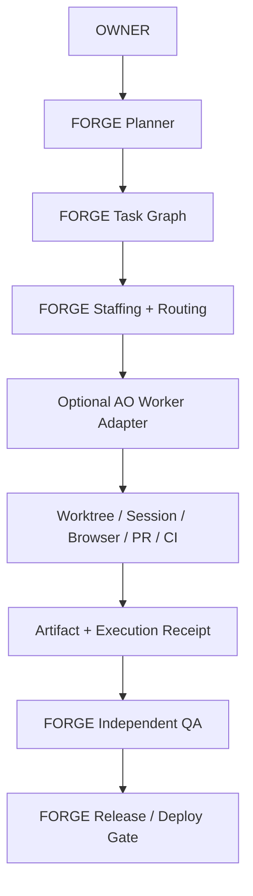

<div align="center">


# FORGE

### Evidence-driven multi-agent project delivery.

**From one-line intent to verified deployment — with explicit authority, dynamic routing, independent QA, and auditable handoff.**

[](#current-status)
[](#portable-forge)
[](#agent-orchestrator)
[](#portable-forge)

</div>

---

## What is FORGE?

FORGE is a local-first **Multi-Agent Project Factory**.

It does not treat a project as a long chat between permanent personas.  
Instead, it turns an OWNER goal into a structured delivery pipeline, assembles only the capabilities needed for the current work, routes each task through an appropriate execution path, verifies the result independently, and keeps deployment authority explicit.

```text
OWNER intent
    ↓
Discovery
    ↓
Requirements
    ↓
Architecture + Plan
    ↓
Dynamic Work Cells
    ↓
Build + Integration
    ↓
Independent QA
    ↓
Release Gate
    ↓
Authorized Deployment
    ↓
Post-deploy Verification
    ↓
Evidence-backed Handoff
```

FORGE is designed around a simple rule:

> **The model is not the architecture. The agent is not the authority. The UI is not the evidence.**

---

## Workflow

```mermaid
flowchart LR
    O["OWNER Goal"] --> I["Intake & Discovery"]
    I --> R["Requirements"]
    R --> P["Planner Authority"]
    P --> T["Task Graph"]

    T --> S["Dynamic Staffing"]
    S --> C["Required Capability"]
    C --> W["Work Cell"]
    W --> X["Task Profile"]

    X --> H["Harness"]
    H --> V["Provider"]
    V --> M["Model"]
    M --> B["Build / Integration"]

    B --> Q["Independent QA"]
    Q --> G{"Release Gate"}

    G -->|Approved| D["Deployment"]
    G -->|Blocked| F["Fix / Re-plan"]

    F --> T
    D --> Z["Post-deploy Verification"]
    Z --> E["Structured Evidence"]
    E --> O2["OWNER Handoff"]
```



---

## Architecture

FORGE keeps these concepts deliberately separate:

```text
Role ≠ Agent ≠ Skill ≠ Work Cell ≠ Harness ≠ Provider ≠ Model ≠ Tool
```

### Authority layer

| Authority | Responsibility |
|---|---|
| **Planner** | Defines the plan, task graph, dependencies, acceptance criteria and execution intent. |
| **Developer** | Owns changes to build artifacts within an assigned scope. |
| **Independent QA** | Verifies the frozen candidate independently from the implementation authority. |
| **OWNER** | Retains irreversible business, security, deployment, spending and credential decisions. |

### Dynamic execution

FORGE does not permanently bind one role to one model.

```text
Task
→ Required Capability
→ Work Cell
→ Task Profile
→ Harness
→ Provider
→ Model
```

Routing is treated as an execution decision, not an identity.

---

## Why FORGE exists

Multi-agent systems are easy to demo and surprisingly hard to operate.

The difficult parts are rarely "make more agents talk." The difficult parts are:

- knowing who has authority to change what,
- preventing provider/model lock-in,
- keeping credentials isolated,
- separating live evidence from human-readable summaries,
- recovering safely from failed execution,
- preventing duplicate or stale work,
- independently verifying the exact candidate that will ship,
- and knowing when the system must stop and ask the OWNER.

FORGE focuses on those engineering problems.

---

## Current status

FORGE V1 has completed transactional production promotion.

| Milestone | Result |
|---|---:|
| Production promotion | **PASS** |
| Production state | `FORGE_V1_PRODUCTION_ACTIVE` |
| Deterministic regression | **33 / 33 PASS** |
| Production smoke | **PASS** |
| Real Chrome control smoke | **PASS** |
| Independent QA | **PASS** |
| Final read-only verification | **PASS** |
| Unexpected production paths | **0** |
| New external spend during promotion | **0** |

Current verified production snapshot:

```text
df7400ebd6a99d825a08f6bbd6b4a5e5ae33554e223e030bcd8d3e215c57e826
```

---

## Portable FORGE

P11 produced a portable release candidate from canonical production.

```text
Extract
  ↓
Double-click bootstrap
  ↓
Detect machine prerequisites
  ↓
Create machine-local FORGE state
  ↓
Doctor
  ↓
Launch
```

P11 clean-room validation covered fresh installation, doctor, launch, idempotence, rollback, malformed packages, unexpected existing targets and provider-discovery states.

```text
P11 Portable Validation: 11 / 11 PASS
```

Portable package identity:

```text
Package ID
284b5ea2fc11d196864284c04d1e65918995517737232b1c1bd5de977f8ab435

Release tree SHA-256
002dac3884133ca5f359b0a4f9ba5bc3f2b65dba8dd3ec26d0f00b4441c19690

ZIP SHA-256
7f04f1c701f9e6f50318077fa4b2e16b7f113d4c9d75ea65ac6d22c2630a4310
```

Portable packaging never includes provider credentials.

---

## Agent Orchestrator

P11 evaluated **Agent Orchestrator (AO)** as a reusable execution layer.

Pinned evaluation target:

```text
Untrivial-ai/agent-orchestrator
v0.13.0
15e9ea971f1711ec8b50e157d6eb300db6cbe0d6
Apache-2.0
```

P11 architecture decision:

```text
ADOPT_AO_LIMITED
```

This does **not** make AO the brain of FORGE.

The intended boundary is:



### AO may provide

- worker/session lifecycle,
- isolated workspaces and Git worktrees,
- terminal/chat supervision,
- browser/process lifecycle,
- PR/CI/review plumbing,
- coding-harness launch mechanics.

### FORGE always retains

- OWNER intake,
- discovery and requirements,
- Planner authority,
- task graph,
- dynamic staffing,
- model/provider routing,
- Independent QA authority,
- deployment gate,
- evidence/audit authority,
- irreversible OWNER decisions.

AO is a qualified but **optional execution backend**. P11 completed Windows x64 runtime qualification, separate-provider daemon proof, evidence mapping, cleanup verification and rollback-to-native parity using fixtures and temporary provider homes. Native execution remains the default.

---

## Provider isolation

Provider identity is an execution boundary.

Example local homes:

```text
Official Codex  → dedicated CODEX_HOME
MaxPlus         → separate dedicated CODEX_HOME
```

FORGE does not merge provider credentials.

For AO-backed execution, the accepted design requires **separate AO daemon/data/run/port boundaries per provider**. AO account switching is not part of the FORGE-managed provider path.

---

## Evidence first

FORGE uses an explicit authority order:

```text
Structured JSON / JSONL
        ↓
Verified runtime receipts
        ↓
Checkpoint projections
        ↓
Markdown summaries
        ↓
UI
```

If a report disagrees with structured evidence, the structured evidence wins.

FORGE records decisions, concise rationale, assumptions, evidence, tests, outcomes, errors and OWNER choices — not hidden chain-of-thought.

---

## Design principles

- **Local-first**
- **Provider-agnostic**
- **Harness-aware**
- **Evidence-driven**
- **Dynamic staffing**
- **Independent QA**
- **Fail closed**
- **Reversible change**
- **Cost-aware routing**
- **Minimal OWNER interruption**
- **No credential merging**
- **No permanent agent swarm by default**

---

## Repository direction

The repository is being structured around clean source and release artifacts rather than copying a machine installation into Git.

Expected top-level shape:

```text
forge-agents/
├─ assets/
├─ runtime/
├─ bootstrap/
├─ adapters/
├─ contracts/
├─ docs/
├─ tests/
├─ examples/
└─ release/
```

Machine-local state, provider homes, credentials, browser profiles and private project data do not belong in this repository.

---

## Roadmap

```text
P10  Production activation
 ✓   FORGE_V1_PRODUCTION_ACTIVE

P11  Portable distribution + AO reuse decision
 ✓   Portable RC PASS
 ✓   AO decision: ADOPT_AO_LIMITED

P11.x  AO limited runtime qualification
 ✓     Windows x64 runtime proof
 ✓     Separate-provider daemon proof
 ○     FORGE → AO adapter
 ○     AO → FORGE evidence mapper
 ○     rollback-to-native parity

P12  First portable end-to-end real project
 ○     Goal → build → QA → authorized deploy → verify → handoff
```

---

## Safety boundary

This repository must never contain:

```text
provider credentials
auth/session/token caches
private .env files
browser cookies/profiles
private project data
production machine secrets
```

FORGE may coordinate execution across providers, but provider authentication remains local to its authorized runtime boundary.

---

## Project philosophy

FORGE is not trying to simulate a company.

It is trying to make project execution **deterministic enough to trust, flexible enough to route intelligently, and transparent enough for an OWNER to understand what is happening without becoming the system operator.**

<div align="center">

**Goal → Work → Evidence → Verified Delivery**

</div>
