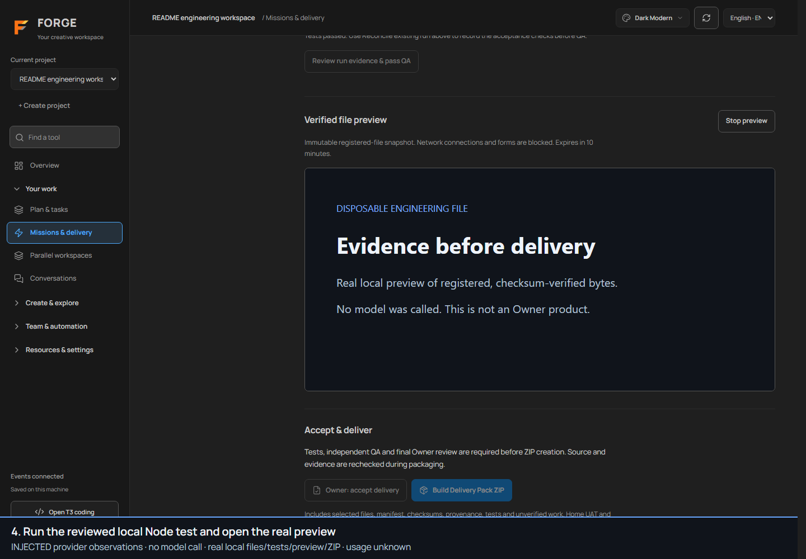
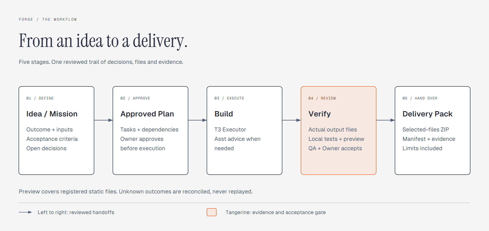
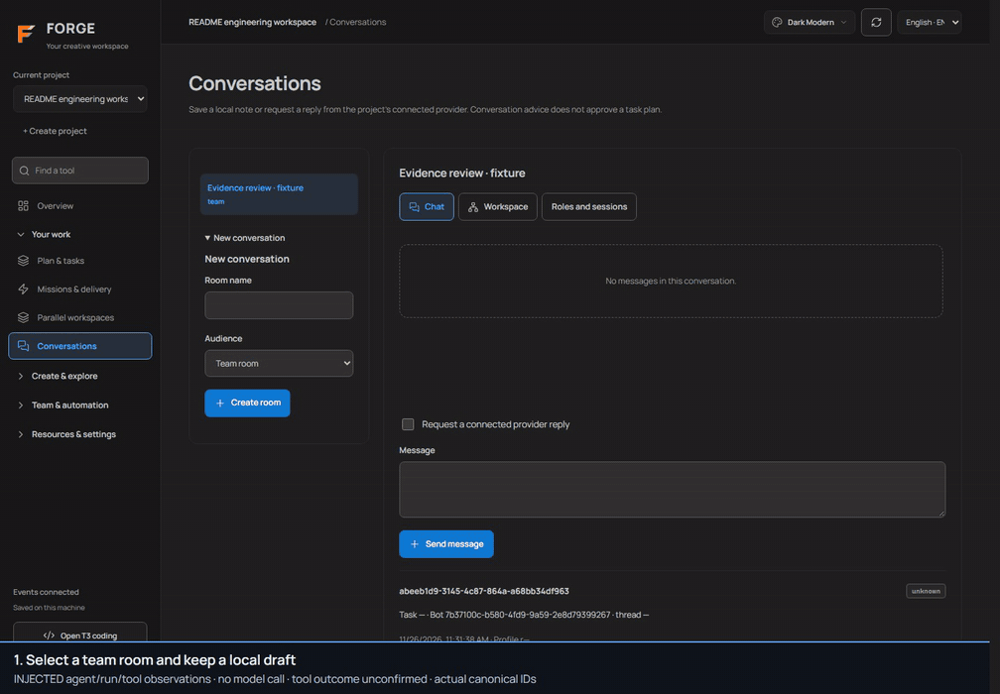

# FORGE

**From an idea to a plan, working files, a preview and verified delivery.**

FORGE is a local-first workspace for coordinating AI agents and reviewing their
work. Keep conversations, task dependencies, documents, code, test evidence and
deliverables in one project, with explicit Owner approval at the boundaries that
matter.

[Get started](#run-locally) · [See the workflow](#idea-to-delivery) ·
[Explore the screenshots](docs/media/README.md) ·
[Thai setup guide](docs/FORGE_LOCAL_QUICKSTART_TH.md) ·
[Development status](docs/owner/forge-local-complete-20261124-v3/progress/CURRENT_STATUS.md)



*Actual production App with disposable engineering data. Provider observations
are injected; local tests, file preview and delivery artifacts are real.
[Capture provenance and limitations](docs/media/manifest.json).*

> **Development preview.** The local workbench is under active integration.
> Native Guarded automation, native accounting coverage and final release checks
> remain in progress. Live account checks and Home UAT are tracked separately.
> There is no published signed desktop installer. Screenshots and recordings are
> prepared documentation media, pending a refresh on the final integrated tree.

## A workspace that follows the work

- **Plan and deliver.** Turn a brief into a reviewed Mission, canonical tasks and
  measurable acceptance criteria. Register actual output files, run reviewed
  local tests, preview supported static output and produce a verified Delivery Pack.
- **See who is doing what.** Switch a team conversation into a Node-Edge Workspace
  to inspect agents, runs, tools and artifacts. Both views use the same records
  and existing permission-checked controls.
- **Work in isolated checkouts.** Give independent tasks separate Git worktrees,
  check their actual changes and review the integration queue. The original
  workspace and its uncommitted work stay under their existing owner.
- **Choose models deliberately.** Read connected provider catalogs and exact
  model options. Assistance starts with a suitable Executor and brings in a
  larger Asst for difficult or stuck work, under an explicit routing policy.
- **Keep useful knowledge.** Search scoped local memory and retain provenance.
  Central Owner Memory is private until the Owner shares an exact revision with
  a named project. Editing or revoking that source invalidates the old grant.
- **Create documents and reports.** Edit real Univer Docs and Sheets, save and
  reopen revisions, then generate validated DOCX/PDF from saved report sources.
- **Operate from the same project.** Run Python jobs, inspect artifacts, configure
  compute and serving targets, review MCP permissions and monitor outcomes.
  Unknown results and unreported costs remain visible as unknown.

The interface defaults to Thai, supports English and includes 15 semantic themes.
The local core is [Apache-2.0](LICENSE). Optional remote and team services are a
future direction, not a dependency of the local workbench.

## Run locally

Windows is the currently developer-qualified platform. Install **Node.js 24.13+**
and **Git** for coding and worktree features. Python is needed for local notebook
and job execution. The first launch needs internet access to obtain the pinned
dependencies and build the App.

1. Clone the complete repository, or extract its complete source archive.
2. Double-click **[Start-FORGE.cmd](Start-FORGE.cmd)** in the repository root.
3. Wait for readiness and the browser to open. The default address is
   **http://127.0.0.1:4317**; the launcher can select another available local port.
4. Create a project with its own workspace folder. Keep it separate from FORGE's
   source repository, then configure a provider in project Settings.
5. Use **[Stop-FORGE.cmd](Stop-FORGE.cmd)** to stop the service, or
   **[Restart-FORGE.cmd](Restart-FORGE.cmd)** to restart it.

Closing the browser does not stop FORGE. Provider sign-in belongs to FORGE's
isolated matching T3 runtime; your development application's sessions are not
copied into it. API keys use the machine vault and explicit references.

For a terminal-based start:

```powershell
git clone https://github.com/siriponsri/forge-agents.git
cd forge-agents
npm ci --include=dev
npm run build
npm start
```

macOS launcher sources are included as `.command` files. Native macOS operation
and secure credential entry are not yet qualified; see the current status before
choosing that platform.

## Idea to delivery

1. **Write the brief.** Define the outcome, inputs, acceptance criteria,
   dependencies and unresolved decisions. Workflow presets help structure it.
2. **Review the plan.** Choose the team and task dependencies, then approve the
   concrete plan before execution.
3. **Inspect the work.** Follow the task's real run and registered output files.
   Chat and Workspace provide conversation and graph views of the same evidence.
4. **Verify the output.** Review the test command and source hashes, run supported
   local checks and open the immutable static preview.
5. **Accept the delivery.** Review QA evidence, record Owner acceptance and build
   the Delivery Pack with its files, manifest, test results and limitations.


*Real screen recording at 2x speed. Mission source files are predetermined
engineering input; no model authored them in this recording. Local effects are
real. [Static alternative](docs/media/screenshots/mission-preview.png) ·
[Full steps and source recording](docs/media/README.md#software-mission).*

<picture>
  <source media="(prefers-color-scheme: dark)" srcset="docs/diagrams/software-delivery-dark.svg">
  <source media="(prefers-color-scheme: light)" srcset="docs/diagrams/software-delivery.svg">
  
</picture>

*Read left to right. [Open full size](docs/diagrams/software-delivery.svg) for zoom ·
[PNG alternative](docs/diagrams/software-delivery.png) ·
[Editable sources and visual credits](docs/diagrams/README.md).*

Unknown execution outcomes are reconciled using their existing identities.
Reconnection and page reload do not mean an uncertain action should run again.

## More walkthroughs

<details>
<summary>Open the local workspace</summary>

1. Open the ready local App and create a project.
2. Select the saved project and open its workspace.


[Static alternative](docs/media/screenshots/overview.png). This clip begins after
the localhost service is ready; it does not film installation or the launcher.

</details>

<details>
<summary>Switch Chat to a Node-Edge Workspace</summary>

1. Select a team room and keep a conversation draft.
2. Switch to Workspace and inspect the selected Executor run.
3. Inspect persisted recovery and the tool's unconfirmed outcome.
4. Return to Chat with the draft preserved.



[Static alternative](docs/media/screenshots/workspace.png). The graph's provider
observations are injected. An unconfirmed tool result stays unconfirmed.

</details>

<details>
<summary>Edit a document and generate a report</summary>

1. Apply a bounded edit in the actual Sheets editor, save and reopen it.
2. Edit, save and reopen a document in the actual Docs editor.
3. Save a ReportSpec from the saved Sheets source.
4. Generate DOCX/PDF, inspect the rendered PDF and verify the downloads.


[Static alternative](docs/media/screenshots/report-preview.png). These are actual
Windows native engine outputs. Report engines and local fonts are configured
separately; the recording does not redistribute them.

</details>

All clips are real Chromium recordings with numbered documentation captions,
selected contiguous intervals and disclosed 2x speed. No synthetic frames are
used. [All 21 screenshots, static alternatives and provenance](docs/media/README.md).

## How the system fits together

<picture>
  <source media="(prefers-color-scheme: dark)" srcset="docs/diagrams/architecture-dark.svg">
  <source media="(prefers-color-scheme: light)" srcset="docs/diagrams/architecture.svg">
  
</picture>

*The main path runs left to right; supporting paths sit below it.
[Open full size](docs/diagrams/architecture.svg) for zoom ·
[PNG alternative](docs/diagrams/architecture.png) ·
[Editable sources and visual credits](docs/diagrams/README.md).*

FORGE owns project, plan, task, approval and evidence records. T3 owns provider
execution. Executor/Asst are execution roles; they do not introduce another
planner or override approval. MCP selection does not itself grant permission:
Allowed/Ask/Off policies and exact-operation checks apply at dispatch.

Telegram is the first supported mobile bridge channel through Hermes Agent or
OpenClaw. New work enters an Inbox, is linked to a reviewed task and requires
Owner approval in the originating channel. Live mobile qualification is tracked
separately from the bridge's developer fixtures.

## Data, credentials and recovery

Windows data defaults to `%LOCALAPPDATA%/FORGE/workbench`, outside the source
checkout. Machine credentials, provider sessions and browser profiles are not
portable project data and do not belong in Git.

Use the in-App storage and backup tools with their stated scope. Metadata backups
and portable project bundles have different contents; neither should be treated
as a copy of machine credentials or installed engines. Restoring older metadata
preserves deletion, approval-revocation and execution-deduplication safeguards.

For an interrupted local Python attempt, use explicit Compute reconciliation.
FORGE can recover a verified cleanup receipt without executing Python again.
Missing or tampered proof remains interrupted. See the
[local job recovery guide](docs/LOCAL_JOB_RECOVERY_TH.md) and
[security policy](SECURITY.md).

## Verification and current limits

Developer checks exercise real SQLite, Git, HTTP/session/CSRF, mounted Univer,
native Windows report engines, Python process cleanup, actual local tests,
previews and verified archives. Provider/native observations are injected only
where the evidence explicitly says so. They do not establish model quality,
live account access or cloud/mobile behavior.

| Area | Qualification boundary |
|---|---|
| Guarded proactive automation | The [bounded native route](docs/guarded-route.md) connects approved recipes to live route/run checks and existing text-file actions. Developer checks use actual native binaries with a loopback model fixture. Transport hardening and final review remain pending; arbitrary tools and resource caps are unavailable. |
| Usage and budgets | Atomic policy holds and unknown accounting are implemented. Native monetary receipt coverage remains incomplete; completion never means zero cost. |
| Research Lab | Fixed local CPU/file experiments, independent checks and exports are exercised. Agent component/action/resource qualification and official benchmark execution are separate. |
| Remote providers, compute and mobile | Adapters and setup flows have scoped developer tests. Account-specific live checks require their own evidence. |
| macOS and Home UAT | Native qualification and Owner home acceptance remain not run. |

Read the [current status](docs/owner/forge-local-complete-20261124-v3/progress/CURRENT_STATUS.md),
[acceptance evidence](docs/owner/forge-local-complete-20261124-v3/progress/ACCEPTANCE_EVIDENCE.md)
and [integration ledger](docs/owner/forge-local-complete-20261124-v3/progress/INTEGRATION_LEDGER.md)
for exact revisions, commands, results and remaining implementation work.

## Development and contribution

```powershell
npm ci --include=dev
npm run check
npm run build
npm test
npm run test:browser
```

The public website is an independent package under [apps/website](apps/website/README.md).
Its build, release-availability checks and Cloudflare guide do not start the
workbench or deploy it automatically.

Use isolated branches/worktrees, preserve existing authority boundaries and
include the scope of your verification. See [AGENTS.md](AGENTS.md) for the active
requirements and protected legacy paths. Report bugs through
[GitHub Issues](https://github.com/siriponsri/forge-agents/issues), excluding
credentials, private workspace data and exploit details. Security issues should
be reported privately as described in [SECURITY.md](SECURITY.md).

The README's information hierarchy was informed by the public
[n8n](https://github.com/n8n-io/n8n), [Supabase](https://github.com/supabase/supabase)
and [Dify](https://github.com/langgenius/dify) repositories. Their brands,
screenshots, popularity and licensing are not FORGE claims.

## License

Original FORGE code and documentation are licensed under
[Apache-2.0](LICENSE). See [NOTICE](NOTICE) and
[third-party notices](THIRD_PARTY_NOTICES.md) for separately licensed components.
The [archived P11 and machine-transfer README](docs/legacy/README_P11_HISTORY.md)
preserves earlier portable-release documentation; it is not the current workbench
acceptance status.
