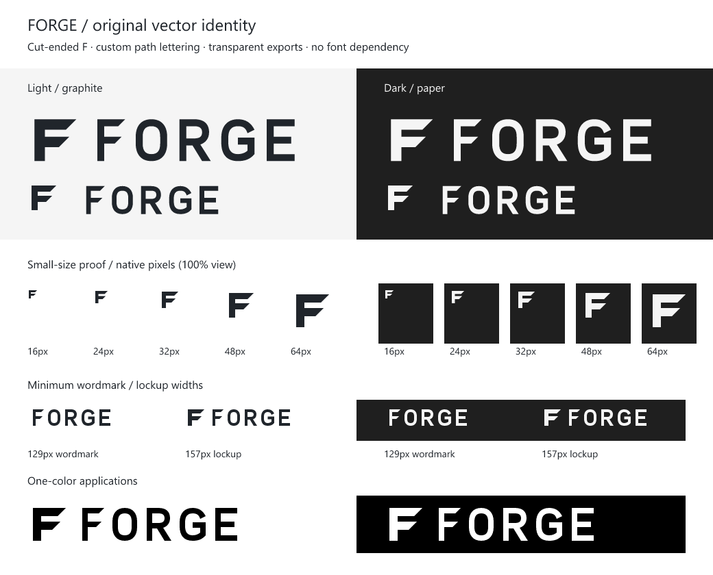

# FORGE identity

An original cut-ended **F**, paired with custom geometric **FORGE** lettering.
The two parallel cuts give the mark a consistent silhouette at small sizes.
Straight geometry keeps it compatible with the workbench's restrained visual
system and the existing editorial diagrams. The identity uses one color at a
time; it does not depend on a badge, gradient or surrounding shape.



## Assets

All SVGs and PNGs have transparent backgrounds. SVGs contain only authored paths
and groups, with accessible titles/descriptions. No font, CSS, script, embedded
image or network resource is needed. PNGs are exported at four times the SVG
canvas size; native 16/24/32/48/64 px mark PNGs are also included.

| Asset | Light surfaces | Dark surfaces | Black / white |
|---|---|---|---|
| Mark, 64 × 64 SVG / 256 × 256 PNG | [SVG](exports/forge-mark-for-light.svg) · [PNG](exports/forge-mark-for-light.png) | [SVG](exports/forge-mark-for-dark.svg) · [PNG](exports/forge-mark-for-dark.png) | [Black SVG](exports/forge-mark-black.svg) · [PNG](exports/forge-mark-black.png) / [white SVG](exports/forge-mark-white.svg) · [PNG](exports/forge-mark-white.png) |
| Wordmark, 258 × 64 SVG / 1032 × 256 PNG | [SVG](exports/forge-wordmark-for-light.svg) · [PNG](exports/forge-wordmark-for-light.png) | [SVG](exports/forge-wordmark-for-dark.svg) · [PNG](exports/forge-wordmark-for-dark.png) | [Black SVG](exports/forge-wordmark-black.svg) · [PNG](exports/forge-wordmark-black.png) / [white SVG](exports/forge-wordmark-white.svg) · [PNG](exports/forge-wordmark-white.png) |
| Horizontal lockup, 314 × 64 SVG / 1256 × 256 PNG | [SVG](exports/forge-lockup-for-light.svg) · [PNG](exports/forge-lockup-for-light.png) | [SVG](exports/forge-lockup-for-dark.svg) · [PNG](exports/forge-lockup-for-dark.png) | [Black SVG](exports/forge-lockup-black.svg) · [PNG](exports/forge-lockup-black.png) / [white SVG](exports/forge-lockup-white.svg) · [PNG](exports/forge-lockup-white.png) |

## Use

- Use graphite `#20252b` on white or paper `#f5f5f5`; use paper on Dark Modern
  `#1f1f1f` or GitHub dark `#0d1117`. Black/white exports serve single-ink use.
  These measured pairs exceed 7:1. Other surfaces need their own contrast check.
- Keep the canvas proportions. Leave at least one stem width of clear space
  around the painted mark (12 units on its 64-unit grid); built-in padding
  contributes 8 units. Do not stretch, rotate or add effects.
- Use the mark alone at **16 px or larger**, the wordmark at **129 px or larger**,
  and the horizontal lockup at **157 px or larger**. Below these widths, use plain
  text. At the minimum wordmark/lockup widths, the cap height is 24 px. Prefer
  SVG or the exact target-size PNG over repeated raster rescaling.
- Give a linked logo the accessible name “FORGE”. When adjacent text already
  names FORGE, use `alt=""` on an HTML image to avoid repetition. For standalone
  inline SVG, keep its title/description and namespace their IDs per instance.
- The root README uses GitHub's theme-specific image fragments. Its two existing
  `<picture>` blocks still belong only to the horizontal diagrams. PNG links
  above remain usable in viewers without SVG or theme-fragment support.

This package updates README branding only. The app icon, favicons, public site,
existing screenshots and diagrams retain their current assets. Their adoption
or media refresh belongs to integration, not this documentation change.

## Source, provenance and license

Authoritative editable geometry: [`tools/brand/build.mjs`](../../tools/brand/build.mjs).
The mark is one filled polygon on a 64-unit grid. The five letters are hand-authored
paths on a 48-unit cap-height grid; they are not font outlines. The source embeds
the exact path coordinates and generates every export. No stock mark, icon
library, image-generation output, traced third-party logo or external typeface
was used. Existing FORGE workbench/media and Diagram Design assets informed the
context only; none of their artwork or font outlines were copied into this logo.

Created for FORGE on 26 November 2026 by the design worker. Original logo geometry,
exports, source and documentation are provided under the repository's
[Apache-2.0 license](../../LICENSE). This records authorship and file licensing;
it is not a trademark clearance or an assertion of exclusive rights to a letter.

Rasterization uses **resvg**, via `@resvg/resvg-js` **2.6.2** (MPL-2.0 tooling),
installed outside the repository. It is not a runtime dependency and its code is
not redistributed here. The contact sheet's explanatory labels use the local
Segoe UI font; no font file is shipped, and that text is not part of the logo.

## Regenerate and verify

Use an isolated tool prefix; do not change the product manifest or lockfile:

```powershell
npm.cmd install --prefix "$env:TEMP/forge-brand-tools" --ignore-scripts --no-audit --no-fund --package-lock=false @resvg/resvg-js@2.6.2
node tools/brand/build.mjs --modules "$env:TEMP/forge-brand-tools/node_modules"
# To refresh README layout evidence, add tooling in the same isolated prefix.
# A compatible installed Chromium is also needed.
npm.cmd install --prefix "$env:TEMP/forge-brand-tools" --ignore-scripts --no-audit --no-fund --package-lock=false @resvg/resvg-js@2.6.2 markdown-it@14.1.0 playwright@1.65.1
node tools/brand/readme-proof.mjs --modules "$env:TEMP/forge-brand-tools/node_modules" --browser-modules "$env:TEMP/forge-brand-tools/node_modules"
python tools/brand/verify.py --baseline 4c944bd
git diff --check
```

Verification needs Python with Pillow. Logo export is font-free and offline
after the isolated rasterizer install. The contact sheet additionally uses an
installed Segoe UI face for labels. The source-built logo exports are
deterministic; proof-label rasterization can vary with the local system font.

[`exports.json`](evidence/exports.json) records source geometry, rasterizer
version, export dimensions, actual SHA-256 hashes and measured contrast.
[`validation.json`](evidence/validation.json) records independent XML/PNG checks,
README/local-link checks and preservation against the assigned base.
The [contact sheet SVG](evidence/contact-sheet.svg) is editable proof, not a
logo export. Visual inspection covered that sheet at native resolution and the
actual small PNGs; it does not establish product or release qualification.

The [README layout evidence](evidence/readme-layout.json) covers local Markdown
fixtures at 900/375 px in light/dark, image decode, theme-logo visibility and
whole-document overflow. [Light desktop](evidence/readme-light-900.png),
[dark desktop](evidence/readme-dark-900.png), [light narrow](evidence/readme-light-375.png)
and [dark narrow](evidence/readme-dark-375.png) capture the first viewport.
These fixtures approximate a GitHub reading surface; they are not a test of its
actual sanitizer or hosted CSS. Existing media remains dated, unchanged evidence.

No provider/account call, application native suite, live GitHub publication,
public deployment or Home UAT was performed. Integration owns final status copy,
logo adoption and media refresh after checking the assembled product.
