# Prepared FORGE documentation media

Prepared from `758af5866ee8cb5ea79a57fe12e38c6739348d0c`; **not final release verification**.

Disposable engineering data. No Owner project, provider turn, live account, or product pilot. **HOME_UAT_NOT_RUN**. The production App, SQLite, HTTP session/CSRF, local Node tests, registered-file preview, verified Delivery Pack, native Office saves and native reports are real.

Where labelled, provider/agent/run/tool observations are deliberately injected. Mission source files are deterministic engineering inputs, not model-authored output. Unknown tool results and usage remain unknown. Captions are documentation annotations, not simulated App state.

Refresh and acceptance instructions: [capture tooling](../../tools/readme-media/README.md). Exact provenance: [manifest.json](manifest.json). Decode/hash checks: [verification.json](verification.json).

## Walkthroughs

All clips are real Chromium screen recordings, selected contiguous intervals at **2x speed**, 5 fps and 1008px width. Intervals between walkthroughs and a 0.6s trailing guard interval are omitted; no interpolation or synthetic frames. Full source: [walkthroughs.webm](sources/walkthroughs.webm). Static alternatives and the same numbered instructions follow each GIF.

### Start Forge

**Qualification:** Built production App · actual localhost readiness and project creation · launcher/clean install not recorded

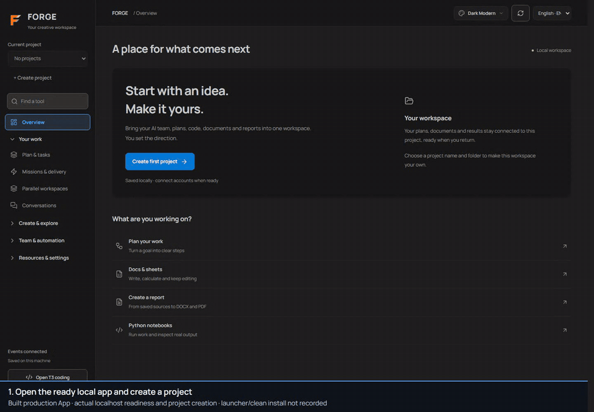

[Static alternative](screenshots/overview.png)

1. Open the ready local app and create a project
2. Select the saved project and open its workspace

### Software Mission

**Qualification:** INJECTED provider observations · no model call · real local files/tests/preview/ZIP · usage unknown

[Static alternative](screenshots/mission-preview.png)

1. Describe the output and measurable acceptance
2. Review and approve the canonical plan
3. Inspect the injected run, then register the actual file
4. Run the reviewed local Node test and open the real preview
5. Review QA evidence, accept delivery, and build the ZIP

### Chat Workspace

**Qualification:** INJECTED agent/run/tool observations · no model call · tool outcome unconfirmed · actual canonical IDs

[Static alternative](screenshots/workspace.png)

1. Select a team room and keep a local draft
2. Switch to Workspace and inspect the selected Executor run
3. Read the persisted recovery snapshot without replaying execution
4. Inspect the tool whose result remains unconfirmed
5. Return to Chat with the draft preserved

### Office Report

**Qualification:** Actual Univer edit/save/reopen + native report engines · manually requested bounded edits · no model call

[Static alternative](screenshots/report-preview.png)

1. Create a workbook and enter a bounded native edit
2. Reopen the saved workbook revision
3. Create a document and enter a bounded native edit
4. Reopen the saved document revision
5. Save a ReportSpec from the actual saved Sheets range
6. Generate real DOCX and PDF with the qualified native engines
7. Preview the rendered PDF and verify both downloadable files

## Screenshots and lossless sources

### Overview

**Qualification:** Built production App · actual localhost readiness and project creation · launcher/clean install not recorded

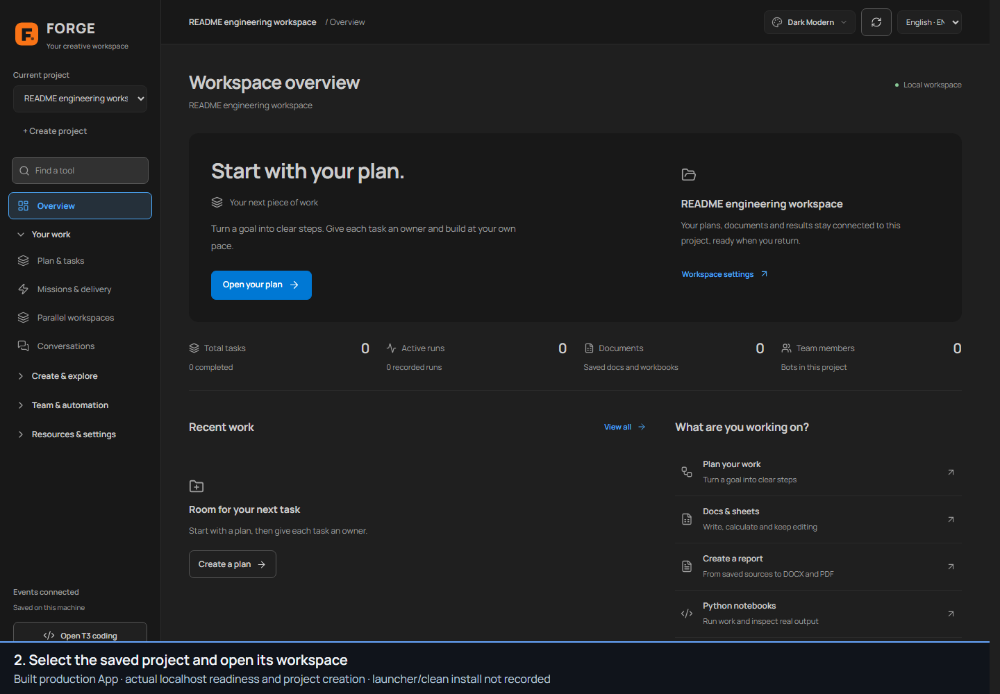

FORGE workspace overview after actual local project creation. Disposable engineering records; no provider run.

[Lossless full-page source](sources/overview-full.png)

### Team

**Qualification:** Actual local bot records; no provider calls

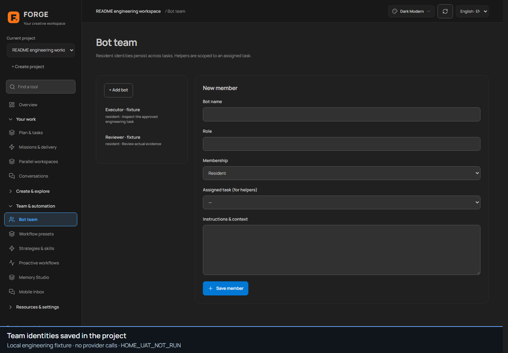

Resident Executor and Reviewer identities saved through production HTTP in the engineering project; no model execution.

[Lossless full-page source](sources/team-full.png)

### Mission Plan

**Qualification:** INJECTED provider observations · no model call · real local files/tests/preview/ZIP · usage unknown

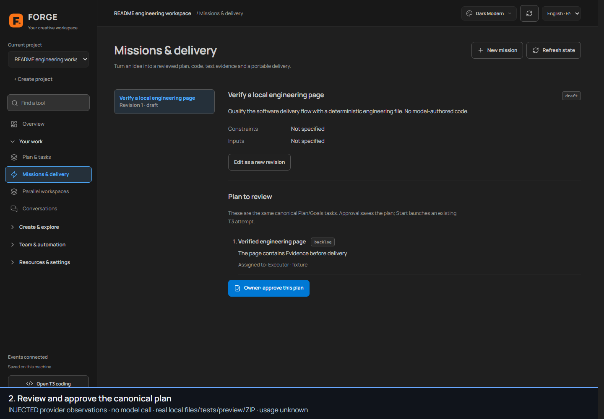

Mission and canonical plan awaiting Owner approval. Provider completion will be injected; deterministic file and local verification are real.

[Lossless full-page source](sources/mission-plan-full.png)

### Mission Preview

**Qualification:** INJECTED provider observations · no model call · real local files/tests/preview/ZIP · usage unknown

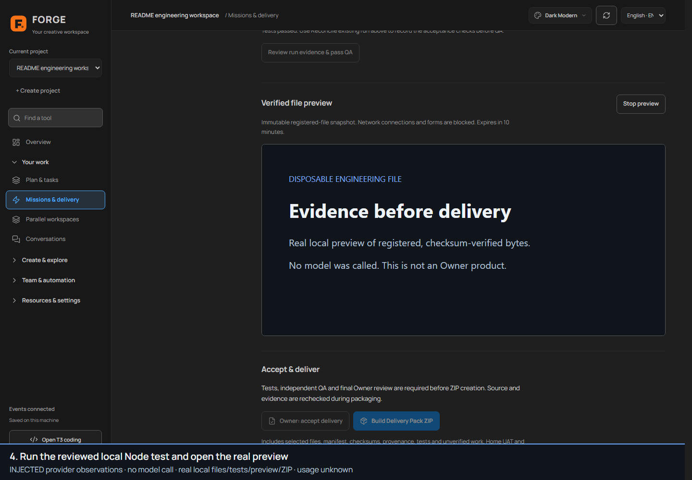

Registered engineering HTML rendered in the real local preview after an actual passing Node test. Provider run is injected; no model call or usage metric.

[Lossless full-page source](sources/mission-preview-full.png)

### Delivery

**Qualification:** INJECTED provider observations · no model call · real local files/tests/preview/ZIP · usage unknown

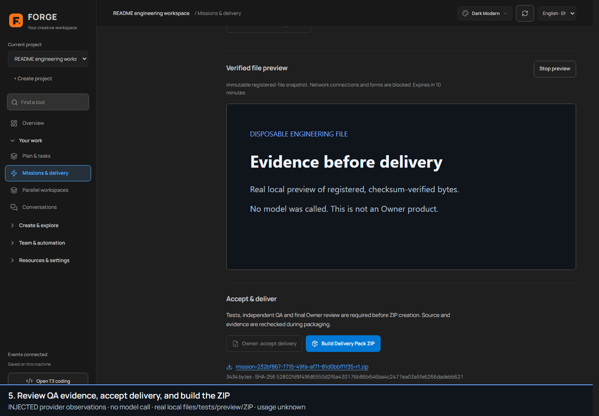

Actual accepted Delivery Pack download with checksums after local tests and QA. Provider execution observation is injected; source is a deterministic engineering file.

[Lossless full-page source](sources/delivery-full.png)

### Plan

**Qualification:** INJECTED provider observations · no model call · real local files/tests/preview/ZIP · usage unknown

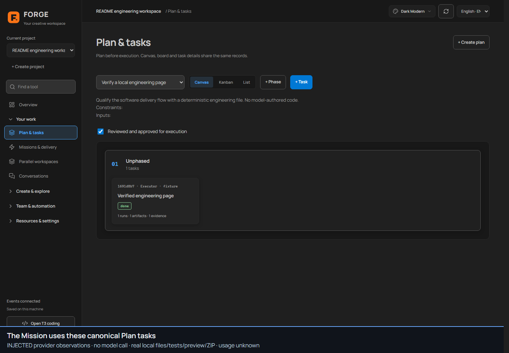

Canonical Plan view for the actual engineering Mission task. Provider observation is injected; no live model run.

[Lossless full-page source](sources/plan-full.png)

### Dependencies

**Qualification:** Real local task/dependency records; not executed

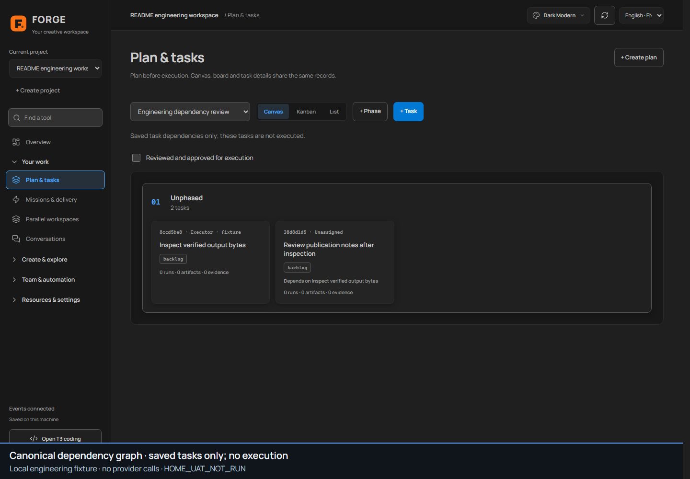

Actual persisted canonical task dependency graph. Both engineering tasks remain in backlog; no execution or provider call is claimed.

[Lossless full-page source](sources/dependencies-full.png)

### Compute

**Qualification:** Real local Python compute only; remote/cloud targets NOT_RUN

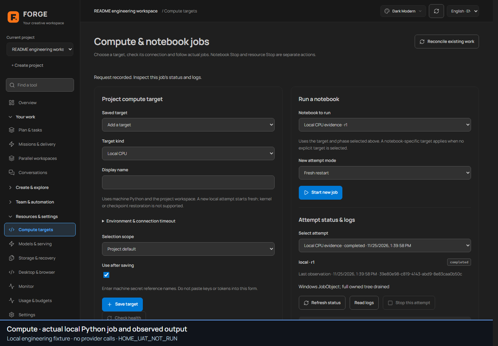

Compute view after actual local CPU notebook execution; observed Python output is 2 + 3 = 5. No cloud resources or provider calls.

[Lossless full-page source](sources/compute-full.png)

### Chat

**Qualification:** INJECTED agent/run/tool observations · no model call · tool outcome unconfirmed · actual canonical IDs

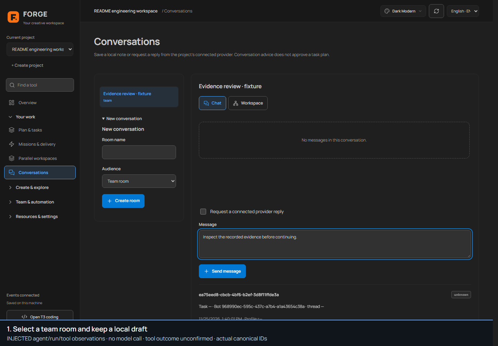

Group Chat with an unsent engineering draft. Run/tool observations injected for the following graph; no provider message sent.

[Lossless full-page source](sources/chat-full.png)

### Workspace

**Qualification:** INJECTED agent/run/tool observations · no model call · tool outcome unconfirmed · actual canonical IDs

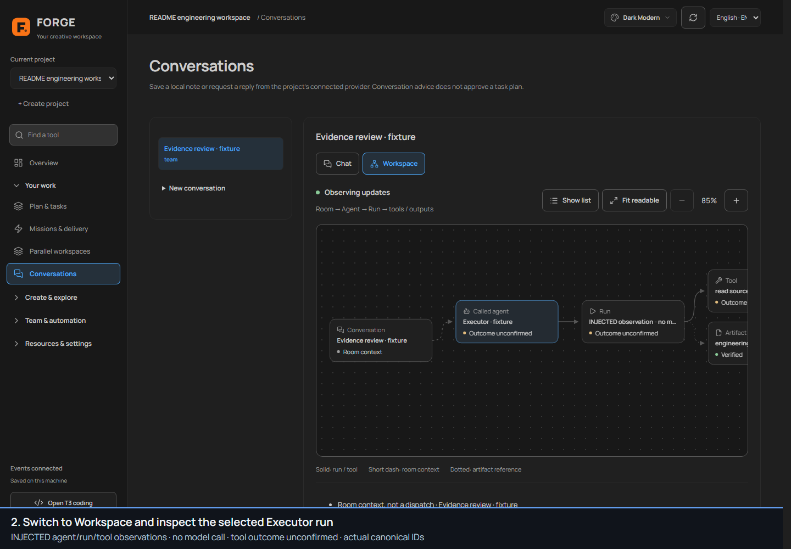

Node–Edge Workspace and selected Executor details, using actual canonical fixture run/bot/attempt IDs. Agent and tool observations injected, no live model call; tool result unconfirmed.

[Lossless full-page source](sources/workspace-full.png)

### Run Evidence

**Qualification:** INJECTED agent/run/tool observations · no model call · tool outcome unconfirmed · actual canonical IDs

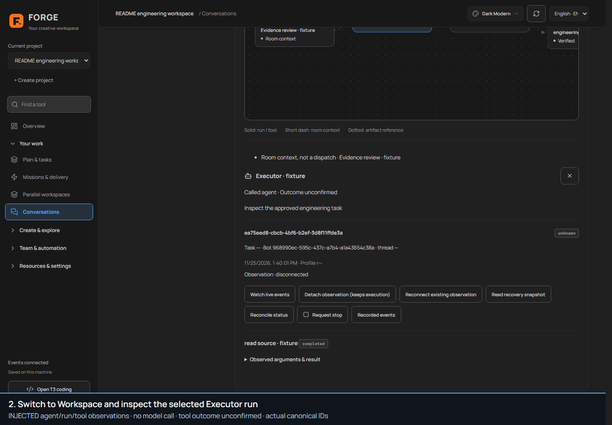

Selected Executor evidence and existing run controls with actual canonical run/attempt identity. Provider/agent observations are injected; no model called and no Stop or approval action is claimed.

[Lossless full-page source](sources/run-evidence-full.png)

### Recovery

**Qualification:** INJECTED agent/run/tool observations · no model call · tool outcome unconfirmed · actual canonical IDs

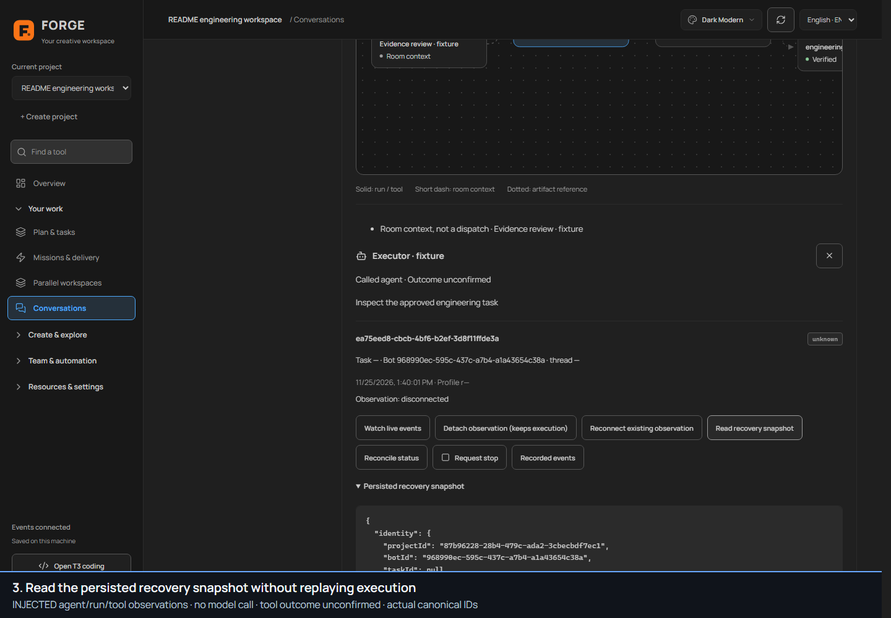

Actual read-only recovery snapshot for the injected canonical fixture run. No provider called and no effects replayed.

[Lossless full-page source](sources/recovery-full.png)

### Tool Evidence

**Qualification:** INJECTED agent/run/tool observations · no model call · tool outcome unconfirmed · actual canonical IDs

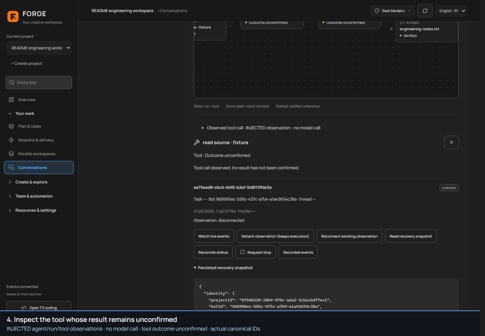

Selected fixture tool identity with outcome unconfirmed. Agent/run/tool observations are injected; no provider call or successful tool result is claimed.

[Lossless full-page source](sources/tool-evidence-full.png)

### Workspace Mobile

**Qualification:** INJECTED agent/run/tool observations · no model call · tool outcome unconfirmed · actual canonical IDs

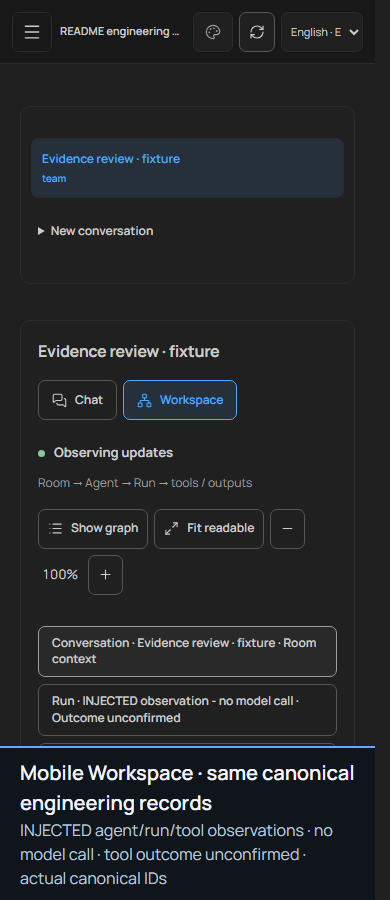

390px mobile Workspace linear inspection list, the accessible alternative to the graph, using the same canonical engineering records. All provider/agent/tool observations injected; no live model call.

[Lossless full-page source](sources/workspace-mobile-full.png)

### Sheets

**Qualification:** Actual Univer edit/save/reopen + native report engines · manually requested bounded edits · no model call

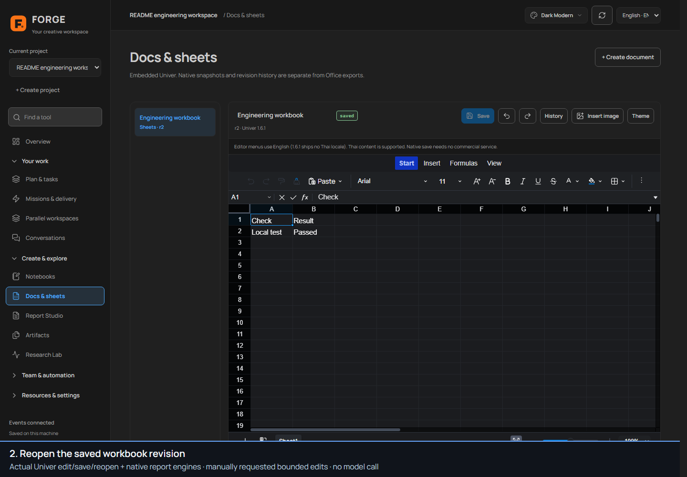

Actual mounted Univer sheet with readable engineering content after bounded Facade edit, durable save, and reopen. The edit was manually requested; no model called.

[Lossless full-page source](sources/sheets-full.png)

### Docs

**Qualification:** Actual Univer edit/save/reopen + native report engines · manually requested bounded edits · no model call

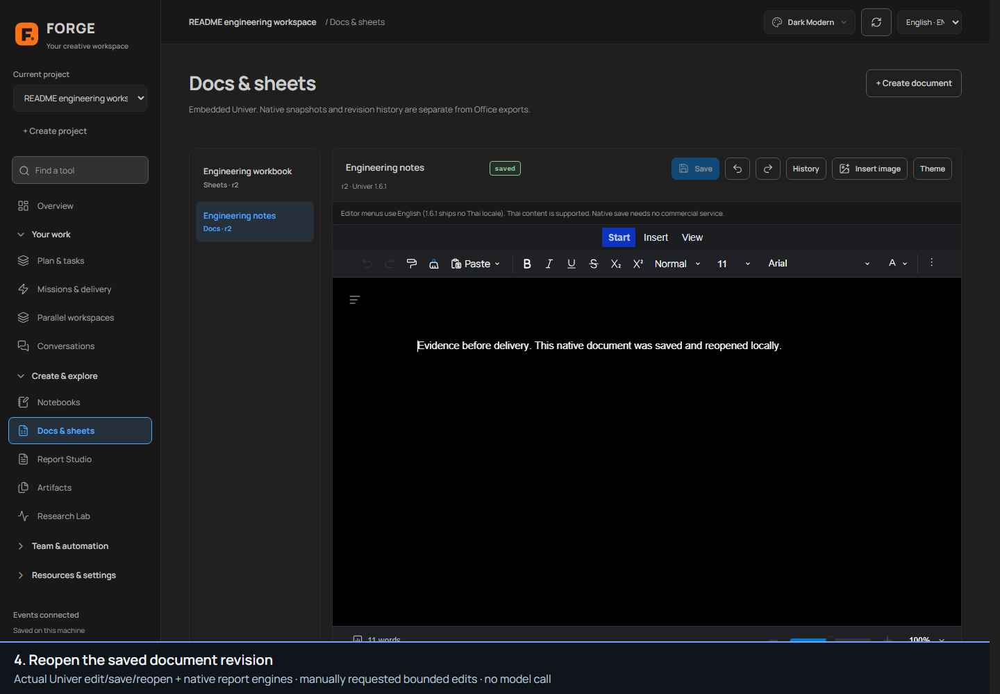

Actual mounted Univer doc with readable engineering content after bounded Facade edit, durable save, and reopen. The edit was manually requested; no model called.

[Lossless full-page source](sources/docs-full.png)

### Report Studio

**Qualification:** Actual Univer edit/save/reopen + native report engines · manually requested bounded edits · no model call

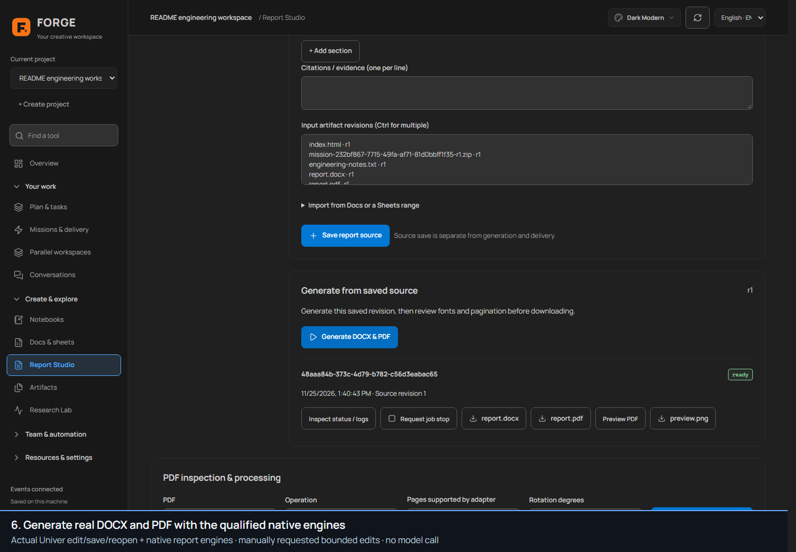

Actual native WordCraft DOCX/PDF report generation from saved ReportSpec and imported Univer sheet revision. No external account or provider call.

[Lossless full-page source](sources/report-studio-full.png)

### Report Preview

**Qualification:** Actual Univer edit/save/reopen + native report engines · manually requested bounded edits · no model call

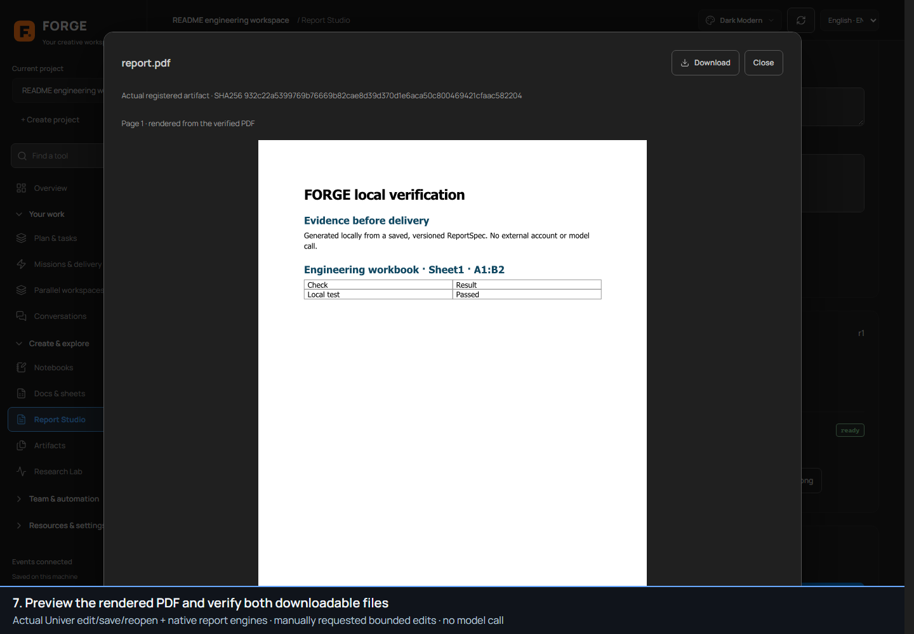

Decoded native PDF page preview of the actual locally generated report, with the saved Sheets table. No provider call.

[Lossless full-page source](sources/report-preview-full.png)

### Owner Memory

**Qualification:** Actual local central memory + explicit named-project grant; disposable engineering content

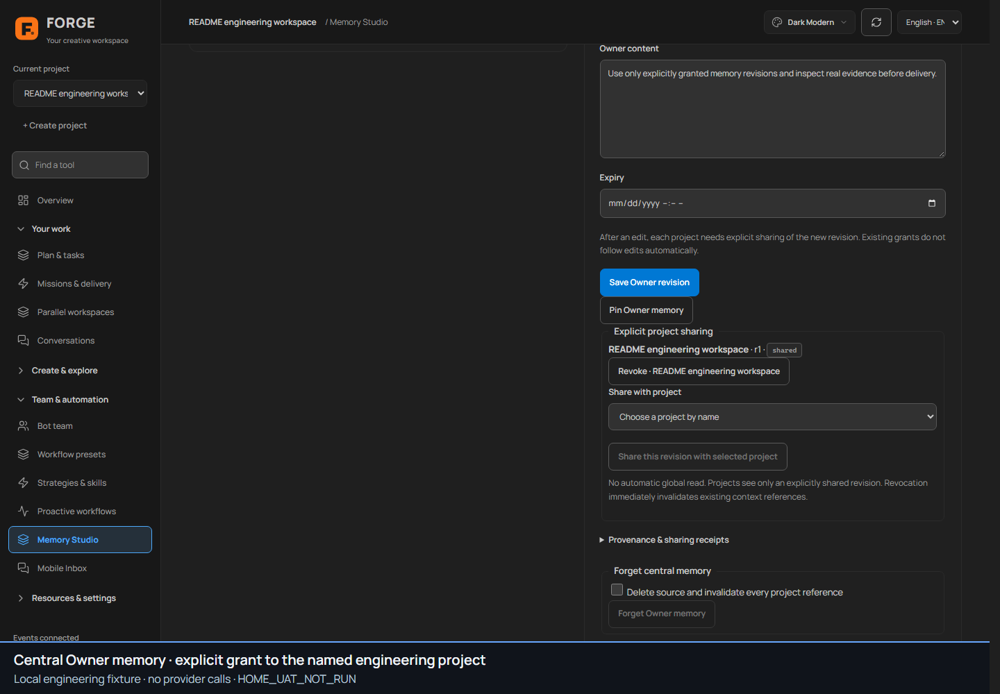

Central Owner source memory after actual private save and explicit grant to the named engineering project. No automatic cross-project read and no model call.

[Lossless full-page source](sources/owner-memory-full.png)

### Artifacts

**Qualification:** Actual local artifacts and verified download hashes; external storage NOT_RUN

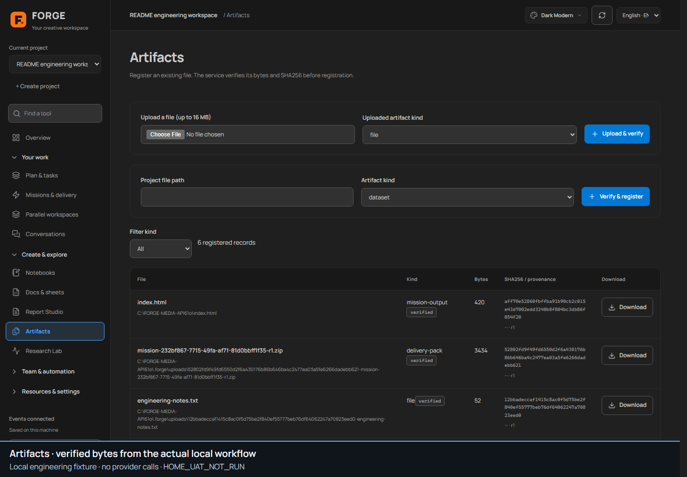

Actual artifact catalog containing uploaded engineering notes and real native report outputs. No cloud storage or model execution.

[Lossless full-page source](sources/artifacts-full.png)

### Overview Mobile

**Qualification:** INJECTED provider observations · no model call · real local files/tests/preview/ZIP · usage unknown

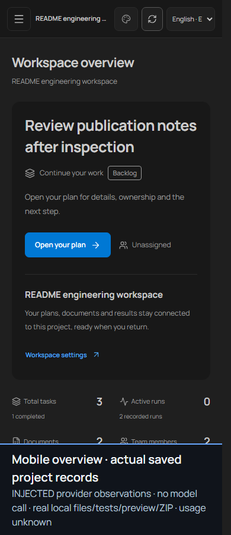

390px mobile workspace overview of actual saved engineering project records. Run observations injected; no model call or usage metrics.

[Lossless full-page source](sources/overview-mobile-full.png)

## Diagram sources

[Architecture](architecture.mmd) and [software delivery](software-delivery.mmd) are original Mermaid sources for the lead’s final README. They preserve FORGE canonical authority, T3 single execution ownership, and the native guarded automation qualification boundary.

## Qualification gaps

- Engineering fixture; not Owner product data or a pilot.
- Provider/agent/run/tool observations injected only where labelled. Mission source files are predetermined engineering input, not model-authored code.
- No fake usage, latency, cost, or model success is displayed. Unknown remains unknown.
- Capture annotations add numbered instructions and qualification only; original App UI/state is otherwise unchanged.
- Engine configuration uses local authenticated HTTP; private executable paths never enter video.
- Start clip covers ready App/project creation, not Windows launcher or clean installation.
- Browser fixture interactions do not qualify macOS, mobile relay, live providers, remote compute or Owner home UAT.
