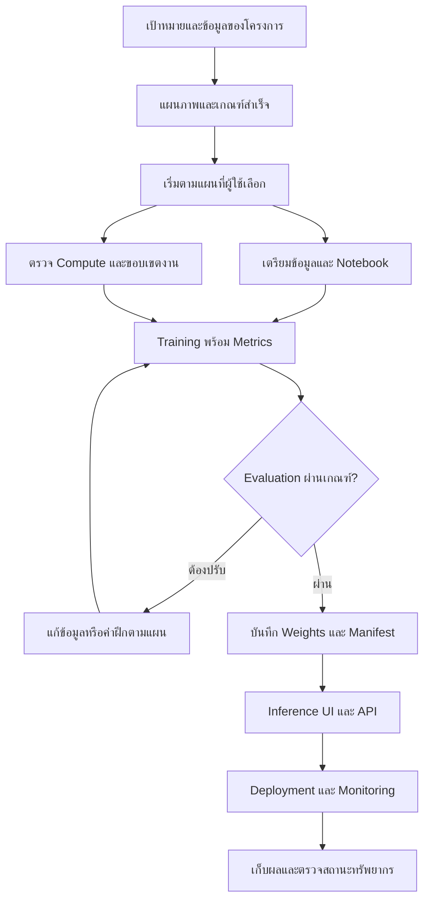

# FORGE: ผล Deep Research สำหรับ AI Training และ Inference/Deployment

วันที่ตรวจ: **24 พฤศจิกายน 2026 — Asia/Bangkok**

สถานะ: **ข้อเสนอจากการตรวจเอกสารและ source ของ upstream** ยังไม่ได้ติดตั้ง/เชื่อมบัญชี/เช่า GPU/เรียกโมเดลหรือทดสอบ workflow จริง รายงานนี้แยกสิ่งที่มีอยู่แล้วออกจากงานที่จะพัฒนาใน FORGE อย่างชัดเจน

**ข้อมูลล่าสุดหลังรายงานนี้:** เจ้าของส่งแผน `CARDIAC_ARREST_MASTER_PLAN.md` เป็น reference pilot แรก แล้วเลือก **Windows public CPU + Colab Free training + LitServe MCP** พร้อม storage **Google Drive + Local Windows + Git repository** และย้ำว่า **product FORGE ต้องเลือกได้อิสระผ่าน Settings; ชุดนี้เป็น configuration ของต้นแบบเท่านั้น** รายละเอียดอยู่ใน [CA_EWS_FORGE_PILOT_TH.md](projects/CA_EWS_FORGE_PILOT_TH.md) และ [Project Storage Settings](PROJECT_STORAGE_SETTINGS_TH.md) คง FastAPI/React replay และเพิ่ม Colab round-trip/LitServe/storage evidence เป็น acceptance ส่วนบัญชี/path/folder/Git remote/API eligibility/runtime/เพดานเวลาและ retention ยังต้องตรวจหรือกำหนดใน setup ข้อเสนอทั่วไปด้านล่างเป็น catalog ไม่ใช่สิ่งที่ทุก project ต้องติดตั้งหรือใช้ฟรีตลอด

## 1. ข้อเสนอหลัก

**สร้าง FORGE ต่อบน T3 Code ใช้ MCP/API/SDK ที่มีอยู่เป็นส่วนเชื่อม และพัฒนา workflow ที่ผู้ใช้ no-code ใช้งานได้ครบในแอปเดียว** มีของพร้อมใช้มากพอที่จะไม่ต้องเริ่มเขียน notebook controller, experiment tracker, cloud API และ desktop input ใหม่ทั้งหมด

คุณค่าของ FORGE คือผู้ใช้บอกเป้าหมาย → เห็นแผนใหญ่ → ทำงานกับทีม bot → ติดตามแต่ละ phase → ได้ notebook, weights, inference interface และ dashboard ที่อ้างอิงผลจริงร่วมกัน

| ยืนยันแล้วจากเจ้าของ | ยังเป็นข้อเสนอทางวิศวกรรม |
|---|---|
| GUI บน T3 Code; ใช้ FORGE ได้แบบ no-code | React Flow สำหรับแผน, dnd-kit สำหรับ board |
| ทีม bot ประจำและผู้ช่วยตามงาน; private chat/team room ใน FORGE | บทบาทเริ่มต้นและจำนวน bot ที่เหมาะกับงานแรก |
| งานหลักคือ AI Training และ Inference/Deployment | ต้นแบบใช้ Windows + Colab + LitServe ตาม project profile |
| เสนอแผนภาพก่อนทำงานและติดตามแต่ละ phase; เลือก Colab training แล้ว | ประเมิน official remote Colab API MCP และ browser Colab MCP แยกตาม capability/สิทธิ์ |
| Product ต้อง flexible; การเลือกชุดนี้เป็นของต้นแบบ | แยก compute/serving/storage/tracking/MCP/agent adapters ที่เปลี่ยนต่อ project/phase ได้ |
| รองรับ main Windows และ desktop/VM แยก | Cua Driver MCP เป็นตัวเลือก desktop หลัก, Playwright เสริมเว็บ |
| ChatGPT, Claude, Gemini, OpenRouter นำร่อง; ขยาย provider ได้ | เลือก native/ACP/API ให้ตรงสิทธิ์บัญชีแต่ละราย |
| ทำ deep search หา MCP ก่อนเขียนส่วนเชื่อม | สร้าง FORGE MCP เฉพาะช่องว่างและงานควบคุมของ FORGE |

แผน CA-EWS ที่ได้รับภายหลังระบุ modality, dataset เริ่มต้น, model ladder และ local replay แล้ว เจ้าของเลือก Windows public CPU + Colab Free training + LitServe MCP และ Drive/Windows/Git storage แล้ว ส่วนบัญชี/folder/path/project remote, eligible runtime, เพดานเวลาและ sync/retention policy ตรวจหรือกำหนดใน setup เสนอเริ่มตรวจ browser-notebook MCP และทดลองทีละงาน; hosted API eligibility ตรวจแยกจาก tier

## 2. Top 3 แนวทางการประกอบระบบ

เป็นการจัดอันดับตามความเหมาะสมกับ requirements ของ FORGE ไม่ใช่ผล benchmark

| อันดับ | แนวทาง | สิ่งที่ใช้ | เหมาะกับ | ข้อแลกเปลี่ยน |
|---|---|---|---|---|
| **1 — แนะนำ** | **FORGE บน T3 + MCP ที่มีอยู่ + adapter เฉพาะช่องว่าง** | Jupyter/Colab, Runpod, HF, tracker ที่เลือก, Cua, Playwright และ wrapper Vast/own-server ตามจำเป็น | เป้าหมายหลาย provider, หลาย GPU, หลายชนิดงาน AI ของเจ้าของ | ต้องทำ connection manager และ job/artifact model ให้เป็นระบบเดียวกัน |
| **2** | เริ่ม workflow บน Hugging Face ก่อน | Hub/Jobs MCP, Inference Endpoints MCP, Gradio, Trackio และ skills | ต้องการพิสูจน์วงจร model → train → serve ด้วย ecosystem ที่เชื่อมกันอยู่แล้ว | พึ่งพาบัญชี/ข้อจำกัดของ HF มากขึ้น; ยังต้องเชื่อม cloud อื่นตาม requirement |
| **3** | เริ่มจาก GPU server ของเจ้าของ | SSH/Jupyter, Trackio หรือ MLflow, Gradio/serving engine ที่เหมาะกับโมเดล | มี GPU/server พร้อมและอยากเก็บข้อมูลใกล้เครื่องตนเอง | ต้องดูแล runtime, storage, networking และ long-running worker มากกว่า |

**ข้อเสนอเลือกอันดับ 1 เป็นสถาปัตยกรรมหลัก** งานพิสูจน์แรกใช้ Windows + Colab + LitServe ตามคำตอบล่าสุด ส่วน product เก็บ provider-neutral plan/task/bot/run/artifact/evidence state และเลือก integrations ผ่าน project profile การเปลี่ยน compute/serving ต้องไม่บังคับเปลี่ยน UI หรือทิ้งประวัติโปรเจกต์ แต่ต้องตรวจ environment/artifact compatibility และสร้าง attempt ใหม่เมื่อจำเป็น ไม่รับรองการย้าย live kernel หรือว่าทุก adapter ใช้งานได้แล้ว

แหล่งยืนยันส่วนที่มีอยู่: [Runpod MCP](https://github.com/runpod/runpod-mcp), [HF Hub MCP](https://huggingface.co/docs/hub/agents-mcp), [HF Endpoints MCP](https://huggingface.co/docs/inference-endpoints/guides/mcp_server), [Jupyter MCP](https://github.com/datalayer/jupyter-mcp-server)

## 3. อะไรมี MCP แล้ว และอะไรควรสร้างเอง

คำว่า **official** ในตารางหมายถึงผู้พัฒนาโครงการ/บริการนั้นดูแล integration ไม่ได้แปลว่าทดสอบกับ FORGE แล้ว ส่วนบริการ hosted และ source ของ connector อาจมีเงื่อนไขต่างกัน

### Notebook และ Compute

| งาน | สิ่งที่พบ | แนวทาง FORGE | ขอบเขตที่ต้องเข้าใจ |
|---|---|---|---|
| สร้าง/อ่าน/แก้/รัน Jupyter Notebook | [Datalayer Jupyter MCP](https://github.com/datalayer/jupyter-mcp-server), BSD-3-Clause | นำมาเชื่อม Jupyter ของเจ้าของ | เป็น third-party ที่มี source; ไม่ใช่ Project Jupyter official และไม่ต้องซื้อ Datalayer hosting |
| ควบคุม Colab runtime/session/code | [Official remote Colab API MCP](https://developers.google.com/colab/api/reference/mcp) | ประเมินเป็น execution adapter สำหรับ pilot | มี runtime/spec/subscription/session tools; ต้องตรวจ API enablement/auth/สิทธิ์จริง แยกจาก tier; file transfer ใช้ HTTP ที่เอกสารกำหนด |
| ทำงานกับ notebook ใน Colab browser | [Google Colab MCP](https://github.com/googlecolab/colab-mcp), Apache-2.0 | Interactive notebook adapter อีกช่องทาง | เชื่อม agent บนเครื่องกับ browser; tools เปลี่ยนหลังเชื่อม ต้องทดสอบ refresh ผ่าน harness |
| เช่า/ควบคุม GPU, Pods, Serverless | [Runpod MCP](https://github.com/runpod/runpod-mcp), Apache-2.0 | Compute candidate ที่คงไว้สำหรับ project อื่น/ภายหลัง | มี hosted OAuth/local API key; ต้องติดตามทรัพยากรและค่าใช้จ่ายของแต่ละ run |
| Vast.ai | [official CLI/SDK](https://github.com/vast-ai/vast-cli), MIT; มี community MCP | เสนอ wrapper บาง ๆ บน official SDK | ยังไม่ยืนยัน first-party control MCP; community candidate มีช่องว่างเรื่อง license/ขอบเขต tools |
| GPU server ของเจ้าของ | Jupyter API/MCP + SSH; มี community SSH MCP | ใช้การเชื่อมที่มีอยู่ แล้วเพิ่มงาน submit/status/cancel ตาม scheduler ของเครื่อง | คำสั่ง SSH ยาวหนึ่งครั้งไม่เท่ากับ job ที่กู้ต่อหลังหลุดได้ |

**อัปเดต Colab:** พบ official remote API MCP เพิ่มจาก browser bridge แล้ว จึงรองรับการออกแบบ runtime/session automation โดยไม่จำกัดทุกงานให้ผ่านหน้า notebook แต่ยังต้องตรวจสิทธิ์และข้อจำกัดจริง ไม่ใช่ server ถาวรหรือ GPU ที่รับรองพร้อมใช้ เก็บ checkpoints ออกนอก runtime และออกแบบ retry/recovery ตาม API semantics ส่วน Colab Enterprise เป็นอีกบริการที่ต้องแยกบัญชี/เงื่อนไข [Colab API MCP](https://developers.google.com/colab/api/reference/mcp) · [Colab FAQ](https://research.google.com/colaboratory/faq.html)

รายละเอียด versions, pins, dependencies และข้อแตกต่าง stop/delete/storage: [COMPUTE_MCP_RESEARCH.md](research/COMPUTE_MCP_RESEARCH.md)

### Model, Training, Inference และ Monitoring

| งาน | Integration ที่มีอยู่ | สิ่งที่ใช้ใน FORGE |
|---|---|---|
| ค้นหาโมเดล/dataset/docs และงานบน HF | [HF Hub MCP](https://huggingface.co/docs/hub/agents-mcp), first-party | ค้นทรัพยากรและใช้ Jobs/Spaces เฉพาะที่เปิดสิทธิ์ |
| Deploy managed model endpoint | [HF Inference Endpoints MCP](https://huggingface.co/docs/inference-endpoints/guides/mcp_server), first-party แยกจาก Hub | สร้าง/ตรวจ/หยุด/ปรับ endpoint และอ่าน logs/metrics |
| Dashboard ทดลอง train แบบเริ่มต้น | [Trackio MCP](https://huggingface.co/docs/trackio/api_mcp_server), first-party; MIT source | ตัวเลือกเริ่มต้นที่เสนอสำหรับ metrics และการถามผลด้วย bot |
| Experiment workflow ที่ใช้ W&B อยู่ | [W&B MCP](https://github.com/wandb/wandb-mcp-server), first-party; MIT connector | query/compare runs, artifact/trace/report; ไม่จำเป็นต้องย้าย tracker |
| Tracking/model management แบบ self-host | [MLflow MCP](https://mlflow.org/docs/latest/genai/mcp/), first-party, experimental | ใช้ชุด tools ของ experiments/runs/models/deployments หรือ GenAI ตาม config |
| Serving logs/metrics/dashboard | [Grafana MCP](https://github.com/grafana/mcp-grafana), first-party; Apache-2.0 connector | อ่าน observability backend ที่ติดตั้งและเก็บข้อมูลแล้ว |
| Inference UX/UI และ callable tool | [Gradio MCP](https://gradio.app/guides/building-mcp-server-with-gradio), Apache-2.0 | ให้แอป inference ที่สร้างมีทั้ง UI และ MCP tool |
| เปิดโมเดลเป็น MCP inference tool | [LitServe MCP](https://lightning.ai/docs/litserve/features/mcp), upstream feature | เจ้าของเลือกเพิ่มใน pilot; LitAPI เปิด `/mcp/` แบบ Streamable HTTP และคง REST prediction API; เสนอ serve artifact ที่รับกลับบน Windows |
| LLM serving | [vLLM](https://docs.vllm.ai/en/latest/serving/online_serving/) API/health/metrics | ใช้เมื่อเหมาะกับโมเดล; lifecycle ผ่าน compute/deployment adapter |

**ข้อเสนอ tracker Top 3:** Trackio สำหรับงานแรกที่ต้องการความเรียบง่าย; W&B ถ้าใช้งานบริการนั้นอยู่แล้ว; MLflow เมื่อต้องการ self-host/model management ที่กว้างขึ้น เลือกเพียงตัวเดียวสำหรับ workflow พิสูจน์แรก

**LitServe กับ Colab MCP มีบทบาทต่างกัน:** Colab MCP ใช้ notebook/compute; LitServe MCP เปิด predictor เป็นเครื่องมือให้ bots เรียก ใช้เป็น serving adapter ที่เปลี่ยนได้ ไม่แทน FORGE orchestrator หรือบังคับให้ทุก project ใช้ LitServe สำหรับ CA-EWS ให้ CLI, FastAPI replay และ LitServe ใช้ predictor/model revision เดียวกัน และตรวจ REST/MCP/offline outputs ก่อนนับว่าผ่าน

การต่อ MCP ทำให้ bot อ่าน/เรียกเครื่องมือได้ ส่วน training script ต้องส่ง loss, validation metric และข้อมูลที่ต้องการติดตามเข้า tracker จริงก่อน หน้าติดตามงานของทีม, กราฟการ train และสถานะ inference service เป็นข้อมูลคนละประเภทและควรแสดงแยกกันอย่างเชื่อมโยง

สำหรับผลโมเดลต้องเก็บ model artifact/weights พร้อม preprocessing/config, dataset revision และผล evaluation ที่ต้องใช้จริง ส่วน base model, adapter และ tokenizer ให้บันทึกเมื่อเกี่ยวข้องกับชนิดงาน หากได้ LoRA adapter ต้องระบุ base model ที่ต้องใช้ร่วมกัน งาน tabular ต้องเก็บ feature/preprocessing pipeline ด้วย ข้อมูลเหล่านี้ทำให้ inference UI โหลดผลของ run เดียวกับที่ผู้ใช้เห็น

รายละเอียด: [TRAINING_MONITORING_MCP_RESEARCH.md](research/TRAINING_MONITORING_MCP_RESEARCH.md)

## 4. Provider ที่ bot ใช้คิด กับ MCP ที่ bot ใช้ทำงาน

ผู้ใช้ควรเห็นชื่อบริการและปุ่มเชื่อมบัญชี ส่วนภายในแยกสามประเภท:

| ส่วน | หน้าที่ | ตัวอย่าง |
|---|---|---|
| Agent/harness | session, code tools, permission events, resume/cancel | Codex, Claude Code, OpenCode หรือ ACP agent |
| Model API | inference, model catalog, key และ billing | OpenRouter, Gemini API, DeepSeek, MaxPlus |
| MCP connector | ใช้ notebook, compute, model tools, tracker, desktop หรือระบบอื่น | Colab MCP, LitServe MCP, Runpod MCP, Jupyter MCP, Cua Driver MCP |

T3 มี native provider และ generic ACP integration ให้ใช้ต่อได้ เอกสารปัจจุบันระบุทั้ง built-in providers, Registry และ local ACP command แต่ความสามารถของ terminal control, account isolation และ subagent lineage ไม่เท่ากันทุก agent จึงต้องตรวจด้วย build ที่จะใช้งานจริง [T3 ACP guide](https://github.com/pingdotgg/t3code/blob/main/docs/user/providers-acp.md)

| บริการที่เจ้าของขอ | ทางเชื่อมที่เสนอจากหลักฐาน |
|---|---|
| ChatGPT | Native Codex/T3 integration ตามสิทธิ์บัญชี หรือ API route แยก |
| Claude | Native Claude Code/adapter ตามสิทธิ์บัญชี หรือ API route แยก |
| Gemini | Wizard เลือกตามบัญชี: consumer route ปัจจุบันเป็น Antigravity CLI; Gemini CLI ยังมี API/enterprise route |
| OpenRouter | ใช้ native provider/API สำหรับ bot inference; official OpenRouter MCP สำหรับค้นโมเดล/ข้อมูลบัญชี/docs/การทดสอบที่อนุญาต |
| Grok, Kimi, Qwen, DeepSeek | มี native harness/ACP ที่เป็น reuse candidates; DeepSeek Harness ยังเป็น preview และมี capability limits |
| OpenCode | ใช้เป็น coding harness หลาย provider; ไม่ใช่ชื่อโมเดลอีกหนึ่งตัว |
| MaxPlus | มี API หลาย protocol/pool; เริ่มจาก provider preset และ optional MCP tools สำหรับ catalog/usage |
| KOB | แยก VS Code extension, CLI และ API: extension ระบุ MCP; CLI MCP/ACP ยังไม่ยืนยันและ license ขัดกัน |

แหล่งสำคัญ: [Google consumer transition](https://developers.googleblog.com/an-important-update-transitioning-gemini-cli-to-antigravity-cli/), [OpenRouter MCP](https://openrouter.ai/docs/guides/overview/mcp-server), [MaxPlus API](https://maxplus-ai.cc/docs/api), [KOB extension](https://marketplace.visualstudio.com/items?itemName=thekaroe.kob-ai), [KOB LICENSE](https://github.com/thekaroe-thailand/kobcli/blob/master/LICENSE), [DeepSeek ACP](https://github.com/deepseek-ai/deepseek-harness/blob/master/packages/acp/acp/README.md)

OpenRouter MCP ไม่ได้ทำให้ normal app inference เลิกใช้ API และบาง tools ทำ inference ที่คิดเงินได้ การมี subscription ของ ChatGPT/Claude/Gemini ไม่ควรถูกตีความเป็น API credits กลางของ FORGE

MaxPlus มี `/v1/messages`, `/v1/chat/completions`, `/v1/responses` ตาม pool ที่รองรับ จึงไม่ควรรับรอง feature parity จากคำว่า compatible อย่างเดียว ส่วน KOB README/package ระบุ MIT แต่ LICENSE ที่ตรวจจำกัดเชิงพาณิชย์ ต้องไม่คัดลอกโค้ดโดยถือว่าเป็น MIT ที่เคลียร์แล้ว

รายละเอียด protocol, endpoint, auth และ qualification: [PROVIDER_MCP_RESEARCH.md](research/PROVIDER_MCP_RESEARCH.md)

## 5. GUI แบบ T3 + แผนผังและบอร์ด

**แนะนำ React Flow + dnd-kit ที่ T3 ใช้อยู่ + UI primitives ของ T3** โดย canvas, Kanban และ task detail ใช้ Plan/Task records ชุดเดียวกัน การ์ดหนึ่งใบเปิดไปที่ bot thread, notebook, training run และ artifact ที่เกี่ยวข้องได้

| อันดับ | Component | เหมาะกับ | ข้อแลกเปลี่ยน |
|---|---|---|---|
| **1 — แนะนำ** | React Flow + dnd-kit | dependency graph, phase status, bot ownership และบอร์ดที่แก้ได้ | ต้องเพิ่ม task semantics/persistence ของ FORGE |
| 2 | Excalidraw + structured board | อธิบาย/ระดมความคิดแบบ whiteboard | ต้องผูก shape กับ task และจัด collaboration เอง |
| 3 | Diagram renderer เดิมของ T3 + board | ทำแผนภาพอ่านง่ายในรุ่นเล็ก | ไม่ใช่ editable task canvas เต็มรูปแบบ |

T3, React Flow, dnd-kit และ Excalidraw มี MIT source licenses ที่ตรวจแล้ว ส่วน tldraw ปัจจุบันมี production licensing จึงไม่ใช่ค่าเริ่มต้น permissive OSS ที่เสนอ รายละเอียด source paths และ version pins อยู่ใน [PLANNING_UI_MCP_RESEARCH.md](research/PLANNING_UI_MCP_RESEARCH.md)

**Miro และ Jira มี official MCP** แต่เจ้าของต้องการประสบการณ์แบบนั้นใน FORGE จึงเสนอให้มี board/canvas ภายในก่อน แล้วเพิ่ม export/sync ภายนอกเป็นตัวเลือก สถานะ done บน Jira หรือ whiteboard ไม่ควรแทนหลักฐานว่า evaluation ผ่าน [Miro tools](https://developers.miro.com/docs/miro-mcp-tools) · [Atlassian tools](https://developer.atlassian.com/cloud/rovo-mcp/guides/supported-tools/)

Notebook รุ่นแรกเสนอให้มี artifact/ผลลัพธ์ preview และ Open in Jupyter/Colab ยังไม่มีหลักฐานว่าฐาน T3 ที่ตรวจมี rich notebook editor พร้อมใช้ ส่วน MCP Apps charts ของ tracker ต้องตรวจ host rendering ก่อนรับรองว่า embed ได้

## 6. Agent ใช้ GUI บน Windows และ desktop แยก

พบ **Cua Driver MCP ที่มีอยู่จริง** ผ่าน `cua-driver mcp` คู่มือระบุการใช้กับ T3 โดย register ใน harness ที่ T3 เปิดใช้งาน มี CLI/SDK แยกด้วย จึงไม่จำเป็นต้องสร้าง MCP translator ใหม่เพียงเพราะต้องการ desktop control [Cua Driver](https://github.com/trycua/cua/blob/main/libs/cua-driver/README.md) · [Agent integration](https://github.com/trycua/cua/blob/main/docs/content/docs/cua-driver/guides/connect-your-agent.mdx)

| ส่วน | ตัวเลือกเสนอ | FORGE ต้องเพิ่ม |
|---|---|---|
| Main Windows | Cua Driver MCP; Windows-MCP เป็นทางเลือกประเมิน | เลือก target, แสดงผู้ควบคุม, stop/takeover และตรวจผล native app |
| Desktop/VM แยก | Driver/runtime แยกใน guest ที่ provision ไว้ | VM lifecycle, connection, viewing/streaming และ task lease |
| Browser/UI QA | Microsoft Playwright MCP | แยก browser profile/context ของงานและแนบผลทดสอบกับ task |

Playwright แยก browser context ได้ แต่ไม่เท่ากับ desktop/VM แยก Cua Driver มี license/component boundary ของตนเองและไม่จัดหา VM/streaming/โมเดลให้ครบอัตโนมัติ

ข้อเสนอ multi-bot คือหนึ่ง desktop มี bot ที่ถือสิทธิ์ควบคุมงานได้ครั้งละหนึ่งตัว งาน GUI พร้อมกันใช้คนละ desktop การกดรับช่วงควบคุมต้องกันคำสั่งที่ยังค้างและแสดงสถานะจริง ไม่อาศัยเพียงการเปลี่ยนป้าย UI ยังไม่ผ่านการทดสอบบน Windows ของเจ้าของ

รายละเอียดและแหล่งอ้างอิง: [COMPUTER_USE_MCP_RESEARCH.md](research/COMPUTER_USE_MCP_RESEARCH.md)

## 7. ส่วนที่ FORGE ควรพัฒนาเอง

### 7.1 ประสบการณ์เชื่อมต่อสำหรับ no-code

ผู้ใช้เปิด **Connections → เลือกบริการ → เชื่อมบัญชี/ใส่ key → เลือก project/เครื่อง → ตรวจการเชื่อมต่อ** ไม่ต้องเขียน MCP JSON หรือเลือก transport เองในขั้นตอนปกติ

FORGE ต้องจัดการ dependency ของแต่ละ connector, เวอร์ชันที่เลือก, auth handoff, account identity, tool discovery และผลตรวจ capability จริง สถานะที่แสดงควรต่างกันระหว่าง “พบ integration ในเอกสาร”, “ติดตั้งแล้ว”, “เชื่อมบัญชีแล้ว” และ “ทดสอบกับงานนี้ผ่านแล้ว”

Connector แต่ละตัวอาจต้องใช้ Python/Node คนละรุ่น ควรแยก managed environments ไม่บังคับให้ผู้ใช้แก้ dependency ด้วยตนเอง การเปิด connection สำเร็จยังไม่เท่ากับ bot เห็น tools ที่เพิ่มภายหลังหรือแสดงภาพได้ถูกต้อง

### 7.2 Plan, team และงานยาว

พัฒนา plan/task service, bot identity, private/team conversation และงานช่วยชั่วคราวต่อบน T3 runtime เดียว ใช้สถานะเดียวกันทั้ง GUI และเครื่องมือที่ bot เรียก ไม่ให้ระบบย่อยหลายตัวอ้างว่าเป็นเจ้าของ turn หรือ run เดียวกัน

งานยาวต้องมี FORGE run ID กับ provider job/resource ID ที่ติดตามต่อหลัง reconnect ได้ MCP มี Tasks extension สำหรับงาน asynchronous อยู่แล้ว แต่การรองรับขึ้นกับ client/server/version จึงควรมี submit/status/cancel บน durable job service เป็นพื้นฐานร่วมด้วย [MCP Tasks](https://tasks.extensions.modelcontextprotocol.io/specification/2026-07-28/tasks)

การปิดแชต, tool timeout, หยุด agent, ยกเลิก training job และหยุด GPU เป็นคนละสถานะ หากต้องการหยุดค่าใช้จ่ายอัตโนมัติ ตัวเฝ้าดูงานต้องยังทำงานได้แม้แอปบน Windows ปิด และต้องรายงาน storage ที่ยังคงอยู่

### 7.3 Wrapper เฉพาะส่วนที่ยังขาด

| Wrapper ที่เสนอ | ฐานที่ใช้ | ขอบเขตที่ควรมี |
|---|---|---|
| Vast compute | Official Vast SDK | ค้น offer, ตรวจค่าใช้จ่าย, create/inspect/stop/delete ทรัพยากรของ run |
| Owner-server jobs | SSH + scheduler/worker ของเครื่อง | submit/status/log/cancel/checkpoint โดยมี ID คงอยู่ |
| FORGE projects/team | Plan/task/bot service ของ FORGE | เสนอแผน, มอบหมายงาน, อัปเดตผลและแนบ artifact |
| Custom provider | MaxPlus/KOB/endpoint ที่ผ่านตรวจ | Model catalog/auth/usage/protocol mapping; MCP เป็นตัวเลือกเฉพาะ operations |
| Custom inference deployment | Serving API/SDK ที่เลือก | health/inference/log/stop ของ deployment ที่ระบุ |

FastMCP มี OpenAPI/FastAPI integration ใช้เป็น scaffolding ได้ แต่ควรเลือก tools ระดับงานแทนการเปิด endpoint ทั้งหมด รวมถึง management APIs ที่ไม่จำเป็น [FastMCP](https://gofastmcp.com/docs/integrations/openapi)

## 8. Hermes, single-agent-loop-kit และ repo เดิมยังอยู่ตรงไหน

| แหล่งแนวคิด/component | บทบาทที่เสนอในสถาปัตยกรรม AI ใหม่นี้ |
|---|---|
| T3 Code | ฐาน GUI, project/thread, code/diff review และ provider lifecycle ที่เสนอให้นำมาใช้เป็นฐาน |
| Hermes | เลือก skill/tool ที่เกี่ยวกับ phase; เลือก harness จาก capability ที่พิสูจน์ได้; เก็บข้อเสนอปรับ skill พร้อม evidence |
| single-agent-loop-kit | ประเมิน/ลด loop ที่ซ้ำและการตรวจแก้ที่ไม่คุ้มในงานหนึ่ง ๆ โดยยังมีหลาย bot ได้ |
| Agent Orchestrator / Orca | อ้างอิงหรือเลือก worker/worktree/task lifecycle เฉพาะส่วนที่เข้ากับ runtime หลัก |
| Paseo / Happy | อ้างอิงหรือเชื่อม remote/session capabilities เมื่อมี requirement โดยไม่เพิ่ม runtime เจ้าของงานซ้ำ |
| OpenBot | พฤติกรรมทีมประจำ/การสนทนาเป็น reference; FORGE bot service เขียนเองเพื่อรักษาทางเลือกเชิงพาณิชย์ |
| Hugging Face skills | เติมความรู้เฉพาะด้าน training/data/tracking โดยคัดและปรับให้ตรงแผนของผู้ใช้ |

ตัวอย่าง adaptation ที่เสนอ: phase เตรียมข้อมูลเลือก dataset/notebook skills; phase train เลือก training/tracker/compute tools; phase deploy เลือก serving/GUI QA tools โดยไม่ต้องเปิด tools ทุกบริการให้ทุก bot ตลอดเวลา ความพร้อมของ vision, tool calls, OAuth, cancellation และงบเป็นเงื่อนไขเลือก harness ก่อนคะแนนคุณภาพ

เมื่อ run สำเร็จ ให้เสนอ skill improvement จากผลที่ตรวจแล้วก่อนนำไปใช้ทั่วไป ยังไม่เรียก capability rules ใน prototype ว่าเป็นระบบเรียนรู้ที่พิสูจน์ประสิทธิภาพแล้ว

OpenBot ที่ตรวจใช้ PolyForm Noncommercial; ทิศทางเชิงพาณิชย์ของ FORGE ยังไม่กำหนด จึงไม่ควรคัดลอก source โดยสมมติว่า permissive license ส่วน Cua Driver, Spaces/streaming และ optional perception ต้องตรวจแยก component [ข้อกำหนดและแหล่งอ้างอิงเดิม](REQUIREMENTS_INTERVIEW_TH.md) · [Hermes adaptation](HERMES_ADAPTATION.md)

## 9. แผนภาพ workflow ที่ควรพิสูจน์

นี่คือ **ข้อเสนอ workflow** สำหรับทำ requirements และ acceptance ให้ตรงกัน ไม่ใช่หน้าจอที่พัฒนาเสร็จแล้ว

Canvas และ board อ้างถึงงานในกราฟเดียวกัน แต่ละ phase แสดงผู้รับผิดชอบ งานที่รอ artifact และผลตรวจจริง การทดลองหลายรอบอยู่ในรายละเอียด phase ไม่ทำให้ภาพรวมกลายเป็นกราฟ tool calls จำนวนมาก

## 10. ลำดับพัฒนาที่เสนอหลังปิด requirements งานแรก

| ระยะ | สิ่งที่จะส่งมอบ | หลักฐานรับงาน |
|---|---|---|
| 1 — เส้นทางหลักใน T3 | FORGE shell, connection wizard หนึ่ง harness/compute, plan/canvas/board, bot และห้องคุย | ข้อมูล plan/task ตรงกันและเปิดไป thread ของผู้รับผิดชอบได้ |
| 2 — Notebook ถึงผลโมเดล | Run/job ID, status/logs, cancel/reconnect และตรวจ resource state ก่อนเริ่ม remote training; Notebook, training แบบมีขอบเขต, tracker หนึ่งตัวและผลโมเดล | มี output/metrics และ artifact ที่ trace กลับไป data/code ได้; ติดตามต่อและยกเลิกงานจริงได้ |
| 3 — Inference และ GUI use | UI ที่โหลด weights ชุดนั้น, API test, native Windows และ guest test | ผู้ใช้ป้อนตัวอย่างแล้วได้ผลจริง; bot ควบคุม target ถูกเครื่องและหยุดได้ |
| 4 — ขยาย Cloud lifecycle | ขยายหลาย cloud, provisioning, reconciliation/retry และ retention/teardown อัตโนมัติจากการควบคุมขั้นต่ำที่มีตั้งแต่ระยะ 2 | ไม่มีการส่งงานซ้ำเมื่อหลุด; ตรวจ remote state และทรัพยากรค้างได้ |
| 5 — ขยายบริการและ adaptation | Providers/compute เพิ่ม, skills ที่ผ่าน review, optional Miro/Jira sync | connector ใหม่ผ่าน capability/acceptance ของตัวเอง |

ระยะเหล่านี้เป็นลำดับงาน ไม่ใช่ประมาณเวลาที่รับรองก่อนประเมินกำลังพัฒนา สำหรับ CA-EWS ลำดับจริงคือ Windows preparation/smoke → Colab training/evaluation → verified artifact return → local replay และ LitServe MCP การลอง inference ด้วย fixture หรือโมเดลตัวอย่างก่อนหน้านั้นเป็นเพียง optional infrastructure smoke check ไม่ใช่หลักฐานว่าโมเดล CA-EWS ฝึกหรือใช้งานได้แล้ว Core ต้องรองรับ project profile ที่เปลี่ยน components ได้ตั้งแต่ต้น แต่ไม่ต้องเชื่อมทุกบริการเพื่อผ่าน pilot นี้

## 11. คำถามที่เปิดไว้ก่อนรับแผนโปรเจกต์

อัปเดต: แผน CA-EWS และคำตอบภายหลังระบุ workload, dataset เริ่มต้น, model ladder, Windows public CPU + Colab training, LitServe MCP และแนวทาง local replay แล้ว พร้อมย้ำให้ product ยืดหยุ่น ดู [รายการที่ยังต้องถามจริง](projects/CA_EWS_FORGE_PILOT_TH.md) รายการด้านล่างคงไว้เป็นบริบทของรายงานก่อนรับแผน ไม่ใช่คำถามที่ต้องถามซ้ำทั้งหมด

1. **โปรเจกต์ AI ตัวอย่างแรก:** งานภาษา/ภาพ/เสียง/tabular, มี dataset หรือ model เดิมหรือไม่ และต้องการวัดผลอะไร
2. **Compute ที่เข้าถึงได้จริง:** server/GPU ปัจจุบัน, บัญชี cloud ที่มี และสถานที่เก็บข้อมูล/weights ที่ยอมรับได้
3. **ขอบเขตการทำงาน:** งบต่อ run/วัน, เวลาสูงสุด, อะไรทำอัตโนมัติได้ตามแผน และ inference ใช้ส่วนตัวหรือเผยแพร่ให้คนอื่น

สามหัวข้อนี้ตัดสิน workload และ acceptance ส่วนรายละเอียด MCP/ACP, library และ transport ให้ทีมพัฒนาเลือกตามผลวิจัย ผู้ใช้ไม่ควรต้องตอบเป็นรายการ package จำนวนมาก

## เอกสารประกอบและสถานะงาน

- [Requirements ที่ยืนยันและคำถามที่ยังเปิด](REQUIREMENTS_INTERVIEW_TH.md)
- [Compute/Notebook audit](research/COMPUTE_MCP_RESEARCH.md)
- [Provider/Harness/MCP audit](research/PROVIDER_MCP_RESEARCH.md)
- [Planning UI/Miro/Jira audit](research/PLANNING_UI_MCP_RESEARCH.md)
- [Training/Monitoring/Inference audit](research/TRAINING_MONITORING_MCP_RESEARCH.md)
- [Computer-use audit](research/COMPUTER_USE_MCP_RESEARCH.md)

รอบนี้ปรับเอกสาร product/requirements และเพิ่มรายงานวิจัย ส่วน workbench ต้นแบบเดิมยังเป็น prototype ก่อนเลือก T3 ไม่ได้กลายเป็นระบบ multi-bot/MCP/AI training ที่พร้อมใช้งานจากการเพิ่มเอกสารนี้ ไม่มีการ publish, merge, deploy, เชื่อมบัญชี หรือเรียกใช้ทรัพยากรแบบคิดเงินในงานวิจัยรอบนี้
