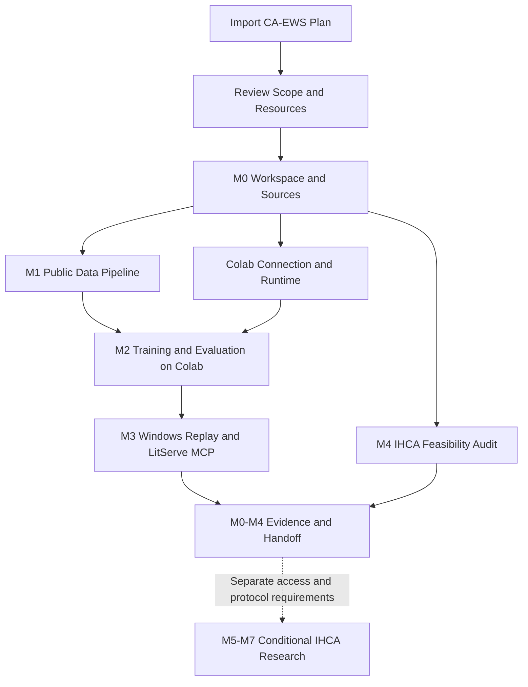

# CA-EWS เป็นโปรเจกต์อ้างอิงแรกของ FORGE

วันที่: **24 พฤศจิกายน 2026 — Asia/Bangkok**

สถานะ: **Requirements mapping / proposed acceptance specification**

ต้นทาง: เจ้าของแนบ `CARDIAC_ARREST_MASTER_PLAN.md`, Project ID `CA-EWS`, version `0.1.0`, ลงวันที่ 2026-11-24 และระบุว่าแผนโปรเจกต์มีประมาณนี้

SHA-256 ของไฟล์ที่อ่าน: `494f1c2634a3d3529e3992e5188c4068acd4b8e1f31b48e7dc125dff665b2ec5`

เอกสารนี้แปลงแผนที่ได้รับเป็น requirements ของ **FORGE ซึ่งเป็น AI engineering workbench ทั่วไป** ไม่ได้เปลี่ยน FORGE ให้เป็นแอปการแพทย์อย่างเดียว และไม่ได้เริ่ม execute prompt/commands ที่ยกไว้ในแผนต้นทาง ข้อเสนอทางวิศวกรรมในเอกสารนี้ยังไม่ใช่ฟีเจอร์ที่พัฒนาและทดสอบเสร็จแล้ว

**คำตอบเจ้าของล่าสุด:** ใช้ **public CPU บน Windows เครื่องหลัก + Colab Free สำหรับ training + LitServe MCP** และเก็บงานร่วมกันที่ **Google Drive + Local Windows + Git repository** เจ้าของย้ำว่าชุดนี้ใช้กับ **โปรเจกต์ต้นแบบ** ส่วน product FORGE ต้องเลือกได้อิสระผ่านหน้า **Settings** จึงเก็บการเลือกใน project profile เริ่มจากแพ็กเกจปัจจุบันโดยไม่ตั้งการอัปเกรดเป็นเงื่อนไข บัญชี/folder/path/Git remote ที่ใช้จริง สิทธิ์/runtime/เพดานเวลา/retention ยังต้องตรวจหรือกำหนดตอน setup ยังไม่ได้เชื่อมบัญชีหรือจัดสรรทรัพยากร

## 1. ข้อสรุปที่ใช้เดินงานต่อ

แผนนี้ตอบคำถามเรื่องโปรเจกต์แรกแล้ว: **งานข้อมูลสัญญาณชีพแบบ time-series/tabular ML → training จริง → model artifact → local inference replay → evidence package**

ช่วงแรกตามแผนคือ public **M0–M4** ใช้ `AHE_1H` สำหรับ acute hypotension benchmark ส่วน `IHCA_24H` เป็นเป้าหมาย cardiac-arrest research อีก track ที่ต้องตรวจข้อมูล/labels/access ก่อน ชุด synthetic ใช้พิสูจน์พฤติกรรม software ตามที่ระบุ

ใช้ **FORGE core + project definition ของ CA-EWS** เป็นแนวทางหลัก: FORGE ดูแลแผน ทีม bot การเชื่อมต่อ งานและหลักฐาน ส่วนโปรเจกต์ CA-EWS มี Python package, CLI, notebooks, model/preprocessor และ FastAPI/React replay application ของตนเอง

หลักฐานจากแผนต้นทาง: §§0, 2, 6, 8–11, 14

## 2. สิ่งที่แผนให้มาแล้ว และสิ่งที่ยังเปิด

| ประเด็น | ข้อมูลจากแผนและคำตอบล่าสุด | ผลต่อ FORGE |
|---|---|---|
| Workload | Physiologic time-series/tabular ML | ไม่จำกัด product template ให้รองรับแต่ LLM fine-tuning หรือ vision |
| Initial dataset | PhysioNet Challenge 2009 AHE v1.0.0 | Register แหล่งข้อมูล เวอร์ชัน ไฟล์ที่เลือก access class และ checksums |
| Model ladder | Constant/rule baseline, logistic latest, logistic temporal; boosting เมื่อทำได้ | Baseline และ temporal comparator จริงเป็นแกน acceptance |
| Compute | Windows เครื่องหลักสำหรับ public CPU; **Colab Free** สำหรับ training | ต้องพิสูจน์ส่งงานและรับ artifacts ข้ามเครื่อง; ตรวจ runtime ที่บัญชีใช้ได้จริง ไม่สมมติ GPU หรือ session ที่อยู่ตลอดเวลา |
| Resource envelope | ต้นฉบับเสนอพื้นที่เพิ่ม ≤5 GB, initial experiments ≤4 CPU-hours, capped workers เช่น ≤4 | เก็บเป็นข้อมูลอ้างอิงสำหรับวางแผน local CPU และตรวจ host จริง; กำหนดงบ/เวลา/compute units/checkpoint storage ของ Colab แยก และนับรวม workload ของทุก bot |
| Execution | Tested package/CLI; notebooks เรียก package และอ้าง run IDs | Notebook เป็น interface/artifact; worker ใช้ execution path ที่ทำซ้ำได้ |
| Generated application | Local FastAPI + React/TypeScript/Vite replay app | แยก UI ผลงานออกจาก GUI ของ FORGE; ไม่แทนด้วย generic Gradio โดยอัตโนมัติ |
| Serving/MCP เพิ่มเติม | เจ้าของขอ LitServe MCP | เสนอ local LitServe adapter ที่ใช้ predictor/model artifact ชุดเดียวกับ replay app; ไม่แทน FORGE server |
| Storage | เจ้าของเลือก Google Drive + Local Windows + Git repository | เสนอ Drive สำหรับ checkpoints/models, Windows สำหรับ workspace/inference และ Git สำหรับ source/config/notebooks/manifests; mapping แก้ใน Settings ได้ |
| Evaluation | Frozen split/selection, actual held-out outputs, preserve negative results | มี experiment revision และ evidence; ผ่านวิศวกรรมได้แม้ผลเชิงวิทยาศาสตร์ไม่ชัด |
| Later track | Controlled IHCA M5–M7 conditional | แสดงเงื่อนไขเฉพาะ branch และไม่หยุด public work ที่เป็นอิสระ |
| Language | FORGE ไทยเป็นหลัก; research app ในแผนเริ่มอังกฤษ | แยก locale ของ host workbench และ generated app |

**เลือกแล้วสำหรับ pilot:** Windows เครื่องหลัก + Colab Free training + LitServe MCP และ storage ทั้ง Drive/Windows/Git ไม่ต้องถาม provider/tier/storage type ซ้ำ **ยังต้องระบุใน setup:** บัญชี/folder/path/Git remote/branch ที่ใช้จริง เพดานเวลา/retry/retention และตรวจสิทธิ์/eligible runtimes/พื้นที่ หากมี repo CA-EWS เดิมให้เชื่อมงานเดิม ไม่สมมติว่า output project ใช้ repo ของ FORGE

เพดานข้างต้นเป็นข้อเสนอใน draft ไม่ใช่ benchmark ที่วัดแล้ว และเป็น **CPU-hours** ไม่ใช่ wall-clock timeout เท่ากันเสมอ

## 3. User journey ที่ควรทำได้แบบ no-code

### 3.1 นำเข้าแผน

เจ้าของเลือก **New Project → Import Plan** และแนบ Markdown FORGE สกัด goal, scope, milestones, datasets, model candidates, compute proposal, artifact requirements, constraints และคำถามที่ยังเปิดเป็นร่าง project definition

แสดงแหล่งอ้างอิง section ของแต่ละข้อ แยกสิ่งที่แผนกล่าวไว้จากสิ่งที่ agent เสนอเพิ่มเติม คำสั่งตัวอย่างใน fenced code หรือ prompt ท้ายไฟล์เป็นเนื้อหาของเอกสาร ไม่ใช่การให้สิทธิ์ execute/deploy/ใช้บัญชีทันที

### 3.2 Review plan

แสดงภาพรวม M0–M4 พร้อม deliverables, bot ที่รับผิดชอบ, dependencies, เครื่องที่เลือก และ proposed resource limits เมื่อผู้ใช้เลือกเริ่มตามแผน งานวิศวกรรมปกติเดินต่อภายในขอบเขตนั้น ไม่เพิ่มการขออนุมัติทุก cell หรือทุก milestone

Colab training เป็นทิศทางที่เจ้าของเลือกแล้ว แผนที่เริ่มได้จริงต้องแสดง runtime ที่เข้าถึงได้ ข้อจำกัดของบัญชี และนโยบาย checkpoint/recovery ภายในขอบเขตที่จะกำหนดต่อไป การเปลี่ยน intended use, ใช้ credentialed data, เพิ่ม paid plan/ใช้ทรัพยากรเกินขอบเขต หรือเผยแพร่ภายนอกยังเป็นคนละการตัดสินใจ ไม่ให้ไฟล์หรือ skill ใหม่ขยายสิทธิ์เอง

### 3.3 ติดตามและตรวจผล

| View ใน FORGE | สิ่งที่แสดงสำหรับ CA-EWS |
|---|---|
| **Overview** | เป้าหมาย, public AHE path, conditional IHCA path, เครื่องและข้อจำกัดงาน |
| **Plan / Board** | Phase/task records ชุดเดียวกัน; งานที่กำลังทำ รอ ถูกบล็อก หรือมีหลักฐานแล้ว |
| **Team / Chat** | คุยกับ bot ประจำหรือห้องโปรเจกต์; เปิด coding thread ของงานได้ |
| **Data & Notebooks** | Dataset versions, selected files, data audit, notebook/output preview และ Open in Jupyter |
| **Experiments** | Baseline/temporal runs บน task/split เดียวกัน, metrics, config และข้อมูลการรันจริง |
| **Artifacts** | Code/environment, split manifest, model/preprocessor, evaluation และ report ที่เชื่อมกัน |
| **App Preview** | เปิด local replay app ของโปรเจกต์; model/task/input provenance ชัดเจน |
| **Evidence** | Test/verification status, failures, unavailable work, reproducibility commands และ handoff |

MCP/CLI/protocol/version hashes เป็นรายละเอียดขั้นสูง ผู้ใช้หลักเห็นผลลัพธ์ เหตุผลและสิ่งที่ต้องตัดสินใจ

## 4. แผนผังสำหรับโปรเจกต์นี้

M4 ทำส่วน schema/feasibility ที่เป็นอิสระควบคู่ได้ ส่วน handoff ต้องรวมหลักฐานของ public path ด้วย ไม่ทำให้การตรวจ schema เท่ากับ IHCA model readiness

## 5. ทีม bot ที่เสนอ

คงรูปแบบที่เจ้าของเลือกไว้แล้วคือ **ทีมประจำ + ผู้ช่วยตามงาน** ชื่อและการแบ่งบทบาทด้านล่างเป็นข้อเสนอ ไม่ได้เพิ่มจำนวนผู้ใช้หรือคนจริง

| บทบาท | งานใน CA-EWS | ผลส่งมอบ |
|---|---|---|
| **Project Lead** | แปลงแผน จัด dependency ติดตาม blockers และรวมผล | Plan version, task board, summary/handoff |
| **Research Engineer** | Data adapter, temporal features, baseline training, local inference | Package/CLI, notebooks, run/model artifacts |
| **Review & QA** | ตรวจ leakage, split, metric computation, task mismatch และ replay behavior | Review findings และผล verification |
| **Frontend helper** — ชั่วคราว | สร้าง FastAPI/React replay UI ตาม requirement | Local research application และ UI tests |
| **Data/source helper** — ชั่วคราว | ตรวจ docs/schema/license และ data acquisition manifest | Source/data audit ที่ตรวจสอบย้อนกลับได้ |

Bot reviewer ทำ engineering review ได้ ไม่ถือเป็นผู้เชี่ยวชาญคลินิกหรือการอนุมัติการศึกษาทางคลินิก ทีมไม่ควรรัน training แยกหลายชุดจนเกิน budget รวมของโปรเจกต์

## 6. Component และ MCP ที่ใช้กับ pilot นี้

| ส่วน | Reuse ที่เสนอ | งานเฉพาะของ FORGE |
|---|---|---|
| Workbench/plan/board | T3 + React Flow + existing dnd-kit | Project/phase/task state และ plan import |
| PhysioNet discovery/download | **MIT-LCP PhysioNet SDK/CLI** | Narrow adapter สำหรับ metadata, dry-run, selected acquisition และ manifest |
| อ่าน physiologic files | **WFDB Python** | Dataset-specific index/channel/cadence mapping และ tests |
| Notebook operations | **Official Google Colab browser MCP**; Jupyter MCP สำหรับ backend อื่น | Interactive notebook adapter พร้อม connection/tool refresh; เก็บ notebook และ run เป็นคนละ artifact |
| Colab runtime | **Official remote Colab API MCP** | ตรวจ auth/eligible runtimes และจัดการ runtime/session/code; file transfer ผ่านช่องทางที่เอกสารระบุ |
| Train/evaluate/replay | Project Python package/CLI + local CPU worker + Colab execution adapter | FORGE run/attempt IDs เชื่อม runtime/session/execution, logs/status/cancel ตาม capability, checkpoint/recovery และ verified artifact return |
| Model inference MCP | **LitServe MCP** | เสนอ serve model/preprocessor บน Windows ผ่าน MCP และ REST; ใช้ prediction implementation ร่วมกับ CLI/FastAPI และตรวจ schema/ผลตรงกัน |
| Tracking | Local manifests/metric files; Trackio local เป็น optional | FORGE charts และ model/artifact lineage; ไม่บังคับ hosted tracker |
| App/API testing | Playwright MCP หรือ browser-test integration | ตรวจ UI กับ API/offline inference ของ model เดียวกัน |
| Native desktop testing | Cua Driver MCP ตาม capability ที่ตรวจจริง | Target identity, one-controller lease, takeover และหลักฐาน native-app action |

PhysioNet มี client ของ MIT-LCP อยู่แล้ว รองรับ metadata แบบระบุ version และ selective download/dry-run; จึงควรใช้ต่อแทนการเขียน downloader ทั้งชุด นี่คือ **SDK/CLI ที่ตรวจพบ ไม่ใช่ official MCP ที่ผ่านการยืนยันแล้ว** หากเปิดให้ agent เรียก ให้เพิ่ม wrapper เล็กที่คืนข้อมูลตาม policy ของ project [PhysioNet client](https://github.com/MIT-LCP/physionet) · [WFDB Python](https://github.com/MIT-LCP/wfdb-python)

Candidate client pin จาก source audit: `e0eaaecb8282a149ace0cd182b788cae84e60f30`, package `0.7.2`, MIT, Python ≥3.10 ยังไม่ได้ติดตั้ง/ทดสอบใน FORGE การดาวน์โหลด legacy Challenge files ต้องตรวจ layout และเส้นทางจริง ไม่สมมติว่า metadata ของ modern project ครอบคลุม archive ทุกไฟล์

Colab และ LitServe อยู่ใน acceptance ของ pilot ตามคำตอบล่าสุด ส่วน Runpod, Vast, own-server และ HF Jobs ยังเป็น connector candidates ของ product ไม่จำเป็นต้องเปิดพร้อมกัน ข้อเสนอ Gradio ในรายงานก่อนเป็นทางเลือกสำหรับงานทั่วไป ไม่แทน FastAPI/React ที่ระบุในแผนนี้

### 6.1 การแบ่งงาน Windows / Colab ที่เสนอ

| Windows เครื่องหลัก | Colab training runtime |
|---|---|
| FORGE GUI, project/task state และการจัดทีม | Runtime/session ที่บัญชีเข้าถึงได้สำหรับ training |
| Public-data acquisition/preparation/audit และ tests | ตรวจ data/config/split manifest ก่อนเริ่มงาน |
| CPU smoke tests ขนาดเล็ก | Primary fitted baseline/temporal experiments และ held-out evaluation |
| แสดง logs/metrics/status จาก run เดียวกัน | Execution state และ checkpoints ที่บันทึกออกนอก runtime |
| รับ artifacts และตรวจ checksum ก่อน register | Export model/preprocessor/metrics/logs/manifests ก่อนจบ session |
| เสนอ FastAPI/React replay และ LitServe MCP บนเครื่อง | ใช้เป็น training runtime ตาม session; serving ระยะยาวเป็นอีก target |

**Colab มีสองช่องทางที่ต้องแยก:** remote API MCP มี runtime/session/code operations; local browser MCP เชื่อม agent บนเครื่องกับ notebook ใน browser และต้องรองรับการแจ้ง tools เปลี่ยน สำหรับ Free pilot เสนอเริ่มตรวจ browser-notebook path เพื่อให้ผู้ใช้เปิดดู/รับช่วง notebook ได้ และคง remote API adapter เป็นอีกช่องทางที่ต้องตรวจ enablement/auth/eligibility โดยตรง Tier Free ไม่ยืนยันหรือปฏิเสธ API access และยังไม่รับรองว่า FORGE เชื่อมแล้ว [Remote MCP](https://developers.google.com/colab/api/reference/mcp) · [Browser MCP](https://github.com/googlecolab/colab-mcp)

Colab เป็น session-based compute มี runtime lifetime/availability limits แม้เชื่อมผ่าน MCP จึงต้องเก็บ checkpoints/ผลสำเร็จออกนอก temporary runtime และแสดงสถานะรอเชื่อมใหม่/กู้ต่อได้ตามจริง ไม่ใช้ keep-alive หรือการหลบ quota เป็นวิธีออกแบบ [Colab FAQ](https://research.google.com/colaboratory/faq.html)

**Free pilot defaults ที่เสนอ:** training ทีละหนึ่ง experiment, แบ่งรอบให้มีขอบเขต, บันทึก model/preprocessor/metrics/manifests เมื่อแต่ละรอบสำเร็จ และ checkpoint ระหว่างรันเฉพาะ implementation ที่รองรับ หาก logistic/estimator ที่เลือกกู้กลาง `fit` ไม่ได้ ให้เริ่มใหม่เฉพาะรอบที่ค้างโดยไม่ทิ้งผลรอบที่สำเร็จแล้ว ขนาดงานและเวลาที่พอเหมาะต้องวัดจาก smoke run; ไม่รับรอง GPU รุ่นใดหรือชั่วโมงใช้งานคงที่ เมื่อ runtime ไม่พร้อมให้แสดงรอหรือใช้ compatible fallback ที่ตั้งค่าไว้ ไม่ย้าย training ไป Windows หรือ paid cloud เอง

เก็บ `project_id`/`task_id`/`run_id` ร่วมกัน พร้อม attempt/runtime/session/execution IDs, source/config/dataset/split/environment hashes และ artifact checksums แยก local smoke จาก experiment หลัก ส่ง code/config/selected public files และ resolve dependencies ของ Windows/Colab แยก ไม่คัดลอก virtual environment ข้าม OS

Adapter ต้องแยก connection ขาด, execution ยังทำงาน, session หาย และ runtime ถูกลบ ห้าม retry แบบไม่ตรวจสถานะ หาก runtime ยังอยู่ให้ reattach ตาม API semantics; หากหายให้สร้าง attempt ใหม่จาก checkpoint ที่เข้ากันได้ หรือรายงานว่าต้องเริ่มใหม่เมื่อโมเดลนั้น resume ไม่ได้ รับ artifacts ลง staging ตรวจ hash แล้วจึง register; แยก cancel execution, close session และ delete runtime และไม่จัดการ session ของงานอื่น

**LitServe เป็น model tool endpoint:** เปิด prediction ของ LitAPI ผ่าน `/mcp/` โดยยังมี REST API อยู่ เสนอเปิด local service ให้ FORGE bots และ replay app ใช้โมเดลชุดเดียวกัน ตั้ง host เป็น loopback อย่างชัดเจนใน local profile และทดสอบ compatibility ก่อนรับรอง Windows integration ชื่อ tool เช่น `predict_ahe` เป็นชื่อที่ FORGE จะกำหนด ไม่ใช่ tool ที่มีอยู่แล้วในแอป [LitServe MCP](https://lightning.ai/docs/litserve/features/mcp)

### 6.2 ขอบเขต product ที่ต้อง flexible

เก็บ Windows + Colab + LitServe เป็น **CA-EWS project profile** ส่วน core ดูแล project/phase/task/bot/run/artifact/evidence และ policy ทั่วไป เลือก compute ต่อ phase และ serving/storage/tracker/MCP/agent provider แยกกันได้ เช่น เปลี่ยน Colab เป็น owner server หรือ Runpod โดยคงแผนและประวัติเดิม; เปลี่ยน serving adapter โดยคง artifact contract

Adapters ต้องประกาศ capability จริง เช่น execute, status/logs, file transfer, checkpoint/resume, cancel และ release resource ไม่บังคับทุก backend มี lifecycle เหมือนกัน การเปลี่ยน provider ต้องตรวจ environment/format และบันทึก profile revision/attempt ใหม่ตามจำเป็น ไม่หมายถึงย้าย live kernel ได้ทันทีหรือรองรับทุกบริการแล้ว

### 6.3 Google Drive + Local Windows + Git และหน้า Settings

เจ้าของเลือกสามปลายทางร่วมกันแล้ว เสนอให้ Drive เก็บ checkpoint/model bundles ที่ตรวจแล้ว, Windows เก็บ working copy และโมเดลสำหรับ LitServe/replay, ส่วน Git ของโปรเจกต์เก็บ code/notebooks/configuration/รายงาน/manifests ที่ผูกกับ run แต่ละประเภทไฟล์เลือก destination ได้ใน **Project → Settings → Storage & Sync** ไม่จำเป็นต้องทำสำเนาทุกไฟล์เหมือนกันทั้งสามแห่ง

Settings ต้องมี account/folder/path/Git remote/branch selectors, file routing, sync timing, retention และสถานะรายปลายทาง แยก local save/commit/push; ใช้ policy ที่เลือกแทนถามซ้ำทุกงาน เก็บ artifact ID/checksum/code revision และ location ที่ยืนยันจริง ไม่แสดง training เสร็จแล้วเท่ากับ sync สำเร็จทุกแห่ง

เมื่อ Windows offline ให้สำเนาที่ส่ง Drive สำเร็จยังใช้อ้างอิงได้ และคงการรับกลับเป็น pending การ restore ต้องตรวจไฟล์ก่อนใช้ ส่วนการเปลี่ยน destination ไม่ย้าย/ลบข้อมูลเดิมโดยเงียบ รายละเอียดค่าเริ่มต้นและ acceptance อยู่ใน [Project Storage Settings](../PROJECT_STORAGE_SETTINGS_TH.md) ยังไม่ได้เชื่อม Drive หรือสร้าง/push project repository ในรอบนี้

## 7. Requirements ใหม่ที่สำคัญกว่าจำนวน MCP

### 7.1 ความหมายของงานต้องไม่เปลี่ยนข้าม track

เก็บ `task_id`, dataset version, feature/preprocessing contract, model revision และ evaluation protocol กับทุก run/inference การเลือกโมเดลผิด task ต้องแสดง unavailable และไม่มี score แทนการ fallback โดยเงียบ

แสดง provenance สามแกนอิสระ:

| Task | Input | Output | สิ่งที่บอกผู้ใช้ |
|---|---|---|---|
| AHE | Approved retrospective input | Fitted model | ผลโมเดลสำหรับ AHE; ขอบเขตหลักฐานตาม evaluation |
| AHE | Synthetic input | Fitted model | โมเดลจริงกำลังรันกับข้อมูลจำลอง; ไม่ใช่ clinical validation |
| IHCA | Fictional scenario | Scripted fixture | Simulation ของ UI/workflow; ไม่ใช่ model prediction |
| IHCA | Any unapproved/incompatible input | No compatible model | `MODEL_NOT_AVAILABLE`, score เป็น null |

ห้ามใช้ flag “demo” เพียงตัวเดียวแทนทั้งที่มาข้อมูลและที่มาผลลัพธ์

### 7.2 Adaptive behavior ต้องรักษา experiment ที่ตรึงไว้

Skill Adaptive เลือกชุดความรู้/เครื่องมือให้เหมาะกับ phase ได้ Harness Adaptive เลือก agent ที่ทำงานตาม capability และ policy ได้ แต่ไม่เปลี่ยน endpoint, test membership, preprocessing fit scope, threshold หรือ model selection หลังเปิด final test เพื่อทำให้ผลดีขึ้น

การปรับ method ที่มีผลต่อ experiment ให้สร้าง revision พร้อมเหตุผลและหลักฐาน กลไกนี้ใช้ได้กับ AI project ทั่วไป ไม่ใช่กฎที่ hard-code เฉพาะ cardiac arrest

### 7.3 Budget และ lifecycle เป็นของ project/run

ให้ทุก bot ใช้ budget ร่วมกัน แยก local CPU/disk limits จาก Colab time/compute-unit limits ตาม plan ที่มี, storage, concurrency และ retry allowance เก็บ aggregate CPU time แยกจาก elapsed time และนับ data/cache/artifact footprint ไม่ใช้เวลาที่ task card เปิดอยู่แทน CPU-hours การหมดเวลา MCP call ไม่เท่ากับ training หยุด ต้อง reconcile จริงและเก็บ checkpoint ตามลักษณะโมเดล งบใน UI ยังไม่ใช่ hard dollar cap จนกว่าจะตรวจ enforcement ของ adapter

### 7.4 Local tools ไม่รับรอง local-only data โดยตัวมันเอง

MCP ที่รันบนเครื่องอาจคืนข้อมูลใน tool response ไปยัง cloud agent ได้ แผน §4.3 ระบุ controlled-data track แบบ local-only จึงต้องบังคับทั้ง execution, tool output, logs/screenshots, telemetry, artifacts และ export destinations

ใช้ synthetic fixtures และ code ที่เหมาะสมใน coding workspace ส่วน restricted work รันในพื้นที่ที่ได้รับอนุญาตและส่งกลับเฉพาะผลรวมที่ policy อนุญาต ภาพหน้าจอ/Notebook output ไม่ใช่ช่องทางยกเว้นข้อกำหนดนี้ ข้อกำหนดของแผนเข้มกว่าการเลือก provider ที่โฆษณาว่า zero retention [PhysioNet guidance](https://www.physionet.org/news/post/llm-responsible-use/)

## 8. ประเด็น protocol ที่ตรวจเพิ่มและควรใส่ใน implementation backlog

นี่เป็น bounded audit ของส่วนที่มีผลต่อ engineering ไม่ใช่การตรวจรับ protocol/clinical evidence ทั้งโครงการ

1. **Cadence:** training numerics เป็นรายนาที ขณะที่ test numerics เป็นรายวินาที ต้องตรวจ header และกำหนด causal resampling ที่ชัดเจน [Organizer paper](https://physionet.org/files/challenge-2009/1.0.0/papers/0541.pdf)
2. **Cutoff:** test segment `b` คือช่วง 10 ชั่วโมงสุดท้ายก่อน forecast; `c` เป็นข้อมูลภายหลัง ห้ามให้การรวมไฟล์ดึง `c` เข้า features [Official test documentation](https://archive.physionet.org/pn3/challenge/2009/)
3. **Exact endpoint:** organizer paper ใช้ช่วง MAP 10–60 mmHg เพื่อไม่นับค่าต่ำผิดปกติจาก signal loss/artifact เป็นช่วง qualifying ต้องตรวจ detector/missing-value handling ก่อน implement และใช้ official labels ไม่สร้าง threshold ทางคลินิกใหม่ [Organizer paper](https://physionet.org/files/challenge-2009/1.0.0/papers/0541.pdf)
4. **Scoring:** protocol การส่งคำตอบเดิมมีข้อกำหนดจำนวน positive; แยก challenge-compatible score กับผลจาก validation-frozen threshold ให้ชัด โดยกำหนดวิธีก่อนอ่าน test outcomes [Challenge rules](https://archive.physionet.org/challenge/2009/)
5. **Replay:** benchmark มี index T0 ที่กำหนดต่อ case การเล่นย้อนหลังหลายเวลาไม่ได้สร้าง labels/หลักฐาน accuracy ใหม่ทุก timestep โดยอัตโนมัติ และ published test answers ทำให้ไม่ใช่ blind prospective evaluation [Training description](https://archive.physionet.org/challenge/2009/training-set.shtml) · [Challenge page](https://physionet.org/content/challenge-2009/1.0.0/)

## 9. Definition of done ที่เสนอสำหรับ FORGE reference pilot

| ช่วง | หลักฐานที่ต้องเห็น |
|---|---|
| **M0** | Import plan แล้วมี project/tasks ที่แก้ได้, source registry และ environment/resource audit ของเครื่องที่เลือก |
| **M1** | ไฟล์ open data ที่เลือกถูกอ่านจริง, manifest/index/channel report, split isolation และ temporal leakage checks |
| **M2** | Training/evaluation จริงบน Colab: fitted baseline และ temporal comparator, held-out predictions, independently checked metrics, model/preprocessor และ reproducible run |
| **M3** | รับ artifacts กลับ Windows และตรวจ checksum; local replay และ LitServe MCP ใช้ artifact ชุดเดียวกัน, REST/MCP/offline/remote reference scores สอดคล้องภายใน numeric tolerance ที่ระบุ, UI unavailable/error states และ browser interactions ตรวจจริง |
| **M4** | Demo/schema/label feasibility ของ IHCA, limitations, source/data/experiment evidence และ handoff ที่รันต่อได้ |
| **FORGE cross-cutting** | Windows→Colab→Windows round-trip; plan/board/thread/run/artifact links ตรงกัน; no-code start/status/cancel/recovery ตาม capability โดยไม่ launch ซ้ำจาก blind retry; shared budget; checkpoint/export evidence; project profile เปลี่ยนได้; no fabricated fallback |
| **Storage & Settings** | กำหนด Drive/Windows/Git ผ่าน GUI; source/notebook/manifests อยู่ใน project Git ตาม policy, model/checkpoints มีสำเนาที่ตรวจแล้วตาม mapping; แสดง sync pending/failed แยกจาก training state และ restore revision ที่เลือกได้ |

ผลทางวิทยาศาสตร์เป็น `INCONCLUSIVE` หรือไม่ดีกว่า baseline ได้โดยยังส่งมอบระบบและหลักฐานที่ถูกต้อง รายการ `IMPLEMENTED` กับ `VERIFIED` แยกกัน; blocked acquisition หรือ missing model ต้องทำให้ affected real-training/inference acceptance ยังไม่ผ่าน

ผล pilot รับรองได้เฉพาะ Colab/LitServe profile และ operations ที่ตรวจจริง ไม่ทำให้ทุก runtime, provider, native Windows GUI หรือ guest desktop ผ่านการรับรองอัตโนมัติ ความสามารถเหล่านั้นต้องมี acceptance หลักฐานของตนเองตามขอบเขต FORGE

## 10. ผลสัมภาษณ์และคำถามต่อที่จำเป็น

**เลือกแล้วเฉพาะต้นแบบ: public CPU บน Windows เครื่องหลัก + Colab Free training + LitServe MCP** โดย FORGE product ต้อง flexible ไม่ต้องถามสถานที่รัน/provider/tier ซ้ำ และคำตอบปัจจุบันไม่ได้กำหนดให้ทุก project ต้องใช้ฟรีตลอด

**Storage ตอบแล้ว:** Google Drive + Local Windows + Git repository และเลือกอิสระในหน้า Settings ของ product จริง ไม่ต้องกลับไปถามตัวเลือก storage เดิม

รายละเอียดที่ยังต้องระบุก่อนเชื่อมหรือเริ่มงานจริง:

1. **Storage bindings ใน setup:** เลือก Drive account/folder, Windows workspace และ Git remote/branch ของ output project; ตรวจพื้นที่/connection และกำหนด sync/retention policy
2. **Run envelope:** เวลาสูงสุด/retry allowance; เสนอ concurrency หนึ่ง training experiment ก่อน ประเมินระยะเวลาจริงจาก smoke run โดยใช้ Free tier ปัจจุบัน
3. **Setup inspection:** เลือกบัญชี ตรวจสิทธิ์ MCP/runtime ที่ใช้ได้ และ workspace Windows; Free tier ตอบแล้วแต่ยังไม่ได้ตรวจการเข้าถึงจริง

ข้อเสนอ no-code เริ่มต้นคือ Connect Colab → ตรวจ runtime → Training → เก็บ checkpoint/รับ artifacts → เปิด replay และเพิ่มโมเดลเข้า FORGE ผ่าน LitServe MCP ผู้ใช้ไม่ต้องเขียน MCP config แต่ขั้นตอน login/เลือกบัญชีและสิทธิ์ยังต้องจัดการผ่าน connection wizard

ตรวจทรัพยากร Windows และเชื่อม workspace/repo เดิมผ่าน setup ไม่ต้องถามใหม่เรื่อง modality, dataset เริ่มต้น หรือ model ladder การเลือก Colab training ยังไม่ใช่การเลือก permanent remote inference deployment หรือ desktop VM

## 11. สิ่งที่ทำในรอบ requirements นี้

- อ่านไฟล์ต้นทางครบและเก็บ hash สำหรับอ้างอิง
- ตรวจ primary sources เฉพาะ benchmark/acquisition/controlled-data implications ที่กระทบ FORGE
- อัปเดต `PRODUCT.md`, บันทึก requirements และลิงก์จากรายงาน MCP เดิม
- จัดทำ mapping และ [UX requirements memo](../research/CA_EWS_FORGE_UX_REQUIREMENTS.md)

ยังไม่มีการดาวน์โหลด dataset, ฝึกโมเดล, เรียก paid model/API, สร้าง CA-EWS repository, ติดตั้ง connector หรือ deploy ในรอบนี้ แผนต้นทางยังคงเดิม
