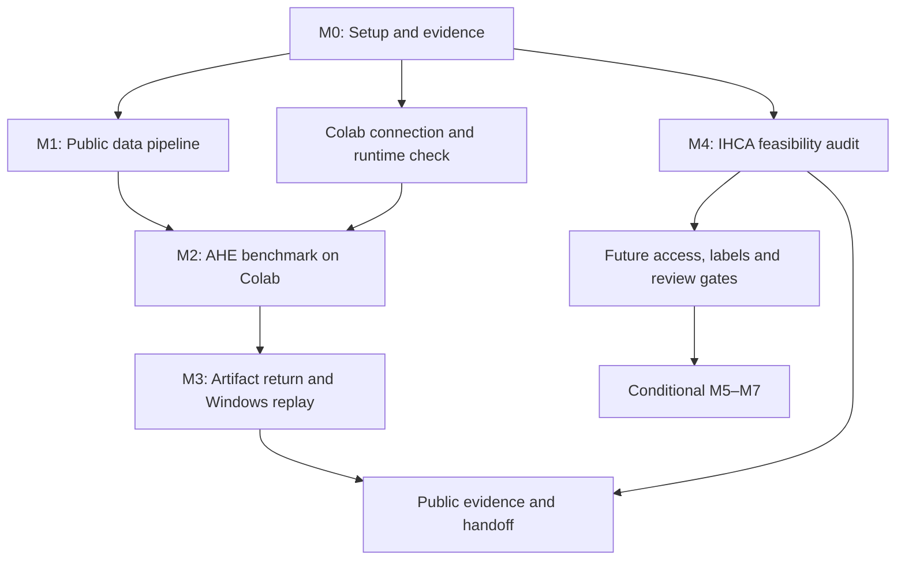

# CA-EWS as the first FORGE pilot: UX requirements

Reviewed 2026-11-24. Source: the complete user-supplied `CARDIAC_ARREST_MASTER_PLAN.md`, version 0.1.0, 580 lines; SHA-256 `494f1c2634a3d3529e3992e5188c4068acd4b8e1f31b48e7dc125dff665b2ec5`. Section references below refer to that attachment. This memo maps its requirements into FORGE; it does not independently validate its scientific references, dataset terms, or clinical claims.

The attachment is requirements input for the generalized FORGE AI workbench. Its embedded implementation contract is not a new instruction to create a separate medical repository or start experiments during this interview. The attachment's own implementation state is `NOT_STARTED`. All GUI flows below are proposals, not implemented features.

**Latest owner decision, 2026-11-24:** use the main Windows machine for public CPU work and **Google Colab for training**, superseding the earlier Runpod choice and the attachment's all-local training default. The owner subsequently confirmed the current tier is **Colab Free**. These choices apply to this reference prototype; FORGE remains provider-flexible, with no permanent free-only restriction. Proposed division: Windows acquisition/preparation/tests, Colab training/evaluation, and verified artifacts returned for Windows replay. The owner also requested LitServe MCP; serving through LitServe on Windows is proposed below. Account/API eligibility, actual runtime, time limits and session/artifact retention remain unqualified. No account connection, provisioning or experiment execution has happened.

**Proposed Free-tier UX:** start with the official browser-notebook connection path to qualify and retain the hosted API adapter as a separate eligibility check. Show one active training experiment initially, preserve completed trial outputs, and distinguish reconnect, supported checkpoint resume, recorded restart and waiting for resources. Keep the notebook visible and make it possible to take over. An upgrade is not a prerequisite; GPU availability and continuous execution are not promised. The owner has now selected **Google Drive + local Windows + a Git repository** together, with storage independently configurable in project Settings. Destination types are settled; actual account/folder/path/remote bindings remain for setup.

## 1. What the supplied plan settles

| Supplied requirement | Consequence for the FORGE pilot |
| --- | --- |
| M0–M4 initial delivery; M5–M7 conditional (§10, §14) | The first project is a public research workflow with an evidence-backed handoff, not immediate clinical deployment. |
| `AHE_1H` first executable benchmark; `IHCA_24H` long-term objective (§2, §5) | Show different endpoints and registries. AHE results cannot populate an IHCA risk panel. |
| Original CPU-first/local defaults (§0, §6.4, §9.1), amended by the owner to Windows public CPU + Colab training | The reference pilot must demonstrate a Windows→Colab→Windows run/artifact round-trip. Select an eligible runtime appropriate to the workload; Colab does not imply a required GPU or unlimited runtime. |
| Real trained baseline plus temporal comparator, held-out predictions, local replay (§7.3, §10) | A polished synthetic UI alone cannot complete the pilot. Poor or inconclusive model results may still satisfy engineering acceptance. |
| Synthetic fixtures and independent open-data work continue if a branch blocks (§0, §10) | Block the affected branch, retain its reason, and keep independent tasks available. |
| Full clinical data and derivatives remain in an authorized private environment (§4.3) | Future controlled work must have a separate execution/export boundary, not merely a badge on the public workspace. |

The first modality, dataset path, model ladder, and local deployment direction are now substantially specified. Do not ask the owner to choose them again as if no plan had been supplied.

## 2. Top three practical first-delivery scopes

| Option | First visible FORGE delivery | Tradeoff |
| --- | --- | --- |
| **1 — recommended: complete public research loop** | Import/review the plan; execute M0–M4 through FORGE; retain real AHE runs, notebooks, local model replay, GUI test evidence, and the separate IHCA feasibility report. | Best fit to the supplied definition of done and FORGE's training-to-inference promise. Requires the complete small vertical slice, rather than only a planner or trainer. |
| **2 — data/training first checkpoint** | Import the complete plan, then deliver M0–M2 with notebook/artifact review, actual fitted models, frozen evaluation, and evidence. Keep M3–M4 visibly pending. | Fastest checkpoint that proves real ML execution; replay/app delivery is deferred, so the whole pilot remains incomplete. |
| **3 — synthetic workflow rehearsal first** | Import/visualize the plan; rehearse bot assignment, failure states, replay controls, and output provenance with explicit synthetic fixtures. | Useful for testing no-code usability before data execution. It proves software behavior only; real acquisition/training and M0–M4 completion remain pending or blocked. |

Option 1 follows the supplied scope. Options 2–3 are staging choices, not alternative definitions of successful M0–M4 delivery. Controlled IHCA training is not a fourth shortcut to a more impressive demo.

## 3. Plan import and review in the T3-based shell

Proposed path: **New project → Import plan → Review extracted plan → Check Windows and Colab → Start pilot**.

1. Preserve the original document as a read-only project source with version/hash. Parse a draft goal, milestones, dependencies, acceptance criteria, resource envelope, and future gates. Display unresolved extraction questions; document text must not silently grant new tool, spending, or data-access permissions.
2. Show a concise overview: “Public AHE benchmark and local research replay; IHCA feasibility in parallel.” Put M0–M4 in active scope and M5–M7 in a collapsed conditional section. Expected outputs are marked **Planned** until real artifacts exist.
3. Show both selected execution targets and their separate resource limits before Start. The supplied 5 GB / 4 CPU-hour envelope is an original local planning reference, not measured usage or a Colab entitlement (§6.4). Inspect account/runtime eligibility and define remote time, storage, concurrency, retry and any spending limits separately.
4. Start ordinary engineering tasks under the reviewed scope and specified resource policy. Do not insert an owner confirmation after every milestone; surface only a material plan change or a new access/spending/sharing boundary. Keep the plan version associated with each run.

Proposed phase graph, preserving the plan's permitted parallelism:

The canvas, phase board, and task detail share IDs and state. Keep the supplied evidence vocabulary (`IMPLEMENTED`, `VERIFIED`, `NOT_RUN`, `FAILED`, `BLOCKED`, `INCONCLUSIVE`, etc.; §11.3). A card move cannot manufacture verification. Show implemented-but-untested explicitly; do not use “Done” to conceal absent run evidence. Exclude unopened future milestones from current completion totals.

## 4. Three independent labels for every result

**Endpoint, input origin, and output origin are separate dimensions.** A fitted model can run on synthetic inputs; a scripted trace is not fitted-model inference (§2, §9.2–9.4).

| Case | Required display | Permitted conclusion in this pilot |
| --- | --- | --- |
| AHE model on authorized retrospective AHE data | `AHE_1H` + actual input source + fitted model/run ID + split | Defined AHE retrospective results from the saved report; not arrest prediction. |
| Fitted AHE model on synthetic inputs | `AHE_1H` + **Synthetic input** + **Real model execution** | Inference/software behavior; not measured clinical or held-out performance. |
| No valid IHCA model | `IHCA_24H` + `MODEL_NOT_AVAILABLE`; null score | The model is unavailable. Never substitute AHE or display zero as low risk. |
| Scripted IHCA workflow fixture | Permanent **SYNTHETIC — NOT A MODEL PREDICTION** + scripted-output marker | Demonstration of workflow behavior only. |
| Future controlled IHCA run | Restricted environment, valid endpoint/model lineage, approval/export state | Only the scope supported by its eventual evidence and approved export policy; unavailable initially. |

Persist source-plan response fields including `task_id`, `model_id`, `run_id`, `input_source`, `index_time`, `horizon_hours`, `status`, nullable `score`, `score_type`, quality/coverage, abstention reason, synthetic-input flag, and scripted-output flag (§9.3). Render uncalibrated scores as scores. Keep test A/B, validation, endpoints, and measurement levels separate in comparisons.

## 5. Bot roles and assignment

Use the already-selected persistent team plus temporary helpers. Proposed persistent roles are **Lead** (plan/state/owner decisions), **Builder** (code, notebooks, app), and **Reviewer** (software tests, provenance, leakage checks, reproduction evidence). Add temporary data-engineering, ML-experiment, and UI/QA helpers only for concrete tasks. A single provider/account may serve several roles.

Every task has one accountable owner, an actual T3 thread, deliverables, acceptance evidence, and a blocker reason where relevant. Show the trained **research model** separately from the **coding assistant/provider**: the plan does not require an LLM in the clinical predictor (§6.2), while FORGE's agents still use coding harnesses.

Do not label a bot “clinical approver” or treat its review as qualified clinical oversight. The plan explicitly leaves unfilled clinical roles unfilled (§13). Clinical/access gates belong to the owner and appropriately qualified people later; they do not block independent public work now.

## 6. Required no-code surfaces

| Surface | First-pilot behavior |
| --- | --- |
| **Plan / Board / Task detail** | Review phase purpose, responsible bot, dependencies, current state, next action, and evidence. Open the associated T3 conversation or diff. |
| **Data and access** | Dataset/version/access class, actual acquisition/audit state, split manifest, and label feasibility. No invented counts. The public pilot does not offer arbitrary real-patient-file upload (§9.3). |
| **Notebooks** | Planned/available/verified notebook artifacts; execution status and run IDs; useful output preview; Open in configured Jupyter/Colab where permitted. A full embedded JupyterLab editor is not needed to create/run `.ipynb`. The package/CLI remains reproducible execution, per §8.2. |
| **Experiments and research models** | Baseline/temporal comparisons within the same endpoint and split; actual metric files, uncertainty, feature schema, dataset/split hashes, preprocessing and trusted model artifact. Keep failed runs. |
| **App preview and replay** | Open the generated local research app; explicit replay clock, play/pause/step/reset, causal history, data-quality states, horizon, and prediction inspector. Future observations/event markers stay hidden until their replay time (§9.2). |
| **Evidence and delivery** | Download approved reports and reproducibility metadata; inspect real screenshots/test outcomes and known limitations. Missing artifacts remain unavailable. Training/inference verification and research conclusions are different statuses. |
| **Runtime / monitoring** | Windows and Colab identity, real execution state/logs, measured telemetry and artifact-transfer state; no invented progress percentage. Track runtime/session/execution IDs internally. Distinguish interrupted code, closed session and deleted runtime; preserve outputs before destructive cleanup. Production monitoring and live hospital alerts are outside this pilot. |
| **Desktop target** | Identify current Windows versus a separate desktop, its controller, and Stop/Take over. Replay browser QA alone does not verify FORGE's full native-desktop capability; that remains a separate platform acceptance item. |

Preserve two UI layers: FORGE's T3-based workbench remains Thai-first with English available. The supplied plan describes the generated research application's English default and optional later TH/EN switch (§9.1). That application-specific preference does not replace FORGE's established language preference. Its suggested FastAPI/React stack is an output-project choice, not a replacement FORGE server.

**Proposed prototype serving:** preserve the FastAPI/React replay app and one shared, versioned prediction package. The requested LitServe integration is proposed as a separate process on Windows exposing that predictor through REST and MCP; the replay app can call its REST endpoint. Verify both routes against the same saved preprocessing/model and fixed inputs. LitServe is selected for this pilot but remains an optional serving/export adapter for other projects, not FORGE's mandatory backend. Its documented `/mcp/` feature exposes a LitAPI as tools; it does not orchestrate Colab training. [Official feature](https://lightning.ai/docs/litserve/features/mcp)

Google now documents a [remote Colab MCP](https://developers.google.com/colab/api/reference/mcp) with runtime/session/code operations and separate HTTP file transfer. This is distinct from the [browser-linked Colab MCP](https://github.com/googlecolab/colab-mcp). Qualify the selected connector's authentication, eligibility and host support; do not assume browser-only capability or persistent Colab serving. See the [compute audit](COMPUTE_MCP_RESEARCH.md) and [serving audit](TRAINING_MONITORING_MCP_RESEARCH.md).

**Confirmed storage UX:** provide **Project → Settings → Storage & Sync**. For this pilot, propose Drive for checkpoints/model bundles, Windows for the working copy and verified inference artifacts, and the output project's Git repository for source/notebooks/config/reports/manifests. Let the user edit file routing and sync timing, select folders/remote/branch through GUI, and distinguish local saves, commits and remote pushes. Show per-destination status and retry/restore; training complete does not imply synchronization complete. Another project may select a different combination. Do not assume the generated project's Git remote is the FORGE source repository. See [Project Storage Settings](../PROJECT_STORAGE_SETTINGS_TH.md). This is a specification, not an implemented Settings screen or connected storage.

## 7. Future branch and export boundaries

Keep M5–M7 visible with reasons such as missing authorized access, insufficient label timing/grouping, or required human review (§4.3, §5.2, §10). A schema audit can finish while IHCA training remains `BLOCKED_LABELS`; those are different tasks. Optional ECG/sepsis tracks stay outside the initial scope.

The supplied plan forbids controlled rows, screenshots, data-bearing logs, derivatives, and weights from entering external coding agents or unapproved services. A future restricted workspace therefore needs enforced connector/export rules, not just a privacy label. MCP availability and desktop screenshot access do not override that boundary. Approved aggregate summaries are a separate export artifact. Colab training is now selected for the reference prototype; that choice does not authorize controlled-data transfer, a billing upgrade, SaaS experiment tracking, public deployment or other external sharing.

This memo adopts the attachment's research-only boundary as a project requirement. It makes no independent clinical, regulatory, or dataset-licensing determination; actual source terms and access are checked when the corresponding task is authorized.

## 8. Only unresolved owner decisions

**Confirmed for this prototype:** main Windows for public CPU work, Colab Free for training, and Google Drive + Windows + project Git storage; do not ask the owner to repeat these choices. **Necessary before the first real run:** bind the selected destinations to real accounts/folders/paths/project remote, inspect eligible runtimes, and establish execution limits plus sync/retention policy. Setup should inspect rather than ask the owner to guess capabilities. A separate desktop remains supported in FORGE's product direction; a Colab kernel is not automatically that desktop or a persistent inference deployment.

**Optional staging decision:** choose an earlier visible checkpoint from options 2–3 if desired. Otherwise retain the supplied M0–M4 scope (option 1); do not ask the owner to reconfirm the use case, dataset, model ladder or selected Windows/Colab topology.

Colab account/runtime access and any additional spending remain unverified. Credentialed data, clinical collaborators, prospective evaluation, public portfolio release, and commercial deployment remain future branch decisions. Bot names, routine package choices, diagram libraries, and default feature parameters are engineering choices, not another owner interview. Other FORGE projects can select different compute and serving providers.

## Acceptance consequence for FORGE

The recommended pilot proves a reusable product sequence: **import a supplied plan → review an executable phase graph → coordinate bots → prepare public inputs on Windows → run real experiments on Colab → verify returned notebooks/models/evidence → exercise the Windows inference UI and selected LitServe MCP endpoint → hand off reproducible results**. Verify reconnect without duplicate execution, matching local/reference inference within a documented tolerance, and the final resource state. Its research constraints and selected providers live in project policy and metadata; FORGE remains a general AI engineering workbench. Neither good benchmark numbers nor a synthetic demonstration substitutes for the required evidence.
