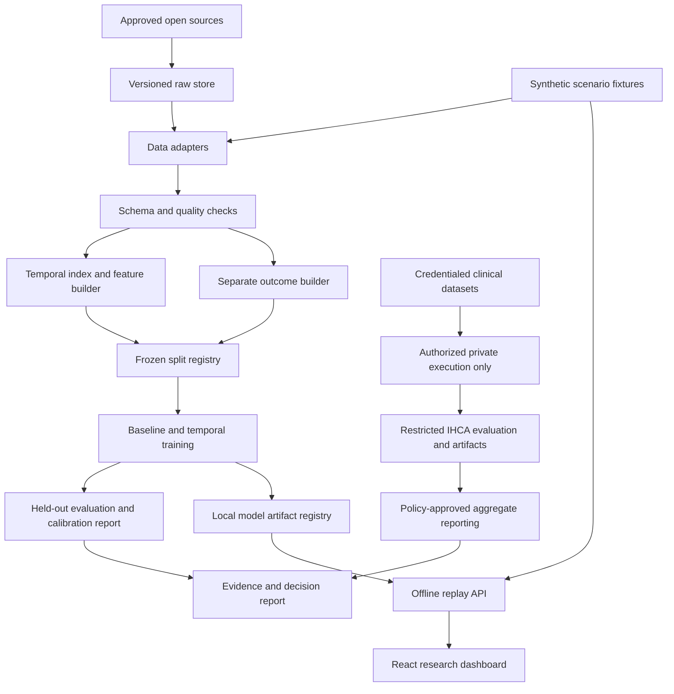

# MASTER PLAN — Cardiac Arrest Early Warning System

**Project ID:** CA-EWS | **Version:** 0.1.0 | **Date:** 2026-11-24  
**Document status:** Draft execution specification for owner and coding agents  
**Product domain:** Cardiovascular care, intensive care, hospital deterioration monitoring  
**Current authorization:** Local, retrospective research PoC only  
**Implementation status:** NOT_STARTED. No data downloaded, model trained, clinical evaluation performed, or software deployed by the author of this plan.

> **Research use only. Not a medical device ready for use.** The PoC must never be used for patient monitoring, clinical decisions, triage, emergency activation, treatment recommendations, or reassurance. All user-facing demonstrations use fictional data or appropriately authorized, explicitly labeled retrospective research outputs. A high-performing proxy model is not a cardiac arrest prediction model.

## 0. Agent execution contract — read first

You are the implementation agent, not a clinical decision maker. Your assignment is to produce a small, reproducible, runnable AI research system and a defensible evidence package, not simply a proposal, notebook screenshot, or UI that simulates model performance.

### Mission and autonomy

1. Inspect the workspace, existing files, runtime, available disk, CPU/GPU, and applicable repository instructions before writing code. If no project exists, create a new isolated project directory named `cardiac-arrest-early-warning` and initialize a local repository. Do not overwrite another project. This plan is the scope of work, not an instruction to modify other Medical AI Portfolio projects.
2. Work toward measurable deliverables, not arbitrary calendar deadlines. Complete the public-data path M0–M4 without waiting for credentialed datasets. For each milestone, implement, run, inspect, repair, and record evidence. Move forward when the relevant acceptance criteria are satisfied; preserve unsuccessful results.
3. Use safe defaults and resolve ordinary engineering choices autonomously. Ask the owner only when a decision genuinely requires new authorization (e.g., credentialed data, paid infrastructure, external sharing, clinical collaboration). Do not turn missing access into a global stop; continue the independent public-data and simulation work.
4. Prefer a working CPU baseline over elaborate neural architectures. No cloud/GPU rental, paid API, new subscription, remote push, or deployment without explicit authorization. No Scite dependency. Public-source retrieval, dependency installation into a project environment, local tests, and local open-data training are in scope, subject to dataset terms and resource limits.
5. Do not fabricate data, metrics, experiments, citations, dataset access, clinical review, or tests. Distinguish real trained-model output, synthetic fixtures, offline replay, and future product concepts. A numerical result generated by a mock model is not experimental evidence.
6. Treat `GOAL.md`, `PLAN.md`, `AGENTS.md`, `STATUS.md`, and the frozen experiment manifests as the operational record. Generate those files during M0 from this specification. Record deviations and justification. This plan takes precedence over convenience defaults, but never over platform, legal, ethical, or dataset restrictions.

### The immediate outcome

By the end of the first implementation cycle, deliver a real trained **acute hypotension prediction** baseline on a public dataset, a tested temporal data pipeline, a local replay dashboard, and a documented cardiac-arrest cohort feasibility audit. The eventual scientific goal is a model for **in-hospital cardiac arrest (IHCA) before onset**, evaluated on eligible clinical data with reliable event timestamps. Until that evidence exists, the arrest prediction feature remains locked and explicitly marked as unavailable or synthetic-only.

## 1. Executive summary and product hypothesis

### 1.1 Intended future product

A hospital research-to-product system that studies whether longitudinal vital signs can support earlier recognition of patients at risk of IHCA. It is intended, after appropriate validation and authorization, to complement rather than replace existing early-warning scores, bedside assessments, and hospital escalation procedures. Initial modeling is restricted to adult ICU data because the reference studies and available datasets support that setting. General wards are a future target requiring independent data and evaluation; ICU results cannot be assumed to generalize.

### 1.2 Why this is worth investigating

- Hospitals already use early warning and deterioration monitoring processes. Siriraj's published SiCTT by MEWS is a concrete Thai example of an existing process for recognizing pre-arrest deterioration [R1]. The commercial proposition cannot be merely a digital score or dashboard.
- The technical hypothesis is that temporal patterns, missingness-aware processing, and calibrated predictions can improve event detection at a manageable review burden relative to simple scores and statistical baselines.
- The business hypothesis is that a hospital quality/patient-safety program can benefit from better prioritization of retrospective review and, eventually, a clinically validated complementary alerting system. Whether it reduces staff burden, complications, or costs is unknown.
- The team has limited access to local clinical records. Open and demo data must prove engineering feasibility first; credible clinical data and qualified clinical partners are prerequisites for real product claims.

### 1.3 Proposed stakeholders and success criteria

| Role | Future interest | What must be proven |
|---|---|---|
| Ward/ICU nurses and physicians | Reliable context, understandable results, manageable review load | No additional harmful workflow burden; usability and appropriate escalation integration |
| Rapid response / critical care teams | Timely, actionable information in existing workflows | Appropriate lead time, event sensitivity, and alert burden under local protocols |
| Quality and patient safety department | Deterioration and incident review | Auditability, completeness, measurable improvement in agreed indicators |
| Hospital IT and security | Interoperability, reliability, data governance | Read-only integration feasibility, access controls, monitoring, support effort |
| Hospital management / procurement | Evidence and total cost | Credible local effectiveness and value, approved procurement pathway |

**No buyer, budget, reimbursement, regulatory classification, or commercial outcome has been confirmed.** An offline model metric alone does not establish clinical or financial value.

## 2. Scope and research tracks

Keep separate task IDs, labels, artifacts, metrics, model registries, and UI terminology. Never pool these endpoints into a single binary outcome called cardiac arrest.

| Track ID | Task | Initial status | Permitted claim |
|---|---|---|---|
| `AHE_1H` | Predict acute hypotensive episodes over the next hour | Active, public-data path | Retrospective performance for the defined hypotension endpoint only |
| `IHCA_24H` | Predict first eligible in-ICU cardiac arrest over the next 24 hours | Data audit active; training conditional | IHCA research performance only after valid event labels and evaluation |
| `IHCA_6H` / `IHCA_12H` | Prespecified secondary shorter horizons | Conditional, after primary cohort is frozen | Separate exploratory metrics; no cherry-picking |
| `ECG_VA` | Detect/describe ventricular arrhythmia from recorded ECG | Optional, after M4 | Rhythm detection or precisely defined pre-event analysis, not IHCA prediction |
| `SEPSIS_PROXY` | Larger-scale temporal pipeline stress test | Optional fallback only | Sepsis benchmark only; not a cardiac endpoint |
| `SYNTHETIC` | Simulate data quality, UI, and workflow edge cases | Active | Software behavior only |

**Primary focus:** `IHCA_24H` is the long-term scientific objective; `AHE_1H` is the first executable engineering benchmark. Do not spend the initial cycle on optional ECG, sepsis, or post-arrest prognosis unless there is a concrete blocker or owner-approved reason.

**Out of scope:** live hospital integration, actual notifications to care teams, autonomous interventions, treatment or resuscitation advice, AED/device control, definitive diagnosis, individual patient-facing risk predictions, post-arrest prognosis as a substitute endpoint, claims of prevented arrests, commercial release, and access to local hospital records without authorization.

## 3. Reference evidence and research questions

### 3.1 Starting evidence (not a novelty claim)

Kim et al. (2024) studied explainable ICU cardiac arrest prediction using longitudinal vital signs, a 12-hour history, hourly estimates for a 24-hour horizon, and TabNet-based modeling across MIMIC-IV and eICU [R2]. The full article and supplementary source-code information are the reproduction starting point. The paper has a published correction [R3]. The agent must inspect the corrected article, supplement, exact version, cohort rules, event ascertainment, and evaluation definitions before declaring a reproduction. Do not assume the current release of MIMIC matches the paper's data version or that reported cohort counts are universal. Report any discrepancy rather than silently correcting it.

### 3.2 Prespecified research questions

- **RQ1 — Feasibility:** Can an auditable, time-respecting pipeline reproduce a public deterioration benchmark end to end with actual fitted models and held-out predictions?
- **RQ2 — Incremental value:** For valid IHCA cohorts, do temporal features improve precision-recall performance and event recall relative to latest-value models and a properly implemented existing score at comparable review burden?
- **RQ3 — Robustness:** How does performance change under irregular or missing measurements, different ICU types, and independent hospitals/datasets when such strata and permissions exist?
- **RQ4 — Usability and calibration:** Can the system communicate data insufficiency and retrospective uncertainty without creating unjustified confidence? Does calibration hold under the target cohort's event prevalence?
- **RQ5 — Business translation:** If the model adds clinical value, what staff workload, integration costs, and evidence would be needed for a Thai hospital to justify adoption?

Potential contribution: an interpretable, low-frequency/missingness-aware temporal model evaluated with realistic replay and matched alert burden. This is a **candidate hypothesis**, not an established literature gap. Confirm against recent reviews and competitor literature in M0/M5. A well-supported negative result is acceptable; do not invent novelty to force a paper.

## 4. Data strategy and access controls

### 4.1 Dataset registry (public sources checked 2026-11-24)

| Dataset / pinned starting version | Access | Role and limitations | Reference |
|---|---|---|---|
| PhysioNet/CinC 2009 — acute hypotension, v1.0.0 | Open, ODC Attribution v1.0 | 60 designated training records and 50 official test records (A: 10; B: 40). Test answers and future segments are now public; strictly isolate them. Small selected cohort; NOT cardiac arrest. | [R4] |
| eICU-CRD Demo v2.0.1 | Open; verify current terms | More than 2,500 unit stays from 20 larger hospitals. Schema, timing and label feasibility only initially; site identifiers removed. Confirm event availability and provenance, not guaranteed. | [R5] |
| MIMIC-IV Demo v2.2 | Open; verify current terms | Small demonstration cohort; adapter and query development. Never treat as a statistically sufficient arrest cohort without audit. | [R6] |
| MIMIC-IV v3.1 | Credentialed; DUA and training | Candidate full development cohort. Check the reference paper's actual version and extraction compatibility; do not silently use an alternative version. | [R7] |
| eICU-CRD v2.0 | Credentialed; DUA and training | Candidate external test cohort. Harmonize outcome and features before comparison; each researcher needs authorized access. | [R8] |
| Sudden Cardiac Death Holter v1.0.0 | Open; verify terms | Historical long-term ECG including pre-event periods in selected SCD cases; incomplete audited annotations, limited controls. Optional, not a ward/ICU risk cohort. | [R9] |
| CU Ventricular Tachyarrhythmia v1.0.0 | Open; verify terms | 35 short recordings with ventricular tachyarrhythmias. Optional rhythm analysis, not general risk prediction. | [R10] |
| Nightingale NTUH cardiac arrest ECG | Controlled access through Globus | ECG-based case/control research, with selection and timing constraints. Contains peri/post-arrest records as well as prior ECGs. Not an equivalent longitudinal vital-sign cohort. | [R11] |
| PhysioNet/CinC 2019 Sepsis v1.0.0 | Open; verify terms | Optional larger hourly clinical-data stress test; explicitly distinct endpoint and official evaluation protocol. | [R12] |

The previously discussed Zenodo Bed Head Ticket dataset is **not a dependency**: access to its landing page was not independently verified in this preparation, and reported survival/mortality labels must not be substituted for timed IHCA. If explored later, verify the actual files, data dictionary, paper and label semantics before registering a separate task.

### 4.2 Acquisition rules

Create `configs/datasets.yaml` and `data/manifests/` with dataset ID, pinned version, landing URL, approved use, actual access class, license/DUA reference, retrieval date, selected file URLs, checksums, sizes, schema version, and owner authorization (if applicable). Verify upstream notices at acquisition time. Do not call a dataset "open source" merely because its article is open access.

For M0/M1, prioritize the smallest relevant numeric files and a few records for a smoke test. Confirm where training data and labels are actually hosted from the official challenge links; the project listing and older archive layouts may differ. Do not recursively mirror every waveform, paper, plot, or archive. Download only necessary files, using resumable transfers and checksum verification. Store raw files immutably outside Git. If a transfer fails, retry boundedly, use official alternatives, and record `BLOCKED` instead of inventing replacements.

For AHE, read the task definition and record naming/segment convention before parsing. Record the exact official index time T0, group labels, available observation segment, and forecast horizon per record. Any after-T0 segment, public test answer, or future-derived label feature must be segregated from model inputs. Do not assume a generic WFDB file name or channel layout; inspect headers first.

### 4.3 Credentialed-data boundary (mandatory)

MIMIC-IV/eICU full releases require individual credentialing, prescribed training, and acceptance of the applicable DUA [R13]. The owner handles identity, institution, approval, and DUA obligations; the agent must not impersonate a researcher or accept agreements on the owner's behalf.

- Use a separate, explicitly authorized local/private workspace for controlled data. Do not share credentials or raw data with collaborators who lack individual rights.
- **Do not send controlled rows, notes, waveforms, screenshots, patient-level outputs, derived datasets, model weights, secrets, or data-bearing terminal logs to GPT Work, ChatGPT, cloud coding agents, public repositories, external LLM APIs, plugins, or unauthorized services.** PhysioNet publishes specific restrictions and guidance [R14]. This project adopts a conservative local-only rule for the credentialed track until an explicit compliance review authorizes a different arrangement.
- Develop code with synthetic fixtures and approved open data in the agent environment; execute credentialed jobs locally by an authorized researcher using sanitized code and controlled storage. Only policy-approved, nonidentifying aggregate summaries may be transferred. No unapproved telemetry or experiment SaaS.
- Treat models and derivatives of MIMIC as restricted pending review, consistent with upstream guidance. Do not automatically publish weights or example predictions.
- Keep raw, processed, restricted artifacts, checkpoints and logs out of Git. No re-identification or joining external identity sources. Open data is still health data; follow its terms and use synthetic public demos by default.

## 5. Target definitions and temporal data protocol

### 5.1 Public task: `AHE_1H`

Implement the official 2009 challenge endpoint: an acute hypotensive episode beginning within the forecast interval after T0. Use official group labels and scoring definitions, not an independently invented threshold. Extract only available historical signals at or before the approved cut-off; implement the exact inclusion boundary from the challenge documentation. For the first baseline, use numeric MAP and other available vital-sign series (where verified) rather than high-frequency waveform processing. Start with up to the final 10 hours of historical data; document any difference from the official available history. Assess channel presence before committing feature sets.

Train on official training records only. Develop using grouped, stratified cross-validation where feasible. Do not use test groups to choose features, preprocessing, thresholds, or models. Because published answers are now accessible, do not describe the test as a truly blind prospective validation. Evaluate test A and B separately using their official labels and metrics. Also report descriptive classification metrics with uncertainty; the selected test cohorts are unsuitable for estimating real-world incidence or clinical workload.

If independent patient IDs cannot be verified for the challenge, group by original recording/subject mapping as available, check duplicate/overlapping signals, and explicitly report unresolved subject overlap. Never claim proven patient independence merely because filenames differ.

### 5.2 Primary task: `IHCA_24H` (conditional)

The following is the proposed protocol for a **new experiment**, not a description of the exact reference study. A clinical/label review must precede model performance claims.

- Population: adults aged 18 or older, ICU stays with interpretable time axes and required data. Use first eligible in-ICU arrest in each hospital admission as primary endpoint; maintain a stable patient-level group for all admissions/stays. A general ward cohort is a separate future study.
- Index time `t`: hourly during eligible ICU observation. Start after 12 hours of observable in-stay history for the main experiment; report excluded early events. Use history `[t-12h, t]` only when all information was actually available by t.
- Prediction window: `(t, t+24h]`; set `y=1` if the verified first eligible IHCA occurs in that interval while the patient remains under the relevant observation setting. Events at or before t are not positives for future prediction and no post-event windows are eligible.
- Negative windows: require reliable absence of the endpoint throughout the horizon under the chosen at-risk definition. For discharge, transfer, death without verified arrest, or loss of observation before the horizon ends, treat as censored/competing outcomes according to a prespecified policy. Conservative initial option: exclude incomplete negative horizons and quantify resulting selection bias; do not automatically call them negatives. Consider competing-risk analysis only after the primary baseline.
- Main eligibility and exclusions: define prior arrest, arrest present at admission, ambiguous onset, repeat events, planned procedures, and care-limitation status before splitting. If care-limitation information is absent or unreliable, state that limitation; do not silently infer it from death or missing observations. Report exclusions and pre-index data coverage.
- Label evidence: map event-time fields and codes from official dictionaries. A discharge diagnosis code, death timestamp, shockable rhythm, medication, or generic deterioration by itself is insufficient to establish onset. Resuscitation-related procedure/treatment times can be candidate proxies only with documented provenance and review; distinguish confirmed from proxy and uncertain labels. Do not equate event documentation time with onset without justification. Remove ambiguous cases from the primary analysis, quantify them, and run a sensitivity analysis only if appropriate.
- Data availability: use measurement time AND chart/availability time where present. If availability time is unavailable, explicitly document optimistic assumptions and evaluate simulated recording delays. Never use backfilled measurements, intervention information that reveals the event, outcome codes, discharge outcomes, future length of stay, or future imputation as predictors.
- Predefine alternate horizons 6h and 12h and minimum actionable lead-time sensitivity analyses. Do not optimize the primary horizon on the test set.

Produce `docs/ENDPOINT_SPEC.md`, `docs/COHORT_SPEC.md`, a source-specific label mapping, a cohort flow diagram, and a label-quality report. If reliable event times or patient grouping cannot be established, mark `IHCA_24H` as `BLOCKED_LABELS`; continue M0–M4. A weaker proxy may be studied under a new task ID only, not silently promoted to the IHCA endpoint.

### 5.3 Canonical data contract

Represent a long-form observation as:

| Field | Meaning |
|---|---|
| `dataset_id`, `dataset_version`, `task_id` | Explicit lineage and endpoint |
| `patient_key`, `encounter_key`, `stay_key` | Source-scoped pseudonymous research keys; never reveal in public UI |
| `site_key` | Optional, only where legitimately available |
| `observed_at`, `available_at` | Source-relative time, normalized to a documented axis; nullable availability with flag |
| `variable`, `value`, `unit`, `source_field` | Canonical variable and provenance |
| `quality_flag`, `missing_reason` | Invalid, absent, stale, interface unavailable, unknown, etc. |

Separate outcome table: `stay_key`, `event_type`, `event_time`, `event_evidence`, `label_certainty`, `observation_end`, `censor_reason`. Separate index table: `stay_key`, `index_time`, `lookback_hours`, `horizon_hours`, `label`, `eligible`, `exclusion_reason`, `split`. Never merge outcome fields into the feature matrix by wildcard joins.

Minimum candidate variables: HR, RR, SBP, DBP, MAP, SpO2, temperature. Secondary contextual variables (age, consciousness/AVPU, oxygen-support flags) only if reliably available before index and compatible across sources. Record units, measurement source (invasive/noninvasive), plausible-range handling and dictionary mapping. Do not invent missing score components; an incomplete EWS is reported as unavailable unless a separately named, prespecified research approximation is justified.

## 6. Modeling and experiment design

### 6.1 Preprocessing

1. Preserve raw data. Parse timestamps, units, duplicate records, and provenance. Resolve duplicates via documented deterministic rules. Invalid values become missing with flags, not arbitrary clipped "normal" values.
2. Construct causal bins (hourly for IHCA; verified cadence for AHE). Aggregate only observations available by the index. Use latest, median, minimum/maximum, variability, slope, measurement count, and time-since-last-observation in prespecified subwindows (e.g., 1h/4h/6h/12h for IHCA). Record the exact feature definitions.
3. Fit imputers, scalers, feature selection, outlier cutoffs learned from data, and class balancing only on development-training folds. Use causal bounded forward-fill when justified; include missingness indicators; no backward fill, future interpolation, or fitting on test data. No unconditional conversion of absent to zero.
4. Test whether missingness and measurement frequency carry site-specific or workflow-specific signals. Include an ablation without these features and a missingness-only baseline to identify reliance on documentation patterns.
5. Use a shared `FeatureBuilder` and task-specific configuration. Enforce identical feature schema for training and inference. Save the transformation with the model.

### 6.2 Model ladder (default)

| ID | Model | Why and when |
|---|---|---|
| B0 | Prevalence-only / constant score | Sanity check and discrimination reference |
| B1 | Simple endpoint-appropriate rule or current-value statistical baseline | AHE: pre-index MAP-based comparator defined on training data. IHCA: documented MEWS/NEWS variant only if required inputs are available. No use of the future AHE definition as a predictor. |
| B2 | Regularized logistic regression on latest values | Transparent, inexpensive baseline |
| B3 | Logistic regression on temporal features | Tests value of temporal summaries without model complexity |
| B4 | Gradient boosting (XGBoost or scikit-learn histogram boosting) | Main nonlinear tabular model, class-aware training |
| B5 | Random forest | Optional secondary baseline when resource budget permits |
| N1 | Small GRU or TCN with masks/time gaps | Conditional: only after temporal baseline, sufficient data, and an identified research question |
| N2 | TabNet | Conditional: reproduce corrected reference protocol where feasible; version/license check first |

No LLM is required in the predictor. Do not train a transformer merely to increase perceived novelty. Model selection must be justified by validation results and resource cost. On the 60-record AHE training set, keep the parameter search small and regard results as exploratory. Train simple baselines first; if a model performs poorly, keep the run and investigate rather than changing the test set.

Use class weighting or carefully documented training-only sampling if needed. No window-level oversampling across splits. Evaluate on original held-out distributions; calibrate on an independent development partition or out-of-fold estimates where sufficient. No calibration fit on test outcomes.

### 6.3 Split and leakage policy

- Register immutable split manifests with hashes, source versions, grouping keys, label counts and creation seed **before model comparison**.
- AHE: preserve official train/test separation; group internal folds at patient level if identifiable, otherwise strongest defensible recording groups. Record that the historical challenge labels are public.
- IHCA: grouped by patient across stays and windows. For development, target a grouped train/validation/held-out test allocation (e.g., 70/15/15 only if counts permit); prefer grouped cross-validation and a held-out test when events are sparse. Stratify at patient/event level when possible. Never split a person's windows across partitions. Where legitimate calendar chronology exists, add a temporal test; do not compare shifted dates across patients without source support.
- External evaluation: freeze model, preprocessing, calibration, thresholds and mapping on MIMIC development data before eICU test. Harmonize endpoint and features, report source/site differences, and distinguish transfer without adaptation from a separate prespecified recalibration study. Demo stays may overlap with full releases; never treat demo and full data as independent validation datasets. Exclude known duplicates or explicitly downgrade the claim if overlap cannot be checked.
- Audit features and joins for event-derived fields, diagnosis proxies, future availability, discharge information, row/window leakage and repeated recordings. Add automated "future perturbation" test: altering data strictly after t must not change features or prediction at t. Add a shuffled-label sanity check and inspect unexpectedly strong results.

### 6.4 Compute defaults and reproducibility

Use Python 3.11 or 3.12 with compatible pinned packages (resolve and record actual versions): numpy, pandas/polars, pyarrow, scikit-learn, WFDB, joblib, pytest; optional DuckDB, xgboost, matplotlib, PyTorch. Use a project virtual environment and lockfile. Default CPU execution with capped workers (e.g., 4 threads or fewer), seed 42 for first run, and 3 prespecified seeds for feasible stochastic experiments. Record Python/OS/library versions, hardware, command, config hash, wall time, peak memory if available, data hash and exit status.

Initial proposed resource envelope: no paid compute; check disk first; target up to 5 GB of additional workspace for the public path and up to 4 CPU-hours for initial experiments. These are planning limits, not measurements or guarantees. Stream selected data, avoid full waveform archives, and stop before exhausting storage. If resource requirements exceed defaults, finish smaller experiments and request authorization only for the expansion. Do not automatically move to external GPU/cloud. Use Parquet and DuckDB for larger local tables; full credentialed releases need a separate storage estimate.

## 7. Evaluation, uncertainty and decision gates

### 7.1 Required metrics

| Metric | Definition / reporting requirement |
|---|---|
| AUROC | Threshold-free discrimination; report alongside PR metrics, not alone |
| Average precision (AP) / AUPRC | Report AP with exact implementation; distinguish trapezoidal PR-AUC if also computed. Include positive prevalence reference. |
| Sensitivity, specificity, PPV, NPV | Report at frozen validation-selected thresholds; give counts and confidence intervals. NPV does not establish safety. |
| Brier score, calibration plot/intercept/slope | Assess probability quality where sample size permits; otherwise label not estimable. Compare with prevalence baseline. |
| Event recall (IHCA) | Number of eligible first events with at least one qualifying pre-event alert / eligible first events. State lead window and minimum lead time. |
| False alert episodes per 1,000 at-risk patient-days (IHCA) | False episodes / observed eligible at-risk hours * 24,000. Use a defined episode policy and report denominator and coverage. Do not extrapolate from the selected AHE challenge cohort. |
| Alert PPV and review burden (IHCA) | True alert episodes / all adjudicable episodes; total alerts and alerts per patient-day, with a clear event association rule. |
| Lead time (IHCA) | Event timestamp minus first qualifying alert in the prespecified window; summarize median/IQR and distribution among detected events, with missed events reported separately. |
| Coverage | Number of valid scored windows / all eligible windows; report unscored events and reason. Do not drop them from event recall denominator solely because the model abstained. |
| Runtime and review cost | Inference latency on target local hardware, total replay time, and future measured human review time (NOT_RUN until measured). |

For AHE, report official test A/B results, confusion counts, AP/AUROC when estimable, and small-sample uncertainty. Do not compute ward alarm burden from single-record benchmark outcomes. For IHCA, report window-level and event-level results separately; use patient-cluster bootstrap (e.g., 1,000 draws with fixed seed where adequate) and paired comparisons on the same held-out patients. If estimates are unstable or bootstrap folds have no positives, report not estimable or broad intervals and avoid strong conclusions.

### 7.2 Alert replay protocol (research only)

Define a deterministic state machine operating on historical/synthetic streams. Example simulation configuration: hourly inference, validation-selected threshold, 6-hour suppression after an alert, no repeated notification while suppressed; explicitly define reopening and gap handling. These parameters are research controls, not hospital recommendations. Compare models with exactly the same episode semantics and matching policy. A qualifying true alert must precede an eligible event within the frozen horizon; an episode with insufficient future observation is unadjudicable, not automatically false. Do not count multiple alerts as multiple prevented events. Use separate event recall and alert precision denominators. Show how recall and burden change with threshold on validation; lock selected operating points before test.

### 7.3 Milestone acceptance is not clinical approval

- **Engineering pass (public PoC):** actual files acquired lawfully, reproducible split, baseline and temporal model trained, held-out predictions generated, metrics computed, leakage tests passing, real local inference replay verified. No minimum clinical accuracy is required for the engineering pass. Poor model performance remains an important result.
- **Scientific feasibility (IHCA):** meaningful event definition and timing, independent patient grouping, documented censoring, adequate event counts/precision assessment, comparable baseline, and no critical leakage or access violations. Calculate required sample size or precision needs based on observed counts, rather than setting an arbitrary clinical sample threshold. If inadequate, report exploratory only.
- **Proposed research go criterion:** test incremental temporal-model utility at prespecified, matched alert burden. Report paired changes in event recall, AP and calibration with uncertainty. A temporal model may proceed to deeper study if it shows plausible improvement without a material coverage or calibration penalty; if differences are inconclusive, classify `INCONCLUSIVE`, not `PASS_CLINICAL`. Lock a quantitative margin with a clinical partner before any confirmatory study. If no clinically informed operating point exists, report research curves without asserting an acceptable burden.
- **Hard stop for affected branch:** invalid labels, prohibited data transfer, confirmed temporal leakage, test contamination, absent patient grouping required for the claim, non-reproducible metrics, or UI displaying mock outputs as real. Repair or downgrade the claim; continue independent safe tasks. No clinical go decision is authorized by this plan.

## 8. System architecture and repository structure

### 8.1 Architecture



The controlled IHCA environment is separate; the diagram intentionally contains no path from restricted clinical rows or model files to the public dashboard or external agent. Reuse tested source code by approved transfer, not by copying protected data.

### 8.2 Suggested repository tree

```text
cardiac-arrest-early-warning/
  AGENTS.md                  # executable agent constraints
  GOAL.md                    # product and research objectives
  PLAN.md                    # milestone tracker derived from this document
  MASTER_PLAN.md             # this specification
  README.md                  # setup, commands, limitations
  STATUS.md                  # evidence-backed progress
  HANDOFF.md                 # next steps and reproducibility notes
  pyproject.toml
  requirements.lock          # or equivalent pinned environment
  .gitignore
  configs/
    datasets.yaml
    ahe_1h.yaml
    ihca_24h.yaml
    replay.yaml
  data/                      # ignored except manifests/templates approved for sharing
    raw/
    interim/
    processed/
    manifests/
  src/caews/
    ingest/
    quality/
    endpoints/
    features/
    splits/
    models/
    evaluation/
    replay/
    api/
  notebooks/
    00_data_audit.ipynb
    01_ahe_baselines.ipynb
    02_ihca_schema_feasibility.ipynb
  scripts/                   # thin reproducible entry points
  frontend/                  # React + TypeScript
  tests/
    fixtures/                # synthetic only
    unit/
    integration/
    leakage/
    e2e/
  artifacts/                 # ignored; model and run artifacts
    runs/
  reports/
    public/                  # reviewed aggregate evidence only
    private/                 # ignored, controlled environment only
  docs/
    DATA_GOVERNANCE.md
    ENDPOINT_SPEC.md
    COHORT_SPEC.md
    FEATURE_SPEC.md
    EVALUATION_PROTOCOL.md
    MODEL_CARD.md
    PRODUCT_BRIEF.md
    RISK_REGISTER.md
    BUSINESS_VALIDATION.md
    REFERENCES.md
```

Do not turn Jupyter notebooks into the only implementation. Notebooks import the tested package and reference run IDs. CLI commands are the reproducible execution path. Store model files with the exact preprocessing contract; load only trusted local artifacts (serialized Python objects can execute code).

### 8.3 CLI contract to implement

The following commands are proposed interfaces, **not commands that already exist**. The agent may adapt syntax once, document it, and provide equivalent one-command workflows. All actual runs should be reproducible from the README.

```bash
python -m caews audit-env
python -m caews fetch --dataset ahe2009 --mode smoke
python -m caews audit-data --dataset ahe2009
python -m caews fetch --dataset ahe2009 --mode benchmark
python -m caews prepare --config configs/ahe_1h.yaml
python -m caews make-splits --config configs/ahe_1h.yaml
python -m caews train --config configs/ahe_1h.yaml --model logistic_latest
python -m caews train --config configs/ahe_1h.yaml --model logistic_temporal
python -m caews train --config configs/ahe_1h.yaml --model gradient_boosting
python -m caews evaluate --config configs/ahe_1h.yaml --split validation
# Freeze selection and threshold before final held-out evaluation.
python -m caews evaluate --config configs/ahe_1h.yaml --split official_test
python -m caews audit-cohort --dataset eicu_demo --task ihca_24h
python -m caews replay --scenario synthetic_ahe --mode research
pytest -q
```

No `fetch` command for full credentialed data is executed automatically. An authorized researcher follows the source's access process separately.

## 9. Local PoC application (real inference + synthetic workflow)

### 9.1 Technology and deployment boundary

Use a small local FastAPI backend with typed schemas and React + TypeScript + Vite frontend. Use local files/Parquet and optionally SQLite for synthetic replay sessions. No production database, cloud hosting, external notification service, LLM API, or HIS integration is required. Provide local start commands and health checks. Bind to localhost by default; do not expose an unauthenticated service externally.

The app is distinct from the portfolio Catalog Hub. The Hub can link to screenshots or a fictional scenario, but it must not inherit claims from the research dashboard. Default UI language is English; a Thai/English toggle is a useful optional portfolio-aligned feature after core functionality. If added, major section titles use English (Thai), and language switching preserves filters and replay state. Do not make localization block the first real model run.

### 9.2 Views and behaviors

| View | Required content and interactions |
|---|---|
| Research Overview | Task selector, model readiness, dataset and access class, run ID, model status, explanation that endpoints differ; actual model metrics only from a saved report |
| Replay Timeline | Fictional or approved retrospective observations, timestamps, quality flags, explicit clock, play/pause/step/reset, causal history chart, prediction horizon, event markers visible only at their replay time (optional analyst reveal after replay) |
| Model Comparison | Same task and split only; B0/B2/B3/B4 metrics, AP/ROC/PR/calibration plots where valid, intervals and limitations; no direct ranking across different endpoints |
| Prediction Inspector | Model version, input window, missingness, output score/probability status, feature contributions, reason for abstention; contributions are not clinical causes |
| Alert Workload Lab | Historical simulation threshold and suppression controls, event recall and episode burden only when estimable, visible indication when a threshold is exploratory vs frozen |
| Evidence & Limitations | Dataset license, endpoint definition, experiment manifests, known errors, label audit status, unavailable features, research boundary and next steps |

AHE data are not a valid training basis for cardiac arrest alerts. In `IHCA_24H` mode before a valid trained model exists, display `MODEL_NOT_AVAILABLE`; optional fictional scripted traces must have `SYNTHETIC — NOT A MODEL PREDICTION` permanently visible. Never generate a plausible IHCA percentage from the AHE model. In AHE mode, allow real trained-model inference on compatible synthetic inputs or policy-permitted retrospective fixtures, label the input source, and distinguish estimated score from a calibrated probability.

### 9.3 API contract (local only)

Proposed endpoints: `GET /health`, `GET /api/tasks`, `GET /api/models`, `GET /api/runs/{run_id}/summary`, `GET /api/scenarios`, `POST /api/replay/start`, `POST /api/replay/{session_id}/step`, `POST /api/replay/{session_id}/reset`, `POST /api/research/predict`. Validate endpoint/task compatibility, data units, timestamp/order, schema and input bounds. An incompatible or missing model returns an explicit unavailable error, never a fabricated fallback. Do not accept arbitrary uploaded real patient files or expose generic clinical prediction APIs. Default predict input is a scenario ID and index or a validated synthetic fixture.

Prediction response minimum fields: `task_id`, `model_id`, `run_id`, `input_source`, `index_time`, `horizon_hours`, `status`, `score` (nullable), `score_type`, `data_quality`, `coverage`, `abstain_reason`, `is_synthetic_input`, `is_scripted_output`, `research_only`. Ensure that no uncalibrated score is labeled a probability and that a withheld prediction is not shown as zero risk.

### 9.4 Scenarios and acceptance tests

Implement deterministic synthetic scenarios with fictional IDs only. Required examples:

- Normal history and a stable recorded sequence: model response or explicit unavailability; never "safe to discharge".
- Deteriorating trend: AHE replay shows actual model output for the AHE endpoint; no claim about an arrest outcome.
- Missing or stale vital signs: quality flag and prespecified abstention/low-coverage handling.
- Future-dated observation: rejected or hidden from index-time feature builder.
- Unknown units, duplicate timestamps, out-of-order records: explicit deterministic handling.
- Model/task mismatch: refusal with null score.
- Corrupted or absent model artifact: visible error, no mock substitution.
- Replay controls: play/pause/step/reset are deterministic; no future information appears in the current feature view.
- Scripted IHCA scenario: visible synthetic watermark; all outputs identified as fixtures; no patient-facing alerting.
- Restricted data path supplied to public app: access denied; no log leakage.

Test both backend and frontend; browser screenshot and interaction verification if a local browser is available. If not, record visual QA `NOT_RUN`, do not claim verified UI based on code alone.

## 10. Milestones — goal-based execution order

| Milestone | Deliverables | Acceptance and next action |
|---|---|---|
| **M0 — Bootstrap and evidence** | Workspace audit, Git ignore, pinned environment, operational docs, source registry, initial risk register; confirm AHE official data layout and evaluation rules | Commands/environment smoke-tested; access and resource boundaries documented. Start M1 without waiting for controlled data. |
| **M1 — Public-data pipeline** | Smoke acquisition, minimal WFDB/numeric adapter, data audit, official split manifest, causal feature pipeline, unit and leakage tests | Actual open records parsed; index/labels verified; counts and missingness reported; training/test isolation checked. If download blocked, implement with synthetic fixtures and keep acquisition blocked; no real-training claim. |
| **M2 — Real AHE benchmark** | B0/B1/B2/B3 and B4 when feasible, validation comparison, frozen selection, official A/B test results, run artifacts, notebook | At least one fitted baseline and one fitted temporal comparator with actual held-out predictions, metric verification and reproducible commands. Report poor/inconclusive outcomes honestly. Do not tune after final test. |
| **M3 — Local AI replay PoC** | Local backend, frontend, model registry, synthetic fixtures, research dashboard and exportable approved report | At least one replay calls actual saved AHE model; results match offline inference; UI labels proxy vs IHCA correctly; core interaction tests pass. If model missing, UI may be completed but M3 real inference remains `BLOCKED`. |
| **M4 — IHCA feasibility and handoff** | eICU/MIMIC demo schema inspection (lawful selected files), outcome mapping/availability report, label confidence and cohort feasibility, product brief and owner decision memo | State whether event times/grouping are adequate, what is missing, and exact access/clinical requirements. Deliver runnable public PoC and evidence package. Never claim IHCA trained merely from schema audit. |
| **M5 — Controlled IHCA reproduction** | Conditional: approved local data, corrected reference-paper protocol audit, frozen cohort, baseline models, retrospective replay | Activate only with data access and valid labels; distinguish reproduction from modified method. Clinical review of label protocol required for stronger claims. |
| **M6 — Robustness and external validation** | Conditional: frozen source model, independent eICU evaluation, missingness/measurement frequency ablations, calibration and alert metrics | Document case mix, mapping, subgroup precision, and failures. No tuning on external test without separately labeled adaptation study. |
| **M7 — Research-to-product decision** | Conditional: study proposal, clinical partner requirements, local data plan, safety and regulatory assessment, business validation and cost model | Owner and qualified stakeholders decide whether to seek approved prospective silent evaluation. No deployment or clinical use authorized here. |

M1–M4 can overlap only when it does not compromise test isolation or real-inference verification. Do not require owner review after each ordinary engineering step. Mark blocked controlled milestones and complete feasible public milestones. M0–M4 are the initial target; M5–M7 are explicitly conditional and not promises.

### First executable sprint checklist

- [ ] Inspect runtime and disk; create isolated project; copy this plan.
- [ ] Initialize operational docs, pinned environment, synthetic fixtures, and data governance.
- [ ] Retrieve a minimal official AHE sample and inspect headers, index and labels.
- [ ] Implement parser and tests; fetch required benchmark files if within disk budget.
- [ ] Freeze official split and internal fold manifests.
- [ ] Train CPU baselines; save predictions and report validation results; lock final test protocol.
- [ ] Run final official test, verify metrics independently, and preserve results.
- [ ] Build actual AHE local inference replay plus clearly unavailable IHCA model state.
- [ ] Audit demo schema/label feasibility and record credentialed-data requirements.
- [ ] Produce final handoff, screenshots if verified, and owner decision memo.

## 11. Verification plan and artifact contract

### 11.1 Minimum automated tests

| Test group | Examples |
|---|---|
| Data and schema | Required fields, valid units, file hashes, duplicate handling, unknown channels, empty source, stable mapping, immutable raw store |
| Endpoint | Boundary at t and t+horizon, post-event exclusion, censored negative, ambiguous event, repeat event policy, group labels matching official AHE definitions |
| Temporal leakage | Future perturbation invariance, availability-time filtering, no backfill, no future-label join, preprocessing fit only on train |
| Split | No patient/group intersection where verifiable, no official test in training, overlap audit, deterministic manifest hash |
| Training/evaluation | Tiny synthetic fit, actual baseline run, fixed-seed repeatability, metrics independently cross-checked, empty/no-positive denominator handled |
| Model registry/API | Task match, feature schema, score null on unavailable, uncalibrated score label, missing/corrupt artifact, trusted loading, no unauthorized paths |
| UI/replay | Causal timeline, simulation label, correct task titles, matching online/offline score, play/pause/reset, empty/error states, no external clinical action |
| Privacy | Git ignore, sanitized logs, no data-bearing telemetry, restricted files refused by public export, no credentials in source |

A test that exercises synthetic data verifies software behavior, not clinical performance. Run a clean reproduction from README in a fresh environment when feasible and record actual command output, exit code and checksums. If impossible, provide exact blocker and partial evidence.

### 11.2 Required run artifacts

Every training/evaluation run gets a stable run ID, config, dataset and split hashes, source commit, environment lock, seed, logs, duration, model/preprocessor, prediction file for permitted local use, metric JSON/CSV, plots, and summary with caveats. Separate validation results from held-out test. Retain failed runs and reasons. Record whether metrics are patient-level, record-level, window-level or event-level.

Suggested outputs: `reports/public/AHE_BENCHMARK.md`, `DATA_AUDIT.md`, `IHCA_FEASIBILITY.md`, `TEST_REPORT.md`, `MODEL_CARD.md`, `PRODUCT_DECISION.md`, plus approved aggregate figures. No raw or restricted outputs included in public reports. Maintain a manifest of file hashes and review status.

### 11.3 Status vocabulary

Use `NOT_STARTED`, `IN_PROGRESS`, `IMPLEMENTED`, `VERIFIED`, `FAILED`, `BLOCKED`, `NOT_RUN`, `INCONCLUSIVE`. `VERIFIED` requires concrete test or run evidence. A feature can be implemented but not verified. Never use `DONE` to hide missing evaluation. Record each claim with artifact path and verification command or reason it was not run.

## 12. Product roadmap and business validation (not execution permission)

### 12.1 Future workflow concept

Existing hospital monitoring and clinical assessment remain authoritative. The hypothetical future system reads authorized observations, checks quality, estimates risk only within validated scope, and presents contextual information to a designated clinician within the hospital's approved workflow. Human assessment and existing escalation protocols govern action. The current PoC stops at offline replay and research review; it cannot send messages, create orders, dispatch staff, or advise treatment.

### 12.2 Business hypothesis and measurement

Potential customer: medium/large hospital quality and critical care programs with an established response workflow, usable digital vital-sign data, and a measurable detection/review problem. This is a segment hypothesis, not a surveyed buyer profile.

| Value driver | Candidate measure | Required evidence |
|---|---|---|
| Detection quality | Eligible event recall at comparable alert workload, lead time, coverage | Retrospective independent cohort; later approved prospective study |
| Workload | Alert episodes per shift/day and minutes of review per episode | Real workflow observation; not inferred from model scores |
| Safety | Missed events, unnecessary escalation, delayed or misleading outputs | Clinical safety evaluation and adverse-event monitoring |
| Financial value | Incremental implementation/support/review cost vs measured avoidable expenses or capacity gains | Hospital-specific costing, actual attribution and uncertainty |

Illustrative cost model (no invented savings):

```text
Annual cost = integration + annualized infrastructure/license + support
              + clinical review workload + training/maintenance
Annual incremental benefit = independently measured attributable benefit
Net benefit = annual incremental benefit - annual cost
```

Do not multiply predicted events by treatment cost to claim savings. Not every detected event is preventable. Do not double count saved labor and new capacity. Estimate review time from observed workflow and distinguish time released from cash savings. Prepare a sensitivity analysis around data integration, alert volume, review effort, and uncertain benefits once values are available.

### 12.3 Interview questions to prepare (no outreach authorized)

- Which patient populations and existing scores/protocols are used? Where is the documented gap?
- How many relevant events and alert episodes occur, and how are onset and response documented?
- What observations are recorded, how often, and when are they available electronically?
- Who reviews alerts, how much capacity is available, and what is the cost of unnecessary reviews?
- Would the hospital prefer better event recall at the same burden, lower burden at similar recall, or another objective?
- Who owns data, clinical safety, IT integration, and the budget? Which existing vendor features already address the problem?
- What independent evidence and approval are required before a silent retrospective/prospective study or purchase?

Prepare a concise competitor matrix in M4/M7: existing early-warning scores/SiCTT, vendor-based monitoring and commercial AI early warning (verify current scope, evidence and local availability; do not fabricate price or exclusivity). Focus on unaddressed workflow and incremental value, not a claim that Thailand lacks such systems.

## 13. Clinical safety, regulation and ethics

- Treat eventual IHCA risk software as a potentially regulated medical software product. Thai FDA qualification, risk class, registration, labeling and change-control requirements must be evaluated using the actual intended use and current official guidance [R15]. A human review step or "research" label alone does not determine classification. No class or approval is asserted.
- Clinical study, prospective silent evaluation, access to hospital data, and any clinical-facing pilot require appropriate institutional ethics/data governance review and qualified clinical oversight. No live alerts or trial enrollment under this plan.
- Evaluate reporting completeness using TRIPOD+AI [R16] and risk of bias/applicability using PROBAST+AI [R17]. These tools support study quality, not regulatory certification.
- Plan subgroup assessment by age, sex, ICU type, missingness and site where available, with sample size and uncertainty. Avoid strong fairness conclusions for small groups. Evaluate domain shift, delayed charting, patient mix, and changes in care processes.
- Model feature importance is associative, not causal. Avoid language suggesting a low score rules out deterioration. Never hide abstention, stale data, or known calibration limitations.
- For future procurement and reimbursement, verify buyer, budget, regulatory route and actual payment mechanisms separately. Do not assume NHSO coverage or Thai Innovation List eligibility.

### Initial risk register

| Risk | Mitigation / owner | Trigger |
|---|---|---|
| Proxy endpoint mislabeled as arrest | Separate task IDs, UI and artifact manifests; engineering lead | Any UI/report calling AHE a cardiac arrest prediction: stop and fix |
| Outcome time unreliable | Label provenance, sensitivity analysis and qualified review; clinical/research owner | No defensible event time: block IHCA training claims |
| Temporal or patient leakage | Frozen group splits, availability-time tests, code audit; ML lead | Any overlap/future feature: invalidate affected run and rerun |
| Rare events / unstable metrics | Report counts, precision, cluster uncertainty; researcher | Too few events: exploratory/inconclusive, no performance guarantee |
| Alert fatigue / false reassurance | Retrospective episode replay and explicit abstention; safety lead | Unvalidated output shown as clinical alert: block demonstration |
| Domain shift | External validation, missingness ablations, local data study; ML lead | Different recording process or population: no transfer claim |
| Controlled data disclosure | Local-only restricted branch, ignore rules, approved exports; data owner | Any unauthorized transfer: stop affected work and follow incident process |
| Inappropriate commercial use of data | Review licenses and derivatives; owner | Unclear reuse rights: no external release or commercial use |
| Resource exhaustion | Minimal numeric files, disk audit, bounded compute; engineering lead | Exceeds envelope: stop expansion, preserve feasible work |
| Attractive UI masking lack of evidence | Permanent task/status labels, real inference vs fixture flag; product lead | Mock results displayed as measured: reject release |

In a solo project one person may implement multiple engineering roles, but clinical validation and independent review cannot be claimed by assigning them to the coding agent. Unfilled clinical/business roles remain unfilled.

## 14. Definition of done for initial delivery (M0–M4)

The initial project is complete for owner review only when it provides:

1. A local, clean, versioned source repository, pinned dependencies, tested setup instructions and runnable CLI.
2. An evidence-backed public dataset audit and reproducible AHE model training/evaluation with actual run artifacts. If acquisition is blocked, mark this deliverable blocked rather than redefining completion as a synthetic demo.
3. A local dashboard demonstrating model inference from the correct endpoint, or clearly labeled blocked real-inference capability. Synthetic IHCA UI is allowed but is not an IHCA model.
4. A separate documented cardiac-arrest data feasibility assessment and conditional plan for controlled cohorts, with no unsupported clinical claim.
5. Test report including `VERIFIED`, `FAILED`, `NOT_RUN`, and `BLOCKED` items as applicable; screenshots only from an actual executed application; known limitations and next commands.
6. A short product/business decision memo, evidence registry, risk register, and a list of the exact decisions the owner must make next.

**Success does not mean positive model results.** If the temporal baseline fails to improve, document why, retain all runs, and recommend the next evidence-generating step. Do not force model selection or change the endpoint to manufacture a success story.

## 15. References and source verification register

Source landing pages and the article information below were checked for plan preparation on 2026-11-24. Links pin starting versions; the implementation agent must recheck availability, licensing, corrections, schema and actual file access before use. No dataset bytes or source-code supplement were downloaded for this plan. These are primary starting sources, not an exhaustive literature review.

- **R1.** Siriraj Hospital. Siriraj Concurrent Trigger Tool by Modified Early Warning Signs (SiCTT by MEWS), 2021. Thai example of an existing prevention/recognition workflow. https://www2.si.mahidol.ac.th/km/cop/sicop/sictt/18121/
- **R2.** Kim YK, Seo WD, Lee SJ, Koo JH, Kim GC, Song HS, Lee M. *Early Prediction of Cardiac Arrest in the Intensive Care Unit Using Explainable Machine Learning: Retrospective Study.* J Med Internet Res. 2024;26:e62890. DOI: https://doi.org/10.2196/62890 . Full text and supplementary source-code information: https://pmc.ncbi.nlm.nih.gov/articles/PMC11445627/ . Reference for protocol design, not evidence of this project's performance.
- **R3.** Published correction linked by the journal for R2: https://www.jmir.org/2024/1/e67135 . Inspect before reproduction; correction contents not independently analyzed for this plan.
- **R4.** Moody G, Lehman L. *Predicting Acute Hypotensive Episodes: PhysioNet/CinC Challenge 2009*, v1.0.0. https://physionet.org/content/challenge-2009/1.0.0/ . Official archived protocol: https://archive.physionet.org/challenge/2009/ .
- **R5.** Johnson A, Pollard T, Badawi O, Raffa J. eICU Collaborative Research Database Demo v2.0.1. https://physionet.org/content/eicu-crd-demo/2.0.1/ ; DOI https://doi.org/10.13026/4mxk-na84 .
- **R6.** Johnson A et al. MIMIC-IV Clinical Database Demo v2.2. https://physionet.org/content/mimic-iv-demo/2.2/ ; DOI https://doi.org/10.13026/dp1f-ex47 .
- **R7.** Johnson A et al. MIMIC-IV v3.1. https://physionet.org/content/mimiciv/3.1/ ; DOI https://doi.org/10.13026/kpb9-mt58 . Includes upstream guidance on derived resources.
- **R8.** Pollard T et al. eICU Collaborative Research Database v2.0. https://physionet.org/content/eicu-crd/2.0/ ; DOI https://doi.org/10.13026/C2WM1R .
- **R9.** PhysioNet. Sudden Cardiac Death Holter Database v1.0.0. https://physionet.org/content/sddb/1.0.0/ .
- **R10.** PhysioNet. CU Ventricular Tachyarrhythmia Database v1.0.0. https://physionet.org/content/cudb/1.0.0/ .
- **R11.** Huang CH et al. Nightingale Open Science, Subtyping Cardiac Arrest with ECG Waveforms. https://docs.ngsci.org/datasets/arrest-ntuh-ecg/ ; DOI https://doi.org/10.48815/N5WC7D . Review applicable version and controlled access before work.
- **R12.** PhysioNet/CinC Challenge 2019. Early Prediction of Sepsis from Clinical Data. https://physionet.org/content/challenge-2019/1.0.0/ . Optional distinct benchmark.
- **R13.** PhysioNet FAQ: https://www.physionet.org/about/faqs/ ; eICU access instructions: https://eicu.mit.edu/gettingstarted/access/ .
- **R14.** PhysioNet. Use of MIMIC Data with Large Language Models and Online Services, 2025-09-24. https://www.physionet.org/news/post/llm-responsible-use/ . Follow current DUA and guidance; this plan imposes a conservative local-only boundary.
- **R15.** Thai FDA Medical Device Control Division, software and AI medical device guidance: https://medical.fda.moph.go.th/samd-head ; risk classification: https://medical.fda.moph.go.th/samd-head/riskclass_samd .
- **R16.** TRIPOD+AI statement. BMJ 2024;385:e078378. https://doi.org/10.1136/bmj-2023-078378 .
- **R17.** PROBAST+AI. BMJ 2025;388:e082505. https://doi.org/10.1136/bmj-2024-082505 .

## 16. Copy-ready instruction for the implementation agent

```text
Read MASTER_PLAN.md in full and act as the research engineering lead for the
Cardiac Arrest Early Warning System. Inspect the local workspace and runtime;
create an isolated repository if needed. Write AGENTS.md, GOAL.md, PLAN.md,
STATUS.md and the reproducibility scaffold. Execute M0–M4 goal by goal, including
real public-data acquisition, actual baseline/temporal model training, frozen
held-out evaluation, and a local research-only replay dashboard. Begin with
PhysioNet Challenge 2009 acute hypotension. Never describe this proxy as a
cardiac arrest predictor. Audit the open ICU demo schemas for the future IHCA
endpoint. Do not activate credentialed-data training without verified access,
valid event times and the required owner authorization. Keep controlled data,
weights and data-bearing logs out of external agents and public services.
Use CPU-first, no paid services, no deployment, no real clinical actions and
no unauthorized data sharing. Implement tests for temporal leakage, patient
split integrity, missing data, task mismatch and synthetic-versus-real output.
Preserve negative and failed results. Continue independent safe work when a
branch is blocked. Do not stop at a UI mockup or a plan if real public-data
training is feasible. Report actual commands, artifacts and verified results;
mark NOT_RUN and BLOCKED honestly. Deliver README, source, locked dependencies,
run manifests, benchmark and feasibility reports, TEST_REPORT.md and HANDOFF.md.
Do not ask the owner routine engineering questions; request approval only for
new access, spending, external sharing or changes to the intended use.
```

**End of master plan.**
