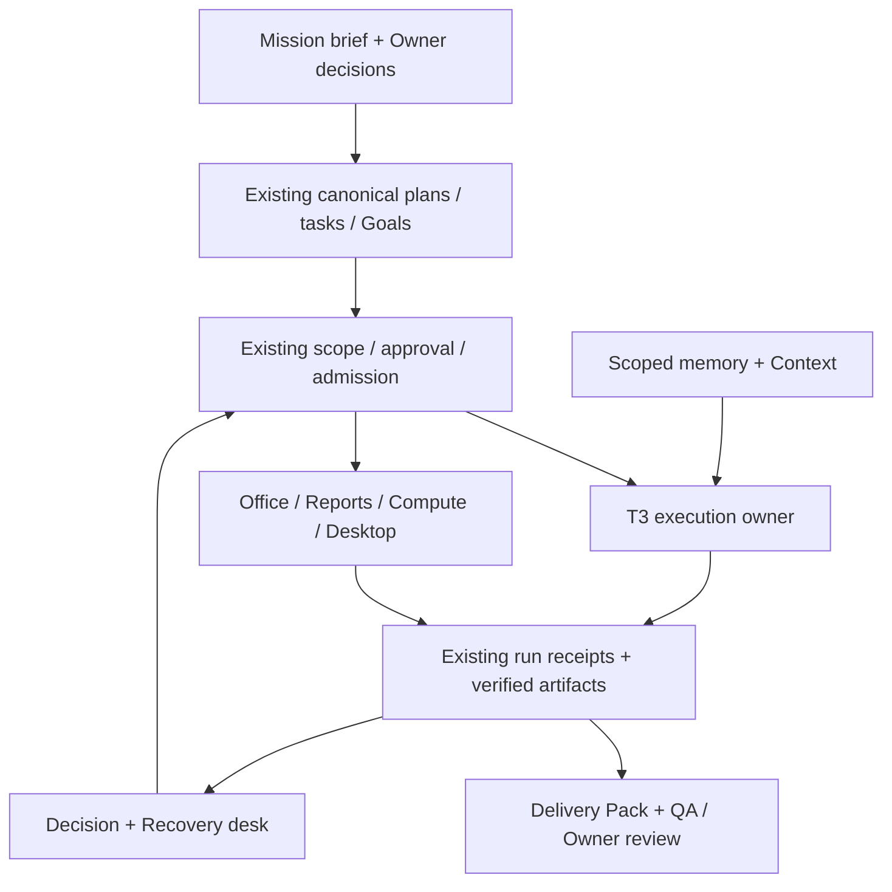

# FORGE — competitive review and requirements decisions

วันที่ตรวจ: 2026-11-25 · FORGE checkpoint `4e8ebd394c14b08d642a5f5e47a2305efb26fd25`

สถานะ: **RESEARCH_COMPLETE / REQUIREMENTS_CONFIRMED / VISUALIZATION_FIRST_SLICE**
สถานะผลิตภัณฑ์ยังเป็น **IMPLEMENTATION_INCOMPLETE / HOME_UAT_NOT_RUN**

Owner ให้เริ่มทำงานต่อ โดยสำรวจ FORGE เทียบ Orca, T3 Code, Paseo และ OpenDot
แล้วเสนอแนวทางให้ตัดสินใจเป็น requirements ก่อนเพิ่มขอบเขตใหม่
การ resume นี้แทนคำสั่งหยุดเฉพาะการเดินงานต่อ ไม่ใช่ release/push/deploy authorization ใหม่

## 1. ขอบเขตหลักฐาน

- ตรวจ Git จริง: main ที่ `4e8ebd3`, working tree สะอาดก่อนรอบวิจัยนี้;
  worktrees ของ workers เดิมยังอยู่ ไม่สร้าง worker หรือแก้ checkout ของ worker
- อ่าน AGENTS, v3 entry/prompt, product brief, precedence, architecture, plan,
  acceptance matrix, PRODUCT และ machine-transfer handoff/progress
- ตรวจ App navigation/mounts, main service/routes, admission, compute credentials,
  Monitor และ handoffs ของ Goals, Assistance และ Plugins
- ใช้ Firecrawl ดึง public homepages/README/architecture ของคู่แข่ง
  เป็นเอกสารและคำประกาศของผู้พัฒนา ไม่ใช่ผล hands-on หรือ benchmark
- ไม่รันโมเดล/บัญชีคู่แข่ง ไม่สร้าง prototype ไม่ติดตั้ง runtime คู่แข่ง
  ไม่ย้าย key ไม่ซื้อ compute ไม่เปิด public listener ไม่ commit/push
- Node ที่พบ `v24.19.0`; ในช่วง research แรก built App ที่มีอยู่ไม่ถือว่าเป็น fresh build
  หลัง Owner ยืนยัน ได้เริ่ม Visualization slice และรัน build/tests ตามผลด้านล่าง

ห้ามให้คะแนนคุณภาพ ความเร็ว ต้นทุน หรือความปลอดภัยเป็นตัวเลขโดยไม่มีการวัดร่วมกัน
การไม่พบ feature ในหน้าที่อ่าน หมายถึง **NOT_ASSESSED** ไม่ใช่คู่แข่งไม่มี feature นั้น

## 2. ระบุตัว OpenDot ให้ถูกต้อง

Owner ยืนยัน **thinkwee/OpenDot** เป็นคู่เทียบ
หน้า `opendot.live` ที่ดึงครั้งนี้ลิงก์ไป `athulsreekumar/opendot`
และระบุ SuperDot/Organisation ซึ่งไม่ใช่หลักฐานของ thinkwee repository
จึงไม่นับฟีเจอร์เหล่านั้นให้ thinkwee/OpenDot
ยังไม่ได้ยืนยันความสัมพันธ์ระหว่างสอง repository และไม่อนุมานว่าเป็น fork เดียวกัน

## 3. แหล่งข้อมูลทางการ

HEAD ด้านล่างคือ revision ที่เห็นจากหน้า repository ขณะตรวจ ไม่ใช่ release ที่ทดสอบแล้ว

| ผลิตภัณฑ์ | แหล่งหลัก | Revision ที่พบ |
|---|---|---|
| Orca | [Homepage](https://orca.dev/), [source](https://github.com/stablyai/orca), [README](https://github.com/stablyai/orca/blob/b864ea6da41af683843e3cf498a5d159ef5e2d84/README.md) | `b864ea6da41af683843e3cf498a5d159ef5e2d84` |
| T3 Code | [Homepage](https://t3.codes/), [README](https://github.com/pingdotgg/t3code/blob/b6869fad67eade8a1396d446870ee9d48f33d82b/README.md) | `b6869fad67eade8a1396d446870ee9d48f33d82b` |
| Paseo | [Homepage](https://paseo.sh/), [README](https://github.com/getpaseo/paseo/blob/ad20814ec8ad3c46e4074c1d38026534c82843fe/README.md), [security](https://paseo.sh/docs/security) | `ad20814ec8ad3c46e4074c1d38026534c82843fe` |
| thinkwee/OpenDot | [README](https://github.com/thinkwee/OpenDot/blob/13b15c2378a3dcef1cdc63464f3e92eb347bf8d2/README.md), [design](https://github.com/thinkwee/OpenDot/blob/13b15c2378a3dcef1cdc63464f3e92eb347bf8d2/docs/DESIGN.md) | `13b15c2378a3dcef1cdc63464f3e92eb347bf8d2` |

เอกสาร Orca `/docs/cli/worktrees` ที่ลองเปิดคืน 404 จึงไม่ใช้เป็นหลักฐาน;
เรื่อง worktrees อ้าง homepage/README แทน
ไม่มีการคัดลอก source ของคู่แข่งเข้าผลิตภัณฑ์ในรอบนี้
การนำ source มาใช้ภายหลังต้องตรวจ license/notices และ revision ของไฟล์นั้นอีกครั้ง

## 4. คู่แข่งทำอะไรได้ดี และ FORGE ต้องตอบอย่างไร

| คู่เทียบ | สิ่งที่พบในแหล่งทางการ | สิ่งที่ควรเรียนรู้ | โอกาสของ FORGE — ข้อเสนอ ไม่ใช่ข้อพิสูจน์ว่าเหนือกว่า |
|---|---|---|---|
| Orca | Parallel coding agents/worktrees, chat/terminal, diff/review, remote/mobile, bots และ external triggers | เปิดงาน แยกงาน ตรวจงาน และกลับเข้าหา Owner ได้ในวงจรเดียว | ทำ Mission ที่รวม code + documents + computation + reports และผูกผลส่งมอบกับหลักฐาน |
| T3 Code | Bring-your-own subscriptions, multi-harness, desktop/web/phone, remote, worktrees และ Git/PR workflow | ความต่อเนื่องของ thread, provider และเครื่อง พร้อม interaction ที่รวดเร็ว | ใช้ T3 เป็น execution foundation เดิม แล้วเพิ่มภาษางาน/เกณฑ์สำเร็จ/ผลลัพธ์สำหรับ no-code |
| Paseo | Native mobile, parallel worktrees, orchestration, plugins, voice, Hub/triggers; เอกสาร relay อธิบาย E2EE และ opt-in pairing | Mobile เป็นพื้นที่ทำงานจริง; plugins ใช้ข้าม client; setup และ reconnect เป็น product flow | Telegram approval/report ที่ตั้งค่าง่ายก่อน แล้วค่อยตัดสินใจ paired rich client ที่แสดง proof/preview ได้ |
| thinkwee/OpenDot | Persistent agents, Inbox/Plan, per-agent computers, helpers/handoffs, MCP apps, scheduled watches, Gatekeeper/second look, effect records, learned lessons และ usage/context | แสดงเฉพาะสิ่งที่ต้องการการตัดสินใจ; agent identities และ permissions เข้าใจง่าย | Owner decision inbox รวม blockers/review/budget/ผลลัพธ์ พร้อม bounded actions และ evidence-linked memory |

Orchestration, mobile, plugins, memory, review และ recovery เป็นความสามารถที่คู่แข่งมีเอกสารแล้ว
จึงไม่ควรประกาศว่าสิ่งเหล่านี้เพียงอย่างเดียวเป็นความแตกต่างเฉพาะ FORGE
ความต่างที่น่าลงทุนคือ **การทำงานตั้งแต่เป้าหมายจนส่งมอบสิ่งที่ตรวจสอบได้ สำหรับผู้ใช้ no-code**

## 5. สถานะจริงของ FORGE ที่ใช้เป็นฐาน

| ด้าน | สิ่งที่พบ | ช่องว่าง/ข้อจำกัด |
|---|---|---|
| Core + UX | App mount ครบหลายกลุ่ม; TH/EN, 15 themes; Overview อิง task จริง | Navigation มี 17 destinations; ต้องทดลองว่าผู้ใช้ใหม่ทำงานจบโดยไม่รู้ชื่อ adapter ได้หรือไม่ |
| Tasks + Goals | Canonical plans/tasks/DAG, bounded goals, evidence criteria, QA/Owner receipts | ต้องปิด combined admission/restore review; independent review เดิมหยุดก่อนเริ่มตรวจ |
| Office + Reports | Native Univer edits/images, versioned source, WordCraft/PdfCraft jobs/artifacts | ต้องมี UX การส่งมอบรวม; supported conversion ยังต้องคงขอบเขตและ fidelity ตามจริง |
| Assistance | Full observed catalogs + explicit ranks/provenance, Executor → Asst → Executor | เป็น policy routing; ยังไม่มีหลักฐานว่าคุณภาพดีขึ้นหรือประหยัดเงินจริง |
| Memory + Context | Private central Owner source, revision-specific project grants, scoped refs/tombstones | Production memory MCP/setup และ final integrated qualification ยังต้องทำต่อ |
| Parallel work | Shared-workspace admission ป้องกันการเขียนชนกันใน `app/server/admission.mjs` | ปัจจุบัน serializes overlapping workspaces; true isolated concurrent execution ยังไม่ implemented |
| Compute + keys | Owned local Python, remote/Colab adapters, machine vault และ key fences | Baseline compute common helper ยังอ่าน process.env; trusted-runtime patch ยัง unapplied |
| Mobile | Mounted Telegram Inbox/bridge/report via Hermes/OpenClaw | Native gateway/mobile account roundtrip NOT_RUN; ยังไม่มี rich FORGE mobile client |
| Monitor + recovery | Recorded run/job state และ actual metrics ที่ backend ส่งมา | ยังไม่มี owner-facing recovery desk และ unified measured cost/usage ledger ที่ครบ |
| Distribution | Windows source launcher และ standalone public website | Clean-install/package/final release checks ยังต้องตรวจ; macOS secure entry ยัง unsupported |

Code anchors: `app/server/main.mjs`, `admission.mjs`, `t3.mjs`, `app/compute/common.mjs`,
`app/web/src/App.jsx`, `Overview.jsx`, `operations.jsx`, `app/goals`, `app/assistance`,
`app/memory`, `app/context`, `app/office` และ scoped worker handoffs

## 6. แนวคิดที่เสนอ พร้อม task และเกณฑ์รับงาน

Owner รับ CR-01/02, CR-06 และ CR-10 ครบทั้งสามกลุ่ม พร้อม CR-12 Visualization
รายการอื่นคงเป็นข้อเสนอ ยกเว้น CR-00 ซึ่งเป็นงานเดิมที่ต้องทำให้เสร็จอยู่แล้ว
ไม่ลด A00–A30 หรือ addenda เดิม และไม่สร้าง planner/runtime/database แข่งขันกับระบบเดิม

| ID / ลำดับ | แนวคิด | ต่อจากของเดิม / เพิ่มใหม่ | เกณฑ์รับงานที่เสนอ |
|---|---|---|---|
| CR-00 / P0 | Finish the reliable core | ปิดงานเดิม | Inspect/apply compute patch อย่างตรวจสอบได้; latest secret/KOB/MCP flow ผ่าน integrated checks; core restart/restore/unknown paths และ independent review มีผลจริง |
| CR-01 / P1 | Mission brief | Guided layer ใหม่บน plans/tasks/goals | User ระบุผลลัพธ์/ไฟล์/ข้อจำกัด; ระบบถามเฉพาะช่องว่าง เก็บ decision revision; แสดงแผนและ acceptance ก่อนเริ่ม; เปลี่ยน requirement แล้วชี้งานที่ต้องตรวจใหม่ |
| CR-02 / P1 | Delivery Pack | รวม artifacts/evidence/report/Git ที่มีแล้ว | แต่ละ deliverable มี source revision, run/attempt, checksum, checks และสิ่งที่ยังไม่ผ่าน; เปิด preview/download ได้; restore/reopen ยังเชื่อมหลักฐานถูกต้อง |
| CR-03 / P1 | Decision + Recovery desk | Projection ใหม่จากสถานะเดิม | Owner เห็น pending question, review, expired connection, conflict และ unknown ในที่เดียว; เลือก reconcile/review/restart ตาม capability; reload ไม่สร้าง effect ซ้ำ |
| CR-04 / P1 | Guided start + work modes | จัด UX เดิมใหม่ | หน้าแรกพาไปงานหลักไม่เกิน 5 หมวด พร้อม Advanced สำหรับรายละเอียด; connect→first verified output มี flow ต่อเนื่อง; keyboard/TH/EN/320px/error recovery ผ่าน |
| CR-05 / P2 | Measured model routing | ขยาย Assistance + ledger | เก็บ observed success, review revisions, latency, tokens และ reported cost ตาม task category; แยก estimated/reported/subscription usage; unknown ไม่กลายเป็น 0; มีเหตุผลและ Owner override โดยไม่ขยาย permission |
| CR-06 / P2 | Isolated parallel execution + integration queue | Runtime/workspace capability ใหม่ | Two independent tasks ทำงานในแยก workspace/branch จริง; task dependency/desktop target/artifact scopes ไม่ชน; รวมเฉพาะงานที่ตรวจแล้ว; conflict/Stop/unknown ทดสอบแยก; worktree ไม่ถูกเรียกว่า security sandbox |
| CR-07 / P2 | Privacy preview | ขยาย scope/grant controls | ก่อนส่งข้อมูล แสดงชุด source/grants กับ provider/tool ปลายทางและผลของ redact/local-only policy; revoke/edit ปิด context เก่า; อย่าอ้างครอบคลุม native harness traffic หากยังควบคุมไม่ได้ |
| CR-08 / P2 | Versioned workflow recipes | ขยาย templates/skills/plugins | เลือก recipe แล้วรู้ inputs/outputs/permissions/compute/acceptance; ปรับเป็น canonical plan เดิม; recipe tests/rollback มีหลักฐาน; ไม่มี arbitrary plugin code auto-install |
| CR-09 / P2 | Work continuity across machines | ขยาย full bundles/handoff | Export portable project bytes/state/evidence, ตรวจ import ก่อนใช้, reconnect machine secrets ผ่าน GUI; ไม่ส่ง keys/provider cookies; ระบุ exactly supported formats และผลหลัง restore |
| CR-10 / P3 | Proactive routines with quiet inbox | Scheduler/trigger layer ใหม่ | Schedule/event มี identity/dedupe/bounds/quiet hours, read/propose default ตามนโยบายที่ Owner ตกลง; external changes ใช้ approval เดิม; ไม่ auto-resend unknown |
| CR-11 / P3 | Rich mobile workspace | Client ใหม่ ถ้า Owner เลือก | เริ่มจาก Telegram ที่ยืนยันแล้ว; optional paired client ดู deliverables/preview/approve/Stop/reconnect ได้; pairing/revocation และ transport tests ก่อน exposure; ห้ามนำ HMAC Telegram bridge ไปอ้าง E2EE |
| CR-12 / P1 | Visualization Workspace | Chat Group projection ใหม่ — Owner ยืนยัน | สลับ Chat ↔ Node–Edge โดย draft เดิมยังอยู่; แสดง agent/run/attempt/tools/artifacts จาก room/project จริง; scope/unknown/tool-result ไม่ผิด; เปิด control ของ run เดิม; รองรับ keyboard/list/zoom/TH/EN/themes/reduced motion |

## 7. Architecture/gap/task map

Mission/Delivery/Recovery เป็น views และ bounded commands บน authority เดิม
Model routing และ isolated workspaces ต้องอยู่ใต้ admission ตัวเดียวกัน
การรวม source ของคู่แข่งทุกตัวจะเพิ่ม turn owners และภาระ compatibility โดยไม่ช่วยให้ flow จบ

ลำดับที่เสนอหลังคำตอบ: ปิด CR-00 ควบคู่กับ CR-12 projection ที่ไม่เปลี่ยน runtime;
จากนั้น Mission/Delivery → isolated parallel + integration queue → proactive recipes
โดยแต่ละกลุ่มยังอยู่ใน scope ที่ Owner รับแล้ว ไม่ใช่ให้เลือกทิ้งกลุ่มใดกลุ่มหนึ่ง
ไม่เลื่อน requirement เดิมที่จำเป็นออกจาก release โดยปริยาย

## 8. Requirements decision actions

| Decision | คำถาม | ข้อเสนอแนะ | Action เมื่อได้รับคำตอบ |
|---|---|---|---|
| CR-D01 | Owner รับทุกกลุ่ม + Visualization Workspace | ยืนยันแล้ว | Mission/Delivery + Parallel + Proactive อยู่ใน requirements; เพิ่ม CR-12 |
| CR-D02 | ไอเดียซอฟต์แวร์ → แผน → โค้ด → preview + ผลทดสอบ | ยืนยันแล้ว | ใช้เป็น acceptance journey แรก; ไม่ activate product prototype |
| CR-D03 | Local core เปิด source; team/remote services เป็นทางเลือกในอนาคต | ยืนยันแล้ว | กำหนด packaging/license task; ยังไม่เปลี่ยน license/publish/คิดเงิน |
| CR-V01 | Live graph + details + ปุ่มควบคุมเดิม | ยืนยันแล้ว | Graph ไม่สร้าง delegation/dependency โดยลากเส้น; Start/Stop/Approve ผ่าน authority เดิม |
| CR-V02 | Owner อนุมัติ recipe + scope + budget แล้วรันอัตโนมัติภายในขอบเขต | ยืนยันแล้ว | เกินขอบเขตเข้า Inbox; Telegram งานใหม่ยังต้อง same-channel approval |

Owner ตอบผ่าน user-input actions ครบ CR-D01–03 และ CR-V01–02 แล้ว
คำตอบที่ยืนยันแล้ว: OpenDot = **thinkwee/OpenDot**

ไม่ถามซ้ำเรื่อง Thai/no-code, Dark Modern/15 themes, ทุก connected models,
quality/cost balance, Executor-first/Asst-when-stuck, KOB API, private Owner Memory
หรือ Telegram same-channel approval ซึ่ง Owner ตัดสินใจแล้ว

## 9. วัดความเหนือกว่าด้วยผลจริง

ใช้ชุดงานเดียวกันกับ version/environment/provider/model/input/output criteria ที่ระบุชัด
บันทึก success/needs-help/failure, เวลาไปถึง first verified output, จำนวน manual steps,
จำนวน correction/review rounds, latency, observed tokens/reported cost และ recovery outcome
ไม่เทียบอัตราค่า API กับ subscription quota เสมือนเป็นต้นทุนชนิดเดียวกัน

Targets ที่เสนอเพื่อให้ Owner ปรับ: clean Windows setup ถึง local editable output ภายใน
10 นาทีเมื่อ dependencies ดาวน์โหลดได้; main navigation ไม่เกิน 5 หมวดใน Guided mode;
ทุก accepted deliverable มี evidence link; scripted restart/unknown-delivery checks
ไม่ทำ effect ซ้ำ ตัวเลขเหล่านี้เป็น **TARGETS_NOT_MEASURED** ไม่ใช่ผลสำเร็จปัจจุบัน

H2H hands-on competitor testing: **NOT_RUN**
Full product regression suite after resume: **NOT_RUN**
External accounts/mobile/cloud qualification: คงสถานะเดิมตามแต่ละ adapter
Home UAT: **NOT_RUN**

## 10. Next executable task

ทำ CR-12 projection และ meaningful integrated checks จาก recorded engineering runs
โดยไม่สร้าง model turn หรือ effect จากการเปิด graph จากนั้น CR-00: inspect pending
compute patch/contract, scoped integration และ tests ก่อน broad verification
Mission/Delivery/Parallel/Proactive เป็น accepted requirements แต่ยังไม่ถือว่า implemented

## 11. First Visualization implementation and verification

- `app/web/src/agent-graph.mjs`: deterministic bounded projection ของ canonical
  room/agent/run/tool/artifact; active/unknown มี priority; ไม่มีการอนุมานจากข้อความ
- `AgentWorkspace.jsx` + `agent-workspace.css`: Chat↔Graph, node details, existing
  Run controls, relation descriptions, list/zoom, current-update vs recorded state
- `work.jsx` inspector keys Run ด้วย run.id เพื่อไม่ค้าง evidence/cursor ของอีก run;
  Chat draft เดิมไม่หายเมื่อสลับ Workspace; App ส่ง existing connection state
- Independent review แรกพบ 4 จุด: selected-run state, artifact/delegation edge
  semantics, mobile scaling และ room form displacement แก้และ capture ใหม่แล้ว
  fresh bounded re-check ยืนยัน 3 จุด และพบ active edge style ทับ pattern ของ
  relation อีกหนึ่งจุด Lead แก้โดยคง dash ของ relation และใช้ opacity แสดง activity
  แล้วทดสอบ active delegated child/solid execution ผ่าน; ไม่มี independent re-review
  หลัง CSS จุดสุดท้าย จึงไม่เปลี่ยน verdict FIX เดิมให้เป็น independent SHIP
- Final production build PASS (11.57s; existing Radix/chunk warnings), detector
  changed targets `[]`, `git diff --check` PASS
- `node --test tests/agent-graph.test.mjs tests/agent-workspace-ui.test.mjs`:
  **6 PASS** (5 projection + 1 built-App browser flow)
- Related `app/web/tests/boundaries.test.mjs tests/product-domain.test.mjs`:
  **6 PASS**; รวมกับ graph tests ในคำสั่งก่อนหน้าเป็น 11 ไม่ใช่ suite ทั้งระบบ
- คำสั่งสุดท้ายรัน graph + built UI + boundary/domain รวม **12 PASS / 0 FAIL**
  เป็น scoped regression ไม่ใช่ full product suite
- Browser ใช้ production HTTP/App/SQLite จริง, run/tool/parent observations เป็น
  injected engineering fixture; artifact upload/hash/download เป็นไฟล์จริง;
  A→B recovery state isolation, live refresh, no-dispatch view switch, draft,
  keyboard/list/TH–EN และ 1600/768/375px ไม่มี page overflow/errors ผ่าน
- Images/evidence: `.impeccable/review/agent-workspace/{desktop,tablet,mobile}.png`
  และ `evidence.json`; ไม่มีข้อมูลบัญชีหรือ model turn; HOME_UAT ยัง NOT_RUN

ยังไม่ implemented ใน slice นี้: native T3 child-worker graph attribution,
history playback, arbitrary graph editing, Mission end-to-end Delivery Pack,
isolated Parallel runtime และ proactive scheduler/envelope runtime
