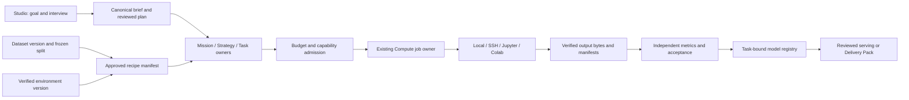

# แผน Universal Training App

## ผลลัพธ์ที่ผู้ใช้ควรทำได้

พิมพ์ว่าอยากสร้างอะไร → ตอบคำถามที่ยังขาด → ตรวจข้อมูลและสิทธิ์ → อนุมัติแผน/งบ →
เลือกเครื่องและชุด Python → เทรน → วัดผลบนชุดที่แยกไว้ → ทบทวน → เปิดโมเดลแบบ local
หรือส่งแพ็กไปปลายทางที่อนุมัติ ทุกขั้นต้องเปิดดูเหตุผล/ไฟล์/ค่าใช้จ่าย/หยุดงานได้
หน้าแรกมีช่องเริ่มงาน รายการแชต/โปรเจกต์ และงานล่าสุด รายละเอียดขั้นสูงค่อยเปิดเพิ่ม

“Universal” หมายถึง recipe และ artifact contract ที่เพิ่มชนิดงานได้ ไม่ใช่โมเดลเดียว
ที่รองรับทุก input และไม่ใช่การรัน Python จากข้อความที่ยังไม่ผ่านแผนอนุมัติ

## ฐานที่มีและสิ่งที่ยังขาด

| ส่วน | ใช้ของเดิม | สิ่งที่ต้องเพิ่ม/ตรวจ |
|---|---|---|
| หน้าทำงาน | `app/web/src/App.jsx`, desktop shell, TH/EN, themes | Studio interview ที่เข้าใจง่าย, empty/loading/failed/recovery |
| แผนและการอนุมัติ | `app/playbooks`, `app/missions`, plans/tasks ใน domain | draft → canonical brief/plan; preview ไม่ใช่ approval |
| ทีมและวิธีทำงาน | Goals/Strategies 6 แบบ, Session roles, T3 | recipe tasks ต้องใช้ owner เดิมและ approved workspaces |
| ข้อมูล | artifact upload/hash, Office, Storage | folder/ZIP manifest, bounded parsers, dataset schema/labels/splits |
| งานคำนวณ | `app/server/compute.mjs`, local/SSH/Jupyter/Colab MCP | ผูก environment จริง; remote artifact return ที่ตรวจ bytes; long-job polling |
| คลาวด์ | RunPod/Vast existing-resource lifecycle | create/delete/provision ยังไม่ใช่ native lifecycle ที่ implement; reviewed MCP operations ต้อง qualify แยก |
| โมเดล | artifacts, serving service | recipe registry, preprocessor/schema/task binding, multiple model backends |
| Serving | local LitServe adapter ที่มี contract จำกัด | ไม่อ้างว่า arbitrary PyTorch/LLM/ONNX ใช้ได้จน adapter ผ่าน |
| หลักฐาน | Workspace checks, Budget, Context, reports | metric provenance, holdout gate, independent recomputation |
| Dependencies | ชุด Node ที่ pin และ Python tooling รอบนี้ | OS/Python/CPU-CUDA lock ต่อ target, upgrade candidate/rollback |

Generic notebook execution ไม่เท่ากับ recipe GUI; generic MCP connection ไม่เท่ากับ
validated create/stop/delete ของ provider และ Mac launcher ไม่เท่ากับ Windows private native parity

## Architecture ที่ใช้เจ้าของงานชุดเดียว

ห้ามสร้าง dispatch loop, credential store หรือ resource owner คู่ขนานกับระบบเดิม
Studio ส่งคำสั่งที่มี operationId และ revision; refresh/retry ต้องใช้ identity เดิม
ไม่สร้างงานใหม่เพื่อกลบ network timeout ผู้ใช้เปลี่ยน recipe/data/compute ต้องเห็นว่า
ต้องอนุมัติแผนใหม่ ไม่แก้ snapshot ของงานที่ส่งไปแล้ว

## Contracts ที่ต้อง implement ก่อนแต่ละ phase

| Entity / receipt | Fields สำคัญและ invariants |
|---|---|
| DatasetVersion | projectId, versionId, classification, license/access, file paths+sizes+hashes, parserVersion, schema, row/group counts, exclusions; raw immutable |
| SplitManifest | datasetVersionHash, taskId, grouping/time axis, train/validation/test IDs, seed, hash; patient groups ไม่ข้าม split |
| RecipeManifest | id/version, task/modality, entrypoint allowlist, params schema, required inputs/outputs, metric definitions, resource limits; code hash และ license |
| EnvironmentReceipt | profile/version, Python exact version, platform/arch, resolved wheel hashes, lock hash, driver/CUDA observation, verification; running job pin immutable |
| TrainingAttempt | canonical job/run/attempt/operation, source/config/data/split/env hashes, machine identity, absolute deadline, limits, stop claim, logs/artifact refs |
| EvaluationReceipt | model+preprocessor+split hashes, validation/holdout distinction, actual predictions hash, metric implementation/version, counts, undefined metrics as null |
| ModelVersion | task, feature schema, transforms, trusted artifact format, weights hash, evaluation refs, input bounds, readiness; incompatible tasks refused |
| DeploymentReceipt | reviewed model version, target binding, environment, start/health/stop observations, access policy, rollback version, unknown state |

เริ่มจาก explicit manifests ใน project artifacts ผ่านเจ้าของเดิม เมื่อจำเป็นต้องเพิ่ม
schema migration ให้ lead ออกแบบ migration+restore tests ก่อน ไม่มี collection ใหม่จาก UI โดยลำพัง

## Security / data behavior

- Upload จำกัดขนาด จำนวนไฟล์ และขนาดหลังแตก archive; ปฏิเสธ absolute/../symlink,
  case collisions, nested ZIP bomb และไฟล์ผิดชนิดก่อน parse; scan ทำใน worker process มีเวลา/หน่วยความจำจำกัด
- Python/notebook/model pickle เป็น executable content: ไม่ execute/load จาก upload
  อัตโนมัติ ต้องแยก trusted recipe และ trusted model provenance; แสดง parser preview ก่อน
- classification `public`, `synthetic`, `restricted`; restricted ห้ามส่ง LLM/MCP/คลาวด์/website
  โดย default การอนุมัติโมเดลไม่เปลี่ยนสิทธิ์ข้อมูล
- Execution owner ตรวจ current plan, permission, budget, data/env hashes หลัง async preparation
  ก่อน dispatch; filesystem inspection เป็น point-in-time ไม่อ้าง OS sandbox
- logs/metrics/artifacts อาจมี sensitive data: sanitize preview และ export allowlist;
  อย่าบันทึก token/headers หรือ rows ผู้ป่วยลง public report
- metric หาย/NaN/no positives = null + reason; ไม่ใช้ศูนย์แทน missing และไม่ยกระดับ
  คำกล่าว agent หรือ screenshot เป็นผลทดสอบ

## Recipe ladder และ acceptance

| Phase | Deliverable | ผ่านเมื่อ | ยังไม่ผ่าน/หยุดเมื่อ |
|---|---|---|---|
| U0 เตรียม | shell/Thai/Studio, dependency CLI, auth fixes, home runbook | focused tests/build และเส้นทาง review ไม่ auto-spend | placeholder หรือ fake train success |
| U1 ข้อมูล | CSV/Parquet + image folder + text JSONL adapters | bounds/hash/schema/labels preview + persisted dataset version + bad-input tests | arbitrary file execution, parser escape |
| U2 CPU recipes | tabular logistic/boosting, temporal features | fitted artifacts, frozen splits, independent metrics, rerun reproducibility | ใช้ training metric เป็น holdout |
| U3 vision/text | small image classification, text classification | same contracts, class mapping, explicit supported env, actual fit/infer smoke | ไม่มี artifact round-trip หรือ model/task mismatch |
| U4 remote | SSH dr-train, Jupyter, Colab durable execution + return | real remote job, cancel/reconcile, checksum round-trip, no redispatch | unknown outcome ถูก retry ด้วย ID ใหม่ |
| U5 compute lifecycle | RunPod/Vast/Colab reviewed MCP create/stop/delete | owner approval bound exact quote/IDs, finite budget, cleanup observed | unowned resource หรือ unsupported capability |
| U6 serving | task-bound local CPU/ONNX/PyTorch adapters | online/offline predictions agree, model corrupt/mismatch refused, restart/stop/rollback | เปิด port/public endpoint โดยไม่อนุมัติ |
| U7 LLM fine-tune | LoRA recipe after GPU qualification | adapter/base model licenses, dataset isolation, actual checkpoint+eval | ยก generic notebook เป็นรองรับทุก LLM |
| U8 product journey | fresh-clone → goal → data → model → report | Home UAT with real account, no-code journey, exact evidence bundle | ยังต้องใช้ hidden shell steps ที่ไม่ได้อธิบาย |

ประมาณงานเป็นลำดับ dependency ไม่รับปากวันเสร็จก่อนวัด hardware/data:
U0 ทำรอบนี้; บ้านเริ่ม qualification SSH + U2 public AHE; U1/U3/U4–U7 เพิ่มเป็น
milestones ที่แยก commit และ acceptance อย่าเปิด GPU เพื่อรอแก้ UI/recipe

## Interview และแผนใน GUI

ถามเป็นชุดสั้นตามข้อมูลที่ขาด พร้อมคำตอบแนะนำและเหตุผล: ผลลัพธ์ที่ต้องการ,
ชนิด/ที่มาข้อมูล, target/label, metric, ข้อมูลใช้ได้ที่ไหน, เครื่อง, งบ/เวลา,
รูปแบบผลส่งมอบ บอกความต่าง train/validate/test ด้วยภาษาไทยทั่วไป
ผู้ใช้แก้คำตอบแล้วเห็น diff ของแผนและงานที่จะรัน ยืนยันแผนคนละขั้นกับการส่ง prompt

หน้ารันแสดงขั้นตอนปัจจุบัน เวลา/งบที่ทราบจริง Stop และ “ตรวจสถานะอีกครั้ง”
ไม่แสดง percentage ปลอม ปุ่ม deploy ต้องแสดง destination และ model version;
unsupported recipe แสดงสาเหตุ/สิ่งที่ต้องตั้งค่า ไม่ทำปุ่มสำเร็จหลอก

## Definition of done ของ Universal Training

แต่ละ supported modality ต้องมี fresh environment, real tiny training, held-out
evaluation, saved model+preprocessor, actual inference, artifact export/reopen,
stop/recovery, bad input/security tests และหลักฐานแยก local/remote
ต้องผ่าน end-to-end home journey ก่อนเรียก product complete; เอกสารฉบับนี้เป็น
แผน implementation ไม่ใช่คำรับรองว่าทุก phase มี code แล้ว
