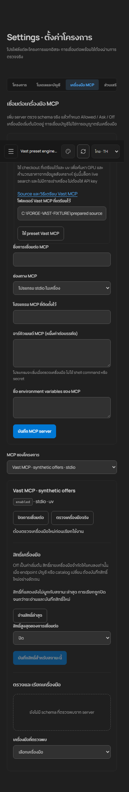

# Prepared Vast MCP connection

FORGE can connect the Owner-provided [Vast MCP source](https://github.com/siriponsri/vast-mcp-test/tree/ef116f4700a4a880dd4651210b9923f8e6a4201f) through its existing scoped MCP client. The inspected revision is `ef116f4700a4a880dd4651210b9923f8e6a4201f`, package 0.1.1, FastMCP 3.4.11 / MCP 1.30.0. Source is external; FORGE does not vendor or relicense it. No upstream license file was present at that revision.

This server currently exposes exactly three read-only tools: `health`, `search_gpu_offers`, and `estimate_run_cost`. Their offers and estimates are **synthetic**. Health reports `LOCAL_MOCK` and `BLOCKED_UNVERIFIED_VAST_SEARCH_SCOPE`. It cannot rent or control a GPU through those tools. A planned number of hours is not a spending cap or a billing Stop.

## Connect through the GUI

1. Prepare the external checkout and its locked environment using that repository's setup instructions. Python and uv must be available on this machine; finish its `uv sync --locked` before the first discovery. No API key is needed for this revision.
2. Open **Settings ? MCP tools ? Add MCP server**. Enter the absolute prepared checkout folder in **Prepared Vast MCP folder** and click **Use Vast MCP preset**.
3. Review the generated command and literal argument rows, then save. The preset uses `uv --directory <folder> run --locked ptp-vast-mcp`. It does not register anything in Codex/Claude, copy keys, run a shell command or change the default Compute target.
4. Click **Discover actual tools**. Verify the three published tool names/schemas and the server version. A cold dependency installation can exceed initial discovery; complete preparation and retry discovery, which invokes no tool effects.
5. Tools default to Off. Review the discovered policy, select Ask or Allowed as appropriate, and save it through the existing Owner controls. Run `health` first and verify mock/live status. Tool requests and approvals retain the existing project/operation/replay checks.
6. A synthetic example is `search_gpu_offers` with `limit:3,disk_gb:40`, followed by `estimate_run_cost` for `mock-101`, the same disk, 2 hours, 1 GB uploaded and 2 GB downloaded. The inspected source returns a synthetic USD 0.588000 estimate. It is not a live price or charge.



The existing **Compute ? Vast** route is separate: it controls an explicitly configured existing resource through the verified REST/executor contract. This new MCP preset does not rent resources or bypass its authorization, revision or Stop boundaries.

## Developer evidence

The production FORGE server, Owner session/CSRF, actual SDK stdio transport and actual external server passed discovery and all three calls with exact replay. Unauthenticated setup was rejected. No client registration, credential migration, account API or rental occurred. [Sanitized protocol evidence](evidence/vast-mcp-20261125.json).

The separate built-App browser check saved literal arguments containing a space, retained no secret references, exercised TH/EN and 375px overflow, and confirmed no process/tool launch on preset/save. Its screenshot is configuration evidence; it does not prove discovery or live pricing.

Reproduce against the prepared pinned checkout:

```powershell
node tools/vast-mcp/verify.mjs <absolute-prepared-checkout>
node --test tests/product-vast-mcp-ui.test.mjs tests/providers-mcp.test.mjs tests/governance-mcp.test.mjs
```

The verification uses disposable application state and synthetic tool data. Live search/account/billing/rentals remain unrun and the upstream live grant remains blocked. Home UAT remains `NOT_RUN`.
